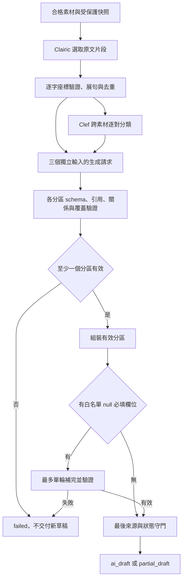

# #183 實作洞察與驗收紀錄

更新日期：2026-11-14。此檔保留各時期的正反紀錄；目前管線閱讀基準與品質界線見「2026-11-12：提取、比對、綜整三階段研究」，首個基準觀測 checkpoint 的實作與手動回報見下節。歷史章節依當時日期與模型／契約判讀，不將舊驗收或部署回報當成本輪現況。**2026-11-08 起，下方歷史所載的 experiment／review profiles、專用 CLI／setup／fixture 及 Cookie helper 入口均已移除；命令僅為歷史執行證據，不可作現行操作指引或本機檔案入口。** 私有 `.wrangler` 資料與帳本保留。

## 現況與使用者確認

以下三點保留 2026-11-08 交接時的已知回報，不表示本輪重新確認部署或 API 驗收；現行操作契約以[證據 API 手冊](./docs/evidence-api-review.md)為準。

- 使用者已確認真實三模型品質實驗成功，並同意公開 [結果](./results/ai-experiment_result.json) 與 [費用報告](./results/ai-experiment_cost.json)。報告為 `ai_draft`，共識 2、爭點 1、立場 3，三項 completed、補完 not_needed；該工作 ledger 記錄 23 attempts、13,362 microUSD、unknown／reserved 為零。這不是 Cloudflare 帳單核對，也不是獨立人工 gold labels。報告 source metadata `e668fa2ea9c70fd3bdbcfd06ebb554b5e3a4747d` 為 dirty，不能聲稱與目前 HEAD 相同或重跑逐字相同。不要另付費重跑以確認使用者的成功回報。
- 正式已由使用者部署 source `73800643596b7114efd0c7623ea436023cd244b9`、`EVIDENCE_API_ENABLED=1`；既有確認為六匿名 401、CSRF 403、`/api/me` 200／super-admin／banned:false，不重跑，也不代表完整六 API 驗收。缺必要綁定 fail closed；現行六 API 與程式閱讀地圖見 [`docs/evidence-api-review.md`](./docs/evidence-api-review.md)。
- 2026-11-08 使用者核准提前清理專用環境、本機驗證及 commit，不 push／deploy、不付費或遠端寫入。PR #191 與遠端原始 0017 已完成，SQL／ledger 不改，`DB_AUTH` 不做 DDL／migration。關閉 #183 是 API 交付與專用環境退場，不表示 UI 或 live 驗收完成；UI／一般 API 移交 [#166](https://github.com/g0v/civic-talk-hono/issues/166)，維護 reconcile／erase 驗收見 [#201](https://github.com/g0v/civic-talk-hono/issues/201)，進度見 [`TODO_AFTER_MERGE.md`](./TODO_AFTER_MERGE.md)。所有私人狀態、歷史結果與 unknown／tombstone 保留。

## 2026-11-14：checkpoint A 使用者手動回報

- 使用者回報「實測 log 有出來」，並授權提交／推送 A，再推進至下一個檢查點；下一個檢查點驗收前不提交。此回報視為 A 的觀測接線手驗，不重跑確認，也不宣稱新的模型內容、原子化或語義品質已通過。
- 下一步依計畫為 B／P0＋E1：固定既有 P0 raw，只評估 claim／context 的展句與去重；Clairic 提示及 Clef／Gemma 不動。新付費呼叫、遠端資料／maintenance 與部署均不在本次授權內。

## 2026-11-13：checkpoint A 基準提取觀測

- 依 `plan.md` 第 6 節第 1 步先補可觀測性，沒有調整 `claims-list-v3`、`evidence-2`、Clairic／Clef／Gemma 的模型請求或設定指紋。P1／E1、原子 claim／context 與下游雙層輸入仍未實作；不是第一階段語義品質已驗收。
- dev-only、owner／admin 且精確 opt-in 的 job GET 新增 `extraction_debug` 白名單；讀既有 raw／extraction／diagnostics，不重算、不回填或新增付費呼叫。以 usage 的 `extract:<materialId>` 對應 raw，避免同正文素材誤歸屬；完整 request／state_text、作者快照與其他模型 raw 不進新投影，來源撤下／清除／失聯及最後查核競態不交付內容。production 及未 opt-in 的回應不新增欄位、不讀提取 raw。
- 前端沿用既有輪詢，獨立於最終草稿輸出 raw、已保存的 legacy 展句及安全提取診斷；全部生成失敗仍可看上游資料。`claim／context` 明示尚未建立，每個工作／工件去重，過期 scope 回應不印；原始 value／spans 不強行 zip，也不將 legacy quote 改名成原子命題。
- 型別檢查通過 167 files，完整測試通過 58 files／714 tests；包含 opt-in／production、401／403／404、相同正文素材歸屬、零證據／拒收／provider 無回應、清除競態與前端 pending→可讀／去重／scope 隔離。測試使用既有隔離 SQLite 與合成 provider，不是真實模型品質或真人 Auth 驗收。
- 真實 Chrome 以實際元件 SSR／hydration 與隔離合成 HTTP 回應，檢查三語、1280／390px、淺／深色共 12 組；原始抽取與 legacy 完整文字可在 console 目視，三個語言工作各兩份素材只各輸出一次，GET 為精確 opt-in，沒有 POST、hydration 警告或水平溢出。另確認 hover、dialog、關閉後 focus、disabled，目視四張代表畫面。這不是正式站、真人 session 或付費流程驗收。
- 暫時 HTML／SSR 驗證器與獨立瀏覽器 profile 已移除，自有前端驗證服務已停止；沒有使用真人 Cookie、遠端 D1、模型呼叫、migration、commit／push 或部署。A 的真實來源手動驗收待操作者進行；操作、副作用與費用界線見[API 手冊](./docs/evidence-api-review.md#checkpoint-a-提取觀測dev-only)。

## 2026-11-12：提取、比對、綜整三階段研究

### 閱讀基準與證據界線

- 本節依 `b62a385` 受控回退後的原始碼研究：Clairic `claims-list-v3`、提取 `evidence-2`、Clef `symmetric-four-way-v2`、生成 `specialized-evidence-v12-baseline-v9`、輸入 `section-values-v6-gemma-chat`、補完 `missing-fields-only-v3`。版本來源為 [`models.ts`](./src/ai/models.ts#L12-L28)，不代表此版本已部署或已完成新的品質實測。
- **程式事實**來自實際 builder／parser／Workflow；**既有實測**沿用上一輪已讀取並保存的兩個議題 7 工作，不宣稱是遠端目前最新工作；**合成探針**只證明特定程式行為；**優化提案**尚未實作、未測得成功率提升。私人正文、完整原始回應與帳號資訊不寫入本檔。
- 本輪只更新研究文件，沒有修改程式、重跑模型、查詢遠端 D1、操作工作／快取／帳本或重新執行完整測試與 build。離線探針直接載入目前純邏輯函式，輸入完全合成，沒有呼叫 provider 或修改 DB。
- 分析模型的推理強度與 Worker 的請求設定是兩件事。目前原始碼的 [`GENERATION_PARAMETERS`](./src/ai/generation.ts#L402-L425) 仍為 `enable_thinking:false`、`max_completion_tokens:8192`，共識／爭點溫度為 0，立場／補完為 0.2。本節沒有據此推定使用者實際調整了哪一層設定，也未操作或實測 Worker 的 thinking 開關。

### 流程與既有實測定位

三個生成請求在程式中依序執行共識、爭點、立場，但都讀取同一份核可證據與必要比較資料，**不是把上一項摘要交給下一項**。每一個付費呼叫有獨立 attempt、來源／帳號查核、原始回應與費用結算；沒有付費重試或通用修復輪。[`runner.ts：paid／生成迴圈`](./src/ai/runner.ts#L195-L258)、[`generationPayload`](./src/ai/generation.ts#L687-L720)。

| 沿用的議題 7 工作 | 原始碼 metadata | 反方素材的提取結果 | 共識／爭點／立場 | 三項實際 temperature |
| --- | --- | --- | --- | --- |
| 較早成功案 | `9ee4bf6`、`dirty=true` | 1 個單位，僅標題 | completed／no_findings／completed | 0／0／0.2 |
| 後續失敗案 | `bf9e71c`、`dirty=false` | 4 個單位，已含反方正文 | failed／failed／failed | 0／0／0.2 |

兩案來源 hash 相同。後者抽取共 12 個單位，比對 48 對，為 15 agree／6 disagree／27 unrelated；三項生成皆 `finish_reason=stop`。共識第 2、3 項宣告了未實際引用的證據；爭點標為 opposition，但跨側有 agree；立場第一群 name／Core_concern 引用超出 opinions 聯集。原版 9ee4bf6 與回退後驗證器離線重播，均得到相同三個拒收代碼。這證明失敗位置，**不證明是哪一句提示造成，也不是新版驗證器額外變嚴**；兩案溫度相同，不能將差異歸因於調低 temperature。成功案爭點為空且漏掉反方正文，也不能作為完整性基準。

### 一、提取：原文定位可靠，不等於主張單位完整

**目前流程。** 入口先驗同議題、可見、非空素材，至少兩份，每份最多 48 KiB、總正文最多 512 KiB；全部檢查在 claim／付費前完成。[`readSourceInput`](./src/ai/source.ts#L78-L125)。每份原文獨立作一次 Clairic `state`，只有 `claims:list<text>`；沒有分塊、speaker／條件／命題 ID，也沒有要求每篇只能回三段。[`buildClairicRequest／parseClairicResponse`](./src/ai/models.ts#L113-L146)。Clairic 官方契約是從 state 提取文字 span，不是保證產生結構化論證；見[官方說明](https://developers.cloudflare.com/workers-ai/models/clairic/)。

**已保護的部分。** 每個 span 都須逐字對回素材；UTF-16／Unicode scalar／UTF-8 逐筆消歧，不接受半字元。value／spans 數量不同時，所有座標和片段均須通過嚴格重配對；壞 span 不降級搜尋。只有缺 span 時才容許唯一精確搜尋，重複文字歧義仍拒收。通過後依句界展開，按素材＋展開範圍去重；全工作證據為零或超過 64 就停止，不偷偷裁切。[`extractClairicEvidence`](./src/ai/evidence.ts#L167-L310)。

**不足與可確認的邊界：**

1. **句界不是論述邊界。** 句點／換行不辨識後置說話者、跨句條件、縮寫或軟折行。已執行的合成探針：`「應停建。」是反對者的主張。` 選取「應停建」只展為 `「應停建。」`；`The U.S. opposes it.` 選取 `opposes` 只得到 `opposes it.`。`甲。"乙。"` 的兩個錨點則產出 `甲。"`、`乙。"`，把後句開引號吞入前句。這些是確定性切片結果，不是對模型行為的猜測。[`isTerminal／expandSentence`](./src/ai/evidence.ts#L125-L159)。
2. **擴大引文與保留獨立主張是兩個不同目標。** 合成原文 `甲方支持全面補助；乙方反對全面補助。` 即使模型回傳兩個正確錨點，仍因展開範圍相同而只剩一個含雙方主張的 evidence ID；同單位後續錨點 metadata 不另保留於 evidence，須回 provider raw 追查。反之，不同但重疊的展句範圍未必去重。不能把 evidence 筆數等同主張數，也不能直接以合併所有重疊範圍解決。[同檔去重處](./src/ai/evidence.ts#L284-L309)。
3. **跨句語境不能由更多下游思考合法補回。** 合成原文 `協會支持補助。` 接下一行 `但前提是先完成經費評估。`，若只選到「支持補助」，quote 不含條件。後續模型只收到選中的 quote，不會讀取整份素材快照；猜到條件也不等於取得可引用證據。
4. **complete 是技術有效性，不是召回率。** 合法 null／空 list 可為 complete、零證據，只要其他素材有證據就不因此觸發 partial；標題片段也不會因缺少完整主張而被辨識出來。現有 coverage 記錄合法性、筆數、拒收、去重及用量狀態，沒有人工核可的核心／少數觀點／條件召回率。[`runner.ts：validate-extraction`](./src/ai/runner.ts#L317-L368)。低 confidence 不是經校準的完整性判定，不能拿來刪除難處理的證據。

**優化方向（尚未實作）。** 先建立直引號、縮寫、後置歸屬、軟換行與跨句條件的離線案例，再修確定性句界缺陷；不要一律追加下一句或忽略所有換行。語義層應先人工標出「可比較主張＋必要語境」，研究把 claim 的精確原文範圍與 context 分開識別，讓同段多方主張能保有各自 ID，又不丟掉歸屬與限定。這是新的中間契約研究，不能假定目前 Clairic 的單一 list 已支援，也不能把改寫後的主張冒充逐字原文。更多、更長片段是否提升召回或反而混合主張，須用人工標準與受控實驗比較。

### 二、比對：全域 pair 關係與具體問題的粒度未對齊

**目前流程。** 所有跨素材無向組合各比較一次，同素材不送 Clef；依 ID 固定方向與題序。素材各有 $n_i$ 段時，配對數為 $\sum_{i<j}n_i n_j$，所以多抽證據會增加比較量，而不是只增加一筆生成輸入。[`createEvidencePairs`](./src/ai/comparison.ts#L82-L106)。每批至多 64 題、完整 JSON 至多 12,288 UTF-8 bytes，單題超限就停止，不截句或漏 pair。這是本站 byte 守門，不是 tokenizer／provider 截斷保證；[Clef 官方](https://developers.cloudflare.com/workers-ai/models/clef/)明示長 state 可能截斷，缺截斷旗標不能當作確認未截斷。

每題只回一個 agree／disagree／unrelated／uncertain。agree 明確容許互補，不要求共同支持同一命題。parser 核對完整題號集合、四類機率範圍／總和及 choice 與機率一致；沒有未校準的信心閾值，也不自行把 choice 改成另一類。[`parseClefResponse`](./src/ai/models.ts#L252-L293)。一題格式錯誤會令同批全部標為 failed；缺失／失敗維持 incomplete／partial，不補成 unrelated 或反推 agree。[`runner.ts：validate-comparisons`](./src/ai/runner.ts#L399-L436)。

**不足與可確認的邊界：**

1. **關係沒有共同的 scope。** Clef pair 沒有「它在比較哪個具體命題、問題、條件」的識別欄位；生成的 question 亦未對應到 Clef scope。因此兩段可能在教育平等上互補、在是否全面現金補助上對立，卻只有一個全域標籤供兩種用途共用。現在 opposition／contradiction 只要跨側有任一 agree 就拒收；立場同群只要有任一 direct-disagree 就拒收。這是資料模型的確定限制，不足以證明某筆 Clef 分類本身錯誤。[`sideRelations／disputesSection`](./src/ai/generation.ts#L876-L955)。
2. **同素材與單一引文內的衝突不在正式比較覆蓋內。** 已執行合成探針：一份素材的兩句相反增班主張，取得不同 evidence ID 後仍沒有 Clef pair，positions 可將它們放同群而通過「沒有 direct-disagree」守門。探針來源集合含另一份素材，但其沒有抽取證據，用以隔離這個能力邊界；不是繞過建立工作的兩素材門檻。故此守門只代表未把「已知正式反對」合群，不代表已證明群內語義一致。[`assertNoDirectDisagreement／positionsSection`](./src/ai/generation.ts#L868-L873)。
3. **候選沒有傳遞性漏洞，但仍只是搜尋線索。** 現行每條 direct-agree 作種子，complete-link 擴展要求所有跨素材邊皆為直接 agree；BFS 路徑與 reverse diagnostics 不會補造邊。同素材節點視為候選內相容，也不多算來源。即使各 pair 都 agree，不同邊仍可能因不同面向互補，未必存在全群共同命題。[`analyzeComparisons`](./src/ai/comparison.ts#L141-L263)、[`generationContext`](./src/ai/generation.ts#L593-L608)。
4. **有界候選不保證每個多來源支持集合都可被選取。** 合成六節點 A–F、各屬不同素材，agree 邊為 AD、AE、BD、BF、CE、CF、DE、DF、EF，其餘 unrelated；實際候選只有 ADE、BDF、CEF。DEF 雖三邊皆 agree，卻不在任一候選中，生成不能選出 DEF 三來源集合。每條支持邊仍有保留，兩來源子集仍可能表達同一命題；這不是「整個命題必然漏掉」，也不是要求改成無界 clique 枚舉。是否影響真實多來源覆蓋須另驗。
5. **固定方向不是雙向品質驗收。** runner 沒有逐 pair 執行反向抽查；symmetrical 是提示判準，不能由程式固定排序推論模型已具順序不變性。batch 額外證據是否干擾單題也未知，需固定 pair 做受控比較，不應直接常態雙倍呼叫。

**優化方向（尚未實作）。** 優先研究可回查的 claim／問題 scope，保留說話者與條件，讓 Clef 獨立判斷該 scope 的關係，再由綜整沿用同一 scope。生成提出的 scope 或主張切分在獨立核對前只是提案；不把原本 agree 改標 disagree，也不能把未通過關係守門的 opposition 強改成 tension 來兜過。若補同素材比對，應比較不同明示主張，而非按來源 ID 猜立場。這會改中間契約、題數與成本，須先影子評估、版本化及授權；暫不更動正式守門。批次失敗粒度、方向敏感性和候選涵蓋為次階段評估，不先用更長 prompt、低信心閾值或無界圖搜尋代替。

### 三、綜整：敘述與集合約束同輪耦合，來源驗證不是語義判官

**目前流程與三項差異。**

- **共識**只能從當輪短 ID 候選選子集，至少兩素材；三型分別是 shared_fact、shared_challenge、shared_position。宣告 evidence_ids 必須與實際 Title／description 引用聯集一致，且各參與素材都要出現在 description；每個候選需採用或明示拒絕。這不是要求產出固定筆數。[`consensusSection`](./src/ai/generation.ts#L817-L865)。
- **爭點**按 question 整理兩側以上，每側不得內含 direct-disagree、同一 evidence ID 不得同時放兩側，claim 須覆蓋該側，description 須引用每側。純同源爭點可接受，但不冒稱正式跨來源關係；只有非 tension 且跨側全部 direct-disagree 才標 `origin=direct_clef`。問題去重僅處理空白與大小寫，不檢驗改寫後的語義重複。[`disputesSection`](./src/ai/generation.ts#L894-L955)。
- **立場**從 opinions 的實際引用推導成員與 Sources，名稱／核心的引用不能增加成員，且全證據必須採用或明示排除。它是素材論述的立場地圖，不是投票者分群；同一素材可含多群，一群亦可含多素材。[`positionsSection`](./src/ai/generation.ts#L959-L1015)。

三項都採具名原生 JSON Schema，只有共識 candidate_id 使用當輪動態 enum；敘述的 evidence ID 仍由 parser 核對是否存在及屬於正確集合。原生回應要求唯一 stop assistant 字串，拒答／工具／截斷／不完整 JSON 均拒收，不讀取思考文字當答案。[`generationSchema／builder`](./src/ai/generation.ts#L668-L720)、[`parseNativeJson`](./src/ai/generation.ts#L1080-L1121)。

**不足與可確認的邊界：**

1. **三步提示不是三個執行階段。** 目前「先 opinions，再 name／Core_concern，再自查覆蓋」仍在一次立場模型回應裡，程式沒有在中途凍結 opinions 聯集。模型同時負責敘述、成員、引用與排除；已保存實測的群外名稱引用及共識多宣告 ID，正是這類跨欄位契約失敗。不能因提示列出順序，就宣稱 LLM 一定按順序思考或完成集合運算。
2. **語義蘊含沒有被驗證。** `citedText()` 核對的是 ID、引用範圍與合法字串，來源回查的是 quote 原文；它沒有判定生成句是否由引文支持。已執行完全合成探針：來源是「甲方支持增加班次」，輸出改為「甲方反對增加班次」，保留合法引用與群組範圍，仍可解析通過。這只證明能力邊界，不表示真實模型在上述工作做了同樣反轉。[`citedText`](./src/ai/generation.ts#L774-L789)。
3. **逐句 citation map 不代表逐句語義核對。** 一個句子物件的 text 可含多句，`addSentenceRanges()` 切成多個範圍後會把同一組 IDs 複製到每句。合成爭點的兩句敘述共用兩個 ID，實際兩個範圍各有兩個引用；來源文字合法不等於每份來源都支持每句。[`addSentenceRanges`](./src/ai/generation.ts#L749-L771)。name 並沒有「必須逐字出現在證據」的驗證，目前失敗是引用聯集越界，不能以放寬字面匹配來修這個不同問題。
4. **空白、排除與有效狀態仍可掩蓋語義漏失。** 共識可拒絕全部候選，爭點沒有逐問題／逐 disagree 種子的採用或排除契約，立場可列出非空排除理由而不採用。程式不能驗證理由是否充分。`no_findings` 是合法空結果，不是「證明不存在」；`ai_draft` 也可能含空分區。
5. **失敗隔離到分區，沒有隔離到 item。** 一個 item 違規會令整個分區失敗；其他有效分區可保留 partial，三項都無有效工件則 failed。這是現有嚴格契約，不應偷偷丟掉壞項目並冒稱完整。null 白名單補完只處理有效草稿的 Overview／Core_concern，不能修未知引用、分群錯誤或跨側關係；必要補完失敗也不交付新結果。[`runner.ts：驗證與組裝`](./src/ai/runner.ts#L556-L765)、[`prepareDraftCompletion／補完`](./src/ai/generation.ts#L1339-L1472)。
6. **議題範圍與證據角色未單獨表達。** 現在 Clairic 只收到素材 content，生成只收到 quote／關係／語言，不另送 issue title／description；完整 sources 主要供伺服器回查。[`generationInput`](./src/ai/runner.ts#L441-L446)、[`generationPayload`](./src/ai/generation.ts#L687-L701)。若將議題題名作選材範圍提示，必須標為不可信、不可引用的 context，不能用它填補素材主張；也不能直接插進目前 Clairic state 而不處理座標映射。是否需要這種聚焦是產品／品質取捨，不能只憑缺欄位判定為 bug。

**優化方向（尚未實作）。** 優先降低模型重複承擔的機械約束，而非再堆一段自查提示。可比較兩條路：

- **新契約內確定性推導重複欄位。** 例如從真正採用的句子引用推導支持集合，再維持兩來源及正文來源覆蓋；這需重新決定共識是否保留模型宣告 evidence_ids，因為歷史裁示曾要求保留。不等於收到壞回應後自動刪掉未使用 ID，也不會解決語義支持或 opposition 的 scope 問題。
- **將結構確定與命名／概述實際拆開。** 先驗證 opinions、成員／排除及關係，再用已凍結的群內白名單寫 name／Core_concern。可以研究是否由既有至多一輪補完承接，而非新增第五輪；但目前 name 必填、補完不接受 name，不能視為現成能力。這會改 schema／目標白名單，並使補完更常付費、延遲與輸出量增加；若另加選材模型階段，呼叫上限與預算也要另議。

全域 evidence ID 動態 enum 可研究用於限制未知 ID，但不能阻止「ID 存在、卻不在該群 opinions 聯集」；單輪固定 schema 亦無法預先取得同輪輸出才形成的群聯集。system 內的 schema 說明與 response_format 有重複結構，是否精簡其中一份可做單變因測試，不能因官方支援 JSON Schema 就假定可刪提示或獲得語義保證。[Gemma 官方契約](https://developers.cloudflare.com/workers-ai/models/gemma-4-26b-a4b-it/)。

### 建議研究順序與驗收方式

| 優先 | 下一步研究，不代表已批准實作 | 必須觀察的結果／代價 |
| --- | --- | --- |
| P0 | 凍結同一來源、版本、證據及關係，建立人工核可的 claim／必要語境／問題 scope 基準 | 分開量測原文定位、核心／反方／條件召回、比較正確性、引用蘊含及遺漏；不能以筆數或 ai_draft 代替。人工標註與歧義裁決有成本。 |
| P1 | 驗證並修正已重現的句界缺陷；比較 claim 與 context 分離的方案 | 離線可證明切片與座標；是否保住歸屬／條件仍須人工核對。不可一律加長引文或合併不同說話者。 |
| P1 | 影子評估帶問題 scope 的比較，納入同源不同主張 | 同一 scope 的四類 precision／recall、未決歧義與下游適用性；保留舊判斷，不直接改標。題數、工件與費用可能增加。 |
| P1 | 比較現行單輪敘述契約與「先凍結集合，再寫受限敘述」 | 分別記錄引用集合錯誤、人工語義品質、反方遺漏、補完頻率、總費用與耗時；契約通過率提高仍不能替代品質。 |
| P2 | 視基準缺口再測方向、批次大小、候選覆蓋、schema 精簡或 thinking | 一次只改一個變因，不先增大上限或常態雙向呼叫。thinking 需驗最終 content／stop、8192 上限與用量，不能補回未送入的原文或消除 scope 不一致。 |

**可先離線完成的是邊界與契約證據，不是新的模型品質成績。** 本輪已驗證同句雙方錨點合併、跨句條件缺漏、引號／縮寫錯分、DEF 候選集合缺口、同源相反主張同群可接受，以及合法引用仍能承載反轉文字／複製到多句的能力界線；沒有永久新增測試、probe 檔或實作。新付費實驗與上述結構性修改須另行授權，保留 owner／admin 隱私、來源 fence、引用守門、unknown 費用及歷史 raw，不以清快取或重跑成功案例作證。

## 本次 API 完整化驗收（2026-11-05）

- `vp check --no-fmt --no-lint`：170 files、零型別錯誤；`vp test`：57 files／599 tests 全部通過。`vp run build` 與 `node scripts/licensing-dependencies.mjs --check` 通過；正式 binding 型別由 Wrangler 重新產生，未手改生成物。
- 回歸先重現並修正：revision 最後快照讀取後的 erase／withdrawn 洩漏、startup／maintenance 將失聯或 unknown 誤判終態、初次 Workflow create 失敗後無法恢復，以及未確認 create 成功卻回 202。取消以 Worker 冷啟為由 restart 活動 Workflow；跨帳號 joined admission 仍使用原付費啟動者的 job ID。
- 實際 Workerd HTTP＋原生 Workflow＋本機 D1 smoke 通過 **36 個 HTTP 檢查**。未套 0017 時，關閉的六 API 同源 404、跨站簡單寫入 403、既有 API 200；手動啟動的 OFF Workflow 回傳 `disabled`、native `complete`，不建立 AI schema，也不代表產出草稿。錯誤地在本機 migration 前啟用則安全 503，不改變既有 API。
- 套用 canonical 0017 後，以正式 `SOURCE_DB ?? DB` 路徑完成 `ai_draft`；驗證 owner／admin／non-owner、快取不新增嘗試、人工 201／過時 parent 409、AI 基底不變與 diff、reconcile 隱藏後不交付正文、erase 清除快照／工件／人改 payload、保留來源資料且永久拒絕再入。此 smoke 使用一次性合成身份與既有合成 provider fixture：6 個 synthetic attempts，不是真實模型品質或帳單；outbound fetch、真實模型呼叫、遠端業務／認證寫入均為 0。
- `node scripts/evidence-review-setup.mjs` 已實跑：兩個不同虛構 ID 的本機 DB 皆套用 0001–0017 並建立合成來源；第二次執行無 pending migration，不重設狀態。`sqlite_master` 只有 `ct_*` 業務表與 Cloudflare／D1／SQLite 內部表，沒有 auth schema。另在隔離 smoke 逐 byte 比對 0017 與既有 Git 版本相同，新增表恰為八張 `ct_ai_*`。
- README／檢閱手冊的 21 個 shell block 通過 `bash -n`、23 個本機檔案連結存在；只檢查語法與引用，未執行文件中的遠端命令。完整六 API 命令及 fixture／不可逆處置說明另經獨立核對。
- 本批沒有修改 UI、模型或提示詞，未新增真人 OAuth、付費模型、遠端 schema 或正式部署驗證。已成功的真實品質實驗沿用上方使用者確認與兩份歷史報告；本次自動化證據不取代它。

## 已核對的環境事實

- 已依使用者明確核准開始實作；`plan.md` 保留核准的實質計畫，`plan_review.md` 與設計圖未改。原先沒有 commit／push／PR 授權；使用者其後授權 commit、push、更新既有 PR #191，再授權文件修訂與 ready for review；未授權 merge、deploy、遠端 migration 或遠端業務資料寫入。
- 一開始所在分支為 `feat/issue-183-evidence-pipeline`，初始工作目錄乾淨。舊的 `clairic_test_result/` 目前是空目錄；本紀錄不把它當作可用 fixture，也不以 fixture 宣稱真實模型能力。
- 歷史環境整合時，`vp run dev:remote` 是 `vp run build && vp dev --mode remote`；當時只有 `CIVIC_AI_EXPERIMENT=1` 選取專用設定。其後曾新增 reviewer profile，兩者皆已於 2026-11-08 退場；以下只記錄當時架構。
- `wrangler.ai-experiment.jsonc` 使用 `src/ai/entry.ts`、本機 `DB`（明列 `remote:false`）、遠端來源 `SOURCE_DB`、只供 Better Auth 正常生命週期使用的遠端 `DB_AUTH`、遠端 Workers AI `AI` 與本機 `EVIDENCE_WORKFLOW`。Vite 與 migration 共用忽略目錄 `.wrangler/ai-experiment`；專用 remote dev 僅綁 canonical hostname `localhost:5173`（loopback，不暴露 LAN）並設 `strictPort:true`，origin 與現有 `BETTER_AUTH_URL`／README 一致。本次環境整合檢查觀察到原 `127.0.0.1:5173` 設定與 canonical origin 不一致：`lsof` 實際看到既有 Node PID 55197 綁 `[::1]:5173`，而早先 smoke 用 `curl --resolve` 強制打 IPv4，可能令瀏覽器 `localhost` 命中另一服務，不能當 OAuth callback 證據。修正後在舊 listener 仍存在時，直接 `CIVIC_AI_EXPERIMENT=1 vp dev --mode remote` 以 exit 1／`Port 5173 is already in use` 安全拒絕；沒有停止未知 PID。人工 OAuth 前須由使用者停止其擁有的 5173 服務。臨時 `--port 5174` 僅供 no-login smoke，`BETTER_AUTH_URL` 仍是 5173，不能驗 callback。
- Cloudflare 文件區分 Worker 執行位置與資源 binding：Vite／Wrangler local development 的程式碼在本機執行，單一 binding 可遠端連線；Workflows 本身須用本機模擬而非 remote Workflow binding。見 [Cloudflare local development](https://developers.cloudflare.com/workers/local-development/) 與 [Workflows local development](https://developers.cloudflare.com/workflows/build/local-development/)。此設計不等於 `SOURCE_DB` 有唯讀資料庫權限：遠端 binding 仍有寫入能力，唯讀邊界必須由來源 repository 的固定參數化 SELECT、呼叫點隔離與行為測試保證。
- `ct_materials` schema 沒有 material `title` 欄；`Source.Title` 映射 `source_name`，缺值用素材 ID，不生成或預覽正文。核心完成的來源程式只讀 `ct_issues` 的 id/title/description/status flags，`ct_materials` 的 id/issue_id/source_name/source_url/raw content/status flags，排除作者快照欄。`source_hash` 是固定順序 metadata+content JSON 的 UTF-8 SHA-256；`content_hash` 只雜湊未 trim／未正規化的原始 content UTF-8 bytes；空正文回 422。這些來源/hash 規則由程式碼與單元測試確認；本次 live source 預檢只取 ID／狀態／長度，未讀正文或重算 remote hash。
- `.dev.vars` 檔案存在，但沒有讀取其內容；其中 OAuth、Better Auth secret 與 URL 是否正確仍未知。安全執行 `vp exec wrangler whoami` 已確認 Wrangler OAuth 可用且權限包含 Workers、D1、Workers AI，另缺 `k2.read`／`k2.write` scope；未輸出／保存帳號識別、token 或 secret。固定唯讀來源查詢以 `vp exec wrangler d1 execute SOURCE_DB --remote --config wrangler.ai-experiment.jsonc --json --command "SELECT id, title, status, abuse_flagged FROM ct_issues WHERE id = 13; SELECT id, issue_id, length(source_name) AS source_name_chars, length(source_url) AS source_url_chars, length(CAST(content AS BLOB)) AS content_utf8_bytes, abuse_flagged FROM ct_materials WHERE issue_id = 13 AND id IN (25, 26) ORDER BY id;"` 執行：議題 13 為 `published` 且未隱藏，素材 25／26 同屬議題 13、未隱藏，原始 UTF-8 bytes 為 339／449。只選取 ID／metadata／長度，沒有讀出正文；Wrangler `rows_written:0`、`changed_db:false`。這只證明遠端來源 SELECT 連線與樣本當下狀態，不驗證 OAuth callback、模型或任何遠端寫入。

## 安全與留存決策

- 原實驗入口只公開證據 API 與必要 Better Auth 登入／session lifecycle，不掛一般業務 API；正式入口另沿用既有業務路由。`DB_AUTH` 正常 OAuth／session 寫入是允許的認證例外；本次不建立 auth schema、不跑 migration、不以 SQL 寫入 auth DB。
- 歷史實驗 `SOURCE_DB` 只作遠端來源 SELECT，實驗工件與清除均在隔離本機 `DB`；當時 reviewer profile 的 `SOURCE_DB` 是獨立本機合成資料庫。這些專用入口已移除；現行正式來源與工作均為業務 `DB`。
- `0017_evidence_pipeline.sql` 建立八個 `ct_ai_*` 表與索引，外鍵只互相指向 `ct_ai_*`，沒有指向業務來源或認證表；`0001`–`0016` 未改。一般業務庫 migration apply 仍會選入 `0017`，遠端只能在確認 main merge 後另獲授權才執行；`wrangler deploy` 本身不會自動 apply migration。
- `DB.remote:false` 僅限制開發時 binding，不能阻止 CLI 明寫 `--remote` 並命中設定中相同的正式 `database_id`；本輪沒有查詢遠端 schema 或 migration ledger，因此遠端是否已有 `0017` 未知。若懷疑誤套，停止後保全紀錄、聯繫維護者並待明確核准修復；不自行 DROP、改寫 `d1_migrations` 或重試。
- **後續 migration 決策取代舊的刪除／獨立 catalog 前置提案：** `0017` 保留作正式 migration，已套用的 SQL 必須 byte-for-byte 不變；合併與遠端執行是分開關卡。隔離資料保留需求、tombstone 與未知費用不得為重跑或繞配額刪除；不因保留 migration 宣稱已獲遠端執行或部署授權。處置與 rollout 見[手冊](./docs/evidence-api-review.md)。
- 遠端來源沒有刪除通知。startup reconcile 及每個 job 的來源查核會在隱藏／變更／刪除後 fail closed；發現延遲取決於下次啟動全量 reconcile 或 job poll，跨庫清除不是即時或原子同步，已送出的推論不能保證撤回。僅隱藏／變更會令舊工作 `withdrawn` 並停止提供舊快照；遠端 delete 或 admin/local erase 才執行本機 hard erase。
- `ct_ai_sources` 以 generation fence 記錄快照來源。paid-attempt 預留、artifact／狀態／完成寫入，以及 snapshot／artifact／revision 讀寫，均比對該工作完整來源集合與已捕捉 generation；一旦來源 erase 增加永久 tombstone generation、將 source／artifact／revision payload 清空，晚到的 provider response 不能重新保存或回傳舊內容。隱藏／改動是 withdrawn fence/status，不宣稱已物理抹除同等資料。
- GET job 在載入 snapshot／artifact 後再做最後一次狀態查核：若最新狀態已是 erased／withdrawn，只回最新 status／時間／usage metadata，不回先前讀取的 data／引文／正文；正常回應使用最新狀態，artifact ID 改變則 fail closed。核心用真正 SQLite barrier 測試 erase 與 withdrawn 各一例，確保 snapshot 已讀取後才提交處置時 HTTP response 無正文／引文／`data`；僅為本機 race regression evidence，非 OAuth／live model evidence。
- Cache identity 只含議題與實際選取素材的 hash、language、pipeline/settings 與 source metadata；未選取素材的隱藏清單不造成明確 `material_ids` selection 的 paid cache miss。POST `input_coverage` 回報本次 selected/all-eligible IDs 與適用的初始排除；可讀 job GET 另外有 `initial_input_diagnostics`（建立時）及 `current_issue_exclusions`（當下 live query）。省略 `material_ids` 時 selection 是所有可用素材，選取集合變更仍會改變 key。
- 首個通過認證的 evidence request 會做來源對帳及 active Workflow 狀態觀察，同 isolate 成功後不重複 bootstrap，失敗則後續 request 可重試。admin reconcile 也觀察明確終態；RPC 失聯或 unknown 不表示終止。正式 Worker 可能有多個 isolate，不能以冷啟為由 restart 仍在執行的 instance；早期本機 cold-start restart 的舊實驗紀錄不適合作為現行行為。
- Admission quota 為每帳號每日 20 個名額，同議題 5 分鐘 cooldown；active 工作先占名額，已開始／unknown／settled paid attempts 的終止工作仍計數。完全未開始 paid attempt 的失敗／撤下／erase 會釋放名額與 cooldown。unknown cost reservation 保留，不當成零費用退回。
- `budgetSql` 使 `reserved`／`started`／`unknown` reservations 跨 UTC day 持續計入總預算；只有 `settled` 金額按 `started_day` 歸日。unknown fee 不會隨日界自動退款，可能讓多個中斷中的未知呼叫持續占用後續日預算；目前沒有 manual bill-adjust／settlement API，也沒有真實帳單或付費額度證據。這是 plan §8 的保守估算決策；是否加入有審計的人工 settlement 流程留待使用者未來決定，不在本次改 ledger 或增加 billing UI。
- 六條 API 均要求 Better Auth session；maintenance POST 另要求 admin／super-admin 與 CSRF。reconcile body 精確 `{}`，回 `checked`／`withdrawn`／`erased`；erase body 僅接受 `{kind:"issue"|"material", id:正整數}`，清除的是**當前綁定的工作 DB**並立 tombstone，不寫來源 DB。舊 maintenance CLI 曾固定操作 `.wrangler/ai-experiment`，現已移除；現行契約見[手冊](./docs/evidence-api-review.md)，本輪不執行維護。
- `eraseSource` 會為 namespace/source ID 建立永久 tombstone：同一隔離 DB 之後任何包含該來源的工作都被拒絕，即使 prompt/settings 改版；這是跨工作保護，不只是舊工作 race fence。issue/material erase 是不可逆的資料清除，不是正常測試 reset；只應在相關人工測試完成後執行。不得刪 tombstone／改 generation 或重建 user state 以強迫重跑。未來是否存在明確 new-generation／new-consent re-import 流程留給人工決策；目前保留保守永久 opt-out。
- `ct_materials` 正文可能含個資。送入 Workers AI 前排除來源欄位中的作者快照 ID／姓名／email，不代表會從素材原文中刪除這些資訊或完成匿名化；素材原文未脫敏，使用者明確同意才可啟動實驗工作。Cloudflare Workers AI 使用平台帳號，計畫中的每日 US$5 是估算額度控制而非帳單硬上限。
- AI 原稿與人改版分開保留；人改文字標為 `human_unverified`。只有逐句回查來源與人工判斷，才能對語義正確性作出品質結論。JSON parse、citation schema 或 HTTP 200 不是語義品質證明。
- provider usage 缺失或 malformed 會標記未知，`actualCallCost` 不推算成零，reserved estimate 不釋放；只要 answer 其餘符合解析／來源／schema 驗證，單獨 usage metadata 錯誤不抹除答案。provider 回傳 `model` 欄位是任意字串 metadata，不能當作不可變權重 revision；Clef 沒回 `truncated` 時保持 unknown。
- 歷史 Cookie jar 調查：`curl --config -` 的 inline `cookie = ...` 不能取代 curl cookie engine。當時的 `scripts/session-cookie-jar.mjs` 從隱藏 stdin 建立 `localhost` host-only session jar；該工具已隨專用 curl 流程退場。原始 header 不含 Domain／Path／Secure／HttpOnly 屬性，無法聲稱保留，且 jar 沒有 port scope，只可用於已核對的 canonical origin。後續同源操作不匯出 Cookie，見[手冊](./docs/evidence-api-review.md)。
- 舊版 README 的 `EXIT` trap 曾誤用位置參數造成錯誤清理目標；當時修正與 401／EOF 測試僅是歷史記錄，現行手冊不依賴該段舊程式。
  舊版真實 401 failure-branch smoke：exit 1／一個合成 loopback GET 401；`rm` scope guard 記錄 basename `session-check.json` 為 state 外目標並拒絕執行，jar 與暫存 response 仍清除，sandbox sentinel 存活。修正版 `bash -n` exit 0；401 分支 exit 1／一個 GET 401，jar、暫存 response、舊 response fixture 均清除；stdin EOF 分支 exit 1／零 request，jar 與舊 response fixture 清除。兩條修正版分支所有 `rm` target 經 `path.resolve` 均在 `.wrangler/ai-experiment`，無 state 外嘗試，sentinel 均存活；使用合成 Cookie、ephemeral `127.0.0.1` listener、沒有 `Set-Cookie`，stdout／stderr 未含合成 Cookie，未碰 canonical 5173、`.dev.vars`、遠端 DB、模型或 OAuth。狀態與 stdout／stderr：`.wrangler/ai-experiment/verification/cleanup-scope-before-401.*`、`cleanup-scope-fixed-bash-n.status.json`、`cleanup-scope-fixed-401.*`、`cleanup-scope-fixed-input-eof.*`。本次僅做 README shell smoke，未重跑完整套件；此前記錄的全套結果為 436 tests。
- Privacy Policy／志願者工具說明已在 zh-TW／en／ja 加入 #183 明確同意、Workers AI、作者快照欄位排除但原文不脫敏、本機快照留存及來源刪除延遲說明；`TERMS_VERSION` 未變更，因只新增 privacy disclosure／每工作獨立 consent，未改既有 Terms 條文或投稿同意契約。一般本機 `/privacy` 以 Chromium 檢查 1440×1000／390×844 桌機／手機、light/dark、zh-TW/en/ja 共 12 組 DOM/computed text/theme／無水平溢出，並實際保存 12 張瀏覽器頁面 PNG 至 `.wrangler/ai-experiment/verification/privacy-*`，摘要為 `privacy-captures.json`。第一次截圖嘗試 timeout；替代 `DOMContentLoaded` 後呼叫 `page.screenshot({waitForFonts:false})` 成功，沒有使用假圖或整個 OS desktop capture。已目視檢閱代表圖 zh-TW desktop light、zh-TW mobile dark、en mobile light、ja desktop dark；另用原圖 `sips` 裁出可讀披露段落 `.wrangler/ai-experiment/verification/privacy-zh-TW-mobile-dark-disclosure.png` 與 `.wrangler/ai-experiment/verification/privacy-en-mobile-light-disclosure.png`，檢視作者快照排除／原文不脫敏文字在深色／淺色手機畫面的可讀性。其餘 8 張有 PNG 與 DOM/computed 記錄但未逐張人工目視。瀏覽器 allowlist 阻擋外部 Google Fonts，畫面使用本機 fallback 字型，不能據此宣稱外部字型已驗。直接啟動一般 `vp dev` 因既有 5173 listener 退出且未停止未知 owner；截圖連到既有的一般本機 `/privacy`，不是專用實驗 Worker。

## 真實執行紀錄與限制

下表為 2026-10-29 環境整合階段的歷史快照；當時尚未執行真實模型或登入的敘述不覆蓋本文現況。當時本機 smoke 使用 cold-start `restart()` 是歷史做法，正式多 isolate 環境不能以 isolate 冷啟證明 Workflow 已停止，因此已取消該重啟假設。

| 項目                                                 | 狀態                                               | 證據／限制                                                                                                                                                                                                                                                                                                                                                                                                                                                                                                                                                                                                                                                                                                                                                                                                                                                                                                                                                                                                                                                                                                                                                                                                                                  |
| ---------------------------------------------------- | -------------------------------------------------- | ------------------------------------------------------------------------------------------------------------------------------------------------------------------------------------------------------------------------------------------------------------------------------------------------------------------------------------------------------------------------------------------------------------------------------------------------------------------------------------------------------------------------------------------------------------------------------------------------------------------------------------------------------------------------------------------------------------------------------------------------------------------------------------------------------------------------------------------------------------------------------------------------------------------------------------------------------------------------------------------------------------------------------------------------------------------------------------------------------------------------------------------------------------------------------------------------------------------------------------------- |
| Wrangler account／scope                              | 已執行                                             | `vp exec wrangler whoami` 顯示登入與 Workers／D1／AI 權限；缺 `k2.read`、`k2.write`。未做資源寫入。                                                                                                                                                                                                                                                                                                                                                                                                                                                                                                                                                                                                                                                                                                                                                                                                                                                                                                                                                                                                                                                                                                                                         |
| `wrangler.ai-experiment.jsonc` 本機設定解析／typegen | 已執行                                             | `mkdir -p .wrangler/ai-experiment && vp exec wrangler types .wrangler/ai-experiment/worker-configuration.d.ts --config wrangler.ai-experiment.jsonc` 成功；實際生成型別為 `DB`／`SOURCE_DB`／`DB_AUTH: D1Database`、`AI: Ai`、`EVIDENCE_WORKFLOW: Workflow<...EvidenceWorkflow['run']...>`，並含 `CIVIC_AI_EXPERIMENT`、`BETTER_AUTH_URL` 與各 OAuth／Better Auth 欄位。第一次因 output directory 不存在失敗，建立忽略目錄後成功；生成物未手改。                                                                                                                                                                                                                                                                                                                                                                                                                                                                                                                                                                                                                                                                                                                                                                                            |
| 固定來源樣本唯讀檢查                                 | 已執行                                             | `SOURCE_DB` 固定 SELECT 查議題 13 與素材 25／26；議題 `published`、素材屬於該議題且 `abuse_flagged = 0`，素材 UTF-8 長度分別 339／449 bytes。只讀 ID／metadata／長度，未選取原文；Wrangler 回 `rows_written: 0`、`changed_db: false`。                                                                                                                                                                                                                                                                                                                                                                                                                                                                                                                                                                                                                                                                                                                                                                                                                                                                                                                                                                                                      |
| 專用本機 D1 migration 與 `sqlite_master`             | 已執行                                             | `vp exec wrangler d1 migrations apply DB --local --config wrangler.ai-experiment.jsonc --persist-to .wrangler/ai-experiment` 成功；Wrangler 明示 Resource location: local，資料位於 `.wrangler/ai-experiment/v3/d1`，最終列表 `0001`–`0017_evidence_pipeline.sql` 全為成功。靜態 `sqlite_master` 查詢確認新增的應用業務表皆為 `ct_*`；另有 Cloudflare／D1／SQLite 系統表 `_cf_METADATA`、`d1_migrations`、`sqlite_sequence`、`sqlite_stat1`，未對 `SOURCE_DB` 或 `DB_AUTH` 執行 migration。                                                                                                                                                                                                                                                                                                                                                                                                                                                                                                                                                                                                                                                                                                                                                 |
| Mixed D1 binding target proof                        | 已執行，只讀                                       | Wrangler `getPlatformProxy` 明確傳入 `remoteBindings:true`（未依賴預設值）；以 `.wrangler/ai-experiment/platform-proxy-proof.wrangler.jsonc` 暫時 D1-only 設定逐字複製 `wrangler.ai-experiment.jsonc` 的 DB／SOURCE_DB 名稱、同 database ID 與 `remote:false`／`true`，省略 secrets、DB_AUTH、AI、Workflow。persist 對齊 `.wrangler/ai-experiment/v3`。安全計數證明混合 target：本機 `DB` 的唯讀 `sqlite_master` 有 8 個 `ct_ai_*` 表；遠端 `SOURCE_DB` 固定參數 SELECT 得 issue 13 published／unflagged 1 筆、material 25／26 屬 issue 13／unflagged 2 筆；`writes:0`。最終成功的 count-only run 使用沒有 secrets declaration 的 D1-only config 與空 env file，不讀 `.dev.vars`；沒有列印 env/bindings object 或任何 secret value，未取正文／作者或碰 auth DB。第一次 helper probe 把 persist 設在 `.wrangler/ai-experiment` 而非 `/v3`，故未見 `ct_ai_*`；此 probe 沒跑 migration／DML，另留一個 ignored `.wrangler/ai-experiment/d1` store，未刪除或重用，以免觸碰不明本機狀態。執行後刪除暫存 script／config／empty env；只保留 JSON evidence `.wrangler/ai-experiment/verification/binding-target-proof.json`。此證明為 helper 在顯式 remote mode 下解析完全相同 D1 binding declarations，不是 OAuth／完整 authenticated Worker 請求。 |
| localhost host fix 後 check／完整 tests（歷史階段）  | 已執行                                             | `vp check --no-fmt --no-lint` pass／148 files；`vp test` pass／48 files、435 tests。log／status `.wrangler/ai-experiment/verification/host-fix-typecheck.log`、`host-fix-typecheck-status.json`、`host-fix-test.log`、`host-fix-test-status.json`。                                                                                                                                                                                                                                                                                                                                                                                                                                                                                                                                                                                                                                                                                                                                                                                                                                                                                                                                                                                         |
| Cookie jar regression 與全套檢查                     | 已執行                                             | targeted `vp test src/tests/evidenceCookieJar.test.ts` pass／1 test；`vp check --no-fmt --no-lint` pass／150 files；`vp test` pass／49 files、436 tests。stdout／stderr／status `.wrangler/ai-experiment/verification/cookie-jar-targeted.*`、`cookie-jar-typecheck.*`、`cookie-jar-full-test.*`。                                                                                                                                                                                                                                                                                                                                                                                                                                                                                                                                                                                                                                                                                                                                                                                                                                                                                                                                          |
| README §3 與 maintenance curl 本機 smoke             | 已執行；synthetic loopback only                    | 從 README 擷取未修改 §3 shell block，在隔離 sandbox 以 stdin 合成 cookie 執行；curl 透過 `--connect-to` 到 ephemeral `127.0.0.1`，不碰 canonical 5173。兩次 jar-only session GET 都 200，server 沒送 `Set-Cookie`；`__Host-`／`__Secure-`、含 percent-escape 及 `=` token 均被實際 curl 傳送並驗證。接著實際跑 `scripts/evidence-maintenance.mjs reconcile`，dummy server 驗證 POST、Origin、JSON `{}` 及 jar cookie；共三個 local request 都通過。環境設 bad local proxy 與 `CURL_HOME/.curlrc` trace，沒有 trace file／cookie echo。stdout／stderr／摘要 `.wrangler/ai-experiment/verification/cookie-jar-readme-smoke.*`、`cookie-jar-maintenance-smoke.*`、`cookie-jar-smoke.status.json`。未測真實 Better Auth session／OAuth，未連遠端服務。                                                                                                                                                                                                                                                                                                                                                                                                                                                                                          |
| Cookie jar frozen production build                   | 已執行，exit 0                                     | `vp run build` source metadata `bb111b6442b856d054bfee4d137d08877f2a4edf`（`dirty`）；stdout／stderr／status `.wrangler/ai-experiment/verification/cookie-jar-build.*`。有既有 JS chunk >500 kB warning；build 曾提示 `.dev.vars` 存在但沒有讀取／列印其值，未部署。                                                                                                                                                                                                                                                                                                                                                                                                                                                                                                                                                                                                                                                                                                                                                                                                                                                                                                                                                                        |
| Wrangler／Workflow synthetic cold-start replays      | 已執行；無 live AI                                 | `.wrangler/ai-experiment/recovery-smoke.json`：完全合成 source/provider。in-flight paid attempt 重播後 `failed/provider_uncertain`，1 attempt、604 microUSD reserved、uncertain 1，不重複呼叫；Clef raw 已保存但 Workflow checkpoint 缺失的重播重用三個已存 raw artifact IDs，不重複 Clairic/Clef，只新增一次 Gemma，`ai_draft`。原生 local Workflow kill/restart 後初始仍顯示 `running`，需應用程式 cold-start safe `restart()`；不宣稱 runtime 自動續跑。新 smoke 的 604 為合成估算，不是 Cloudflare 帳單。更早 fixture 文字長度不同曾得到 607、測試清理後不作為 retained final 結果。                                                                                                                                                                                                                                                                                                                                                                                                                                                                                                                                                                                                                                                    |
| prompt／schema／request／config SHA-256              | 已執行；synthetic settings                         | 新 smoke 使用實際 `pipelineSettings()` builders，無來源快照／真人資料；hashes：Clairic prompt `d06c3ff0031072c47a993d55dbf4320d81a0da81065599b0f4ce4667e029817e`；Clef prompt `57338400c1cd35a8305c114078dfdb58cfae9009944e581ff48861c676be559d`；Gemma prompt `38e44f265b110588e8803759ce1b46efb5ca41c25ea85f58fd866f8b6e4e3680`；Gemma schema `622b01397aada620cbe675a6c27e73d68897fc0f998ddfd68280c108a470666a`；request parameters `3a1d93f4044e3b4250db941408290206f80b81fb05b8a18cef0d226c119eb8e7`；complete settings `8ec0253eb1344782fd107ace7cd41a10bf593686d36cba6abd002a9298a7cb6c`。這些是 builder request/config fingerprints，不是 provider model-weight revision 或 live model 證據。                                                                                                                                                                                                                                                                                                                                                                                                                                                                                                                                       |
| localhost host fix 後 production build（歷史階段）   | 已執行，exit 0                                     | `vp run build`；source metadata commit `bb111b6442b856d054bfee4d137d08877f2a4edf`（`dirty=true`）；log／status `.wrangler/ai-experiment/verification/host-fix-build.log`、`host-fix-build-status.json`。有 JS chunk >500 kB warning；未部署，不代表之後 commit 或發布的 build。                                                                                                                                                                                                                                                                                                                                                                                                                                                                                                                                                                                                                                                                                                                                                                                                                                                                                                                                                             |
| canonical localhost port guard                       | 已安全拒絕，不殺既有 listener                      | 修正後 `host:'localhost'`／`strictPort:true`；`lsof` 顯示 PID 55197 在 `[::1]:5173`。直接 `CIVIC_AI_EXPERIMENT=1 vp dev --mode remote` exit 1、`Port 5173 is already in use`；未啟動服務，未停止該 listener。log／status `.wrangler/ai-experiment/verification/localhost-port-conflict.log`、`localhost-port-conflict-status.json`。                                                                                                                                                                                                                                                                                                                                                                                                                                                                                                                                                                                                                                                                                                                                                                                                                                                                                                        |
| host fix 後的 temporary-port entry smoke             | 已執行；無 OAuth／callback 驗證                    | 為保留 PID 55197，直接 `CIVIC_AI_EXPERIMENT=1 vp dev --mode remote --port 5174`（未 build/prebuild），`http://localhost:5174` ready。status-only no-cookie requests：root 404、job GET／POST 與 maintenance POST 均 401，body discarded；未執行來源操作、建 job 或模型呼叫。因 port 與 `BETTER_AUTH_URL` 不同，不驗 OAuth callback。自有 PID 84596 已停止。log／status／結果 `.wrangler/ai-experiment/verification/entry-load-5174.log`、`entry-load-5174-status.json`、`entry-load-5174-smoke.json`。                                                                                                                                                                                                                                                                                                                                                                                                                                                                                                                                                                                                                                                                                                                                      |
| host fix 前的 IPv4 entry／官方 smoke 與 HEAD         | 保留舊配置紀錄；不是 canonical origin 證明         | 舊 Worker 綁 `127.0.0.1:5173`，使用 `curl --resolve` 強制 IPv4；root 404、匿名 job／maintenance 401，dotenv HEAD 四路徑 403。因 `localhost` 可解析到既有 `[::1]:5173` listener，這些請求不能證明瀏覽器 canonical origin 命中實驗 Worker，也不驗 OAuth。證據 `.wrangler/ai-experiment/verification/final-entry-load.log`、`final-entry-load-smoke.json`、`experimental-dev.log`、`experimental-no-login-smoke.json`、`experimental-dev-head-final.log`、`experimental-dotenv-head-final.json`；未保存 response bodies。                                                                                                                                                                                                                                                                                                                                                                                                                                                                                                                                                                                                                                                                                                                      |
| Build 設定與 `.dev.vars` 路徑／權限                  | 僅查 public ASSETS 路徑、檔名與 mode，未讀檔案內容 | `dist/civic_talk/wrangler.json` 的 `assets.directory` 是 `../client`，由該設定目錄解析為 `dist/client`；`dist/civic_talk/.dev.vars` 位於 ASSETS 目錄外，mode `644`，由 `.gitignore:2 dist` 忽略；build 後對 `dist/client/.dev.vars` 精確路徑查無檔案。此只證明不在 public ASSETS，未證明 Worker bundle／deploy package 是否包含它。未讀 `.dev.vars`、未刪改檔案或權限，未部署。                                                                                                                                                                                                                                                                                                                                                                                                                                                                                                                                                                                                                                                                                                                                                                                                                                                             |
| 真實 Workers AI 呼叫／模型費用／人工品質             | 尚未執行／未驗證                                   | 本次沒有登入、consented job、模型 request 或實際 usage／費用；本功能尚無真人手動功能驗收或獨立 human gold labels。程式測試與開發者設計的預期關係案例不能當人工標準答案。                                                                                                                                                                                                                                                                                                                                                                                                                                                                                                                                                                                                                                                                                                                                                                                                                                                                                                                                                                                                                                                                    |
| 真實 OAuth 登入／session                             | 尚未執行                                           | `.dev.vars` 僅確認檔案存在、未讀內容；OAuth callback 未驗證。人工驗收前須由使用者釋放其擁有的 canonical 5173 listener；入口只有 auth API，沒有登入 UI。                                                                                                                                                                                                                                                                                                                                                                                                                                                                                                                                                                                                                                                                                                                                                                                                                                                                                                                                                                                                                                                                                     |

## Provider 能力與未驗證限制

- 2026-10-29 檢視時，Cloudflare 的 [JSON Mode 支援模型清單](https://developers.cloudflare.com/workers-ai/features/json-mode/)不包含 Gemma 4；[Gemma 4 模型參數頁](https://developers.cloudflare.com/workers-ai/models/gemma-4-26b-a4b-it/)列出 `response_format`，該參數本身不足以證明供應商保證每次都遵循 schema。此後已有使用者確認成功的真實流程，見本文開頭的公開報告；當時的未驗證狀態不代表現在仍無結果。
- [Clef 文件](https://developers.cloudflare.com/workers-ai/models/clef/)說明超過 context 的 state 文字會被截斷；文件列出的回應沒有 provider 截斷旗標。客戶端可拒絕自身可判定的超限輸入，但不能據此聲稱能偵測／排除 provider 內部截斷。2026-10-29 尚無真實 Clef 呼叫；後續實測紀錄見各節，模型能力及截斷行為仍須另行以人工和實際 provider 結果判定。

## 核心 API 契約（程式碼閱讀；專用 Worker 僅完成 no-login HTTP smoke）

已閱讀核心 `src/ai/routes.ts`／維護 helper，並與 README 的六個 API 路徑、範例 schema 對照。POST job 接受 `{ consent: true, material_ids?: number[], language?: "zh-TW" | "en" | "ja" }`，語言預設 `zh-TW`；新工作 `202`／`cache:"miss"`，進行中共用 `202`／`cache:"joined"`，完成快取及既有失敗狀態 `200`。Response `input_coverage` 描述 selection/IDs/exclusions，不加入 paid cache key；GET 可讀 job 有 `initial_input_diagnostics` 與即時 `current_issue_exclusions`。GET job 有 `input_key`、`generation_artifact: { id, sha256 } | null` 及 `provenance.artifacts[]`；每個 artifact 摘要僅含 `{ id, kind, sha256, created_at, model, attempt }`，raw artifact 的 model 欄位為 `{ selector, provider_model, provider_revision, request_id, system_fingerprint, request_sha256, pricing_version, usage_status }`，attempt 為 `{ id, state, estimated_micro_usd, actual_micro_usd }`；非 raw artifact 的 model／attempt 可為 `null`，缺 provider metadata 為 `null`、沒有舊 usage record 則 `unknown`。摘要不含 raw request／response 或作者欄位。source rows 僅有 `{ kind, id, hash }`；全域 `source_checked_at` 是 job 查核時間，沒有 per-source `checked_at`。Revision POST `{ parent_revision_id, data }` 成功回 `201 { revision_id, parent_revision_id, verification:"human_unverified" }`，stale parent `409 revision_conflict`；GET revisions 回 `ai_base` 與 revisions。兩個 admin maintenance POST 見上述 JSON/body／auth 限制。本次專用 Worker 僅用無登入請求確認 `GET /` 的 404 與 GET job／POST job／admin reconcile 的 401；沒有 session，故 authenticated GET payload（包括 audit DTO）、bootstrap/recovery、其他路徑尚無 runtime 驗證，不等於真實 OAuth 或 live Workers AI request。

## 2026-11-01：真實 Gemma 失敗與最小安全診斷

- 本節是後續驗收紀錄；前面 2026-10-29 階段的「尚未執行」不代表本節之後的現況。使用者已執行真實工作並觀察 `GET 200 / status:failed`；只讀本機帳本與工件確認兩次 Clairic 及一次 Clef 有回應，抽取出三段證據，Gemma 呼叫拋例外而記為 `provider_error`。前三次用量估算合計 223 microUSD；Gemma 保留 5,434 microUSD、actual 為未知，不是零費用或帳單核對。
- 原 catch 丟棄例外，現有 job、dev log 與本機 trace 無法還原 provider 原始錯誤。離線從原快照重建 Gemma request 為 6,415 bytes，通過官方同步輸入 schema，設定 hash 與舊工作一致；不經 `as unknown` 的 Gemma binding 型別檢查亦通過。這只能排除已檢查的輸入契約錯誤，不能證明 provider runtime 支援所有結構化生成限制。
- 新版僅於既有、受來源 generation fence 保護的 diagnostics 工件保存固定模型／步驟、白名單錯誤名稱、數字 code／HTTP status 及固定分類；原始例外訊息、stack、cause 與 request 不儲存、不輸出。HTTP status 只採例外明示的數字欄位，不使用 AI binding 的共用 mutable last-request 狀態，避免混入先前或其他併發呼叫；缺值保持 null。
- 修正前新增三種例外的 API／SQLite 回歸皆因缺診斷而失敗；修正後 `evidencePipeline.test.ts` 20 tests 通過，涵蓋私有錯誤文字不洩漏、其他帳號不可讀、單次呼叫及未知費用保留，以及診斷寫入失敗不掩蓋 provider 失敗。獨立 ephemeral loopback smoke 使用合成來源及合成 provider 例外，實際兩次 HTTP request 取得失敗與安全診斷，零真實模型呼叫，未寫入既有 sandbox 或遠端 DB；不得將其當成真實 provider 錯誤或修復證據。
- 補診斷階段沒有改模型參數、快取鍵、migration 或舊工作狀態，也沒有新增付費呼叫。其後使用者另行明確同意一次最小重現：議題 13、素材 25、`zh-TW`；既有私有 jar 的 `/api/me` 回 200、未停權，來源只讀預檢仍可讀且 `rows_written:0`，只送一次 POST，得到 `202/cache:miss`，有限 GET 輪詢得到 `failed/provider_error`。新版診斷成功保存 `step_key:generate`、Gemma selector、`provider_code:8007`；白名單 error name／HTTP status 缺值，category 為 unknown。一次 Clairic 有回應，帳本 actual 33 microUSD；Gemma unknown、保留 5,193 microUSD。沒有重試、不清空 sandbox、不修改舊 job，也未對遠端業務／auth 資料作額外寫入。
- `8007` 不在 [Workers AI 官方錯誤表](https://developers.cloudflare.com/workers-ai/platform/errors/)中；[Cloudflare 公開 issue #21718](https://github.com/cloudflare/cloudflare-docs/issues/21718)曾用同一 code 表示 request queuing 不支援，不能拿該案例替本次非 batch 呼叫定罪。現有 dev log 與本機 observability trace 沒有該例外的進一步紀錄；最小安全摘要沒有保留原始例外，故本次仍無法判定確切參數／服務根因，不猜測修正。這一次重現授權已使用，未再呼叫模型；需要供應商更具體且可安全取得的診斷，不能宣稱 Gemma 已修好。

## 2026-11-01：對照 pocket-polis 的原生 Gemma 呼叫

- 使用者指出 `../pocket-polis` 有可用的 Gemma 實作，據此核對 `src/sensemaking.ts` 的 `runAiModel()`：模型 selector 相同，但該實作只送 `messages`、`max_tokens`、`temperature:0.2` 與 `chat_template_kwargs.enable_thinking:false`，不送 `response_format/json_schema`；JSON 形狀由 prompt 指示。這是呼叫契約的可確認差異，不代表已證實 `8007` 只由某一參數造成。
- 本站改用同樣的最小參數形狀，保留原 8,192 tokens 輸出上限，費用預留同步讀取 `max_tokens`；既有輸出 schema 移至 system prompt，仍使用本站原本的嚴格完成／拒答／JSON／候選／出處驗證。不移植 pocket-polis 的寬鬆字串擷取、JSON 補救或確定性 fallback，也不修改該 repo。
- `gemma_prompt` 版本改為 `evidence-only-native-v2`，schema 指紋直接取既有輸出 schema；實際 request／prompt／設定 hash 自然變更，離線確認與先前失敗工作的設定不同。沒有任意改語言、清除狀態、重設舊工作或消除未知費用。
- 測試的原生 provider 契約 fixture 不再假定支援 JSON Mode，新增的最大輸出費用預留回歸於切換前失敗、切換後通過；生成、流水線及計價三檔共 37 tests 通過。刪除只比對 schema 複本與固定 hash 形狀的實作細節斷言，保留隱私、context 上限、截斷／拒答／工具呼叫、引用及快取隔離等行為測試。
- 獨立 ephemeral loopback smoke 用 TypeScript AST 從 pocket-polis 的實際 payload 擷取四個參數名，對照本站 builder，使用純合成素材與 provider completion 執行本站 runner／SQLite；兩次 HTTP request 得到 `ai_draft`，並驗證草稿文字與 citation 回到正確來源。這是離線契約／合成模型驗證，零真實模型呼叫；原生呼叫修正後的真實 Gemma 與人工語義品質仍未驗證。

## 2026-11-01：原生完成缺欄位與候選契約診斷

- 使用者自行重跑後回報失敗；本輪只讀其最新 job／隔離 SQLite，沒有新增模型呼叫。這次已非 provider error：Gemma raw artifact 存在，`finish_reason:stop`，content 是原始 JSON，使用原生四參數；四次呼叫全已回報用量，帳本合計 actual 617 microUSD（Gemma 394）、uncertain 0、reserved 0。這是該工作的 ledger，並非帳單核對，也不代表先前未知費用已退款。
- 實際原生 message 只有 role/content、沒有 refusal。舊解析器強制 `refusal === null`，離線重播於 `generation_refusal_or_invalid_message` 誤拒；只在記憶體補 null 後仍於 `generation_invalid_candidate` 拒絕。結構摘要確認爭點／立場共五個輸出項目的 candidate_id 都是 evidence ID，不是合法候選 ID；一個爭點候選被拆成兩項，各只引用一份素材。後者確實違反既有跨素材／候選約束，不得為救結果放寬。
- 解析器改為接受省略 refusal 或明確 null，仍要求 assistant／stop／原始 JSON，任何明示非 null refusal、工具呼叫及不完整回應照常拒絕。輸入候選從 id 改為與輸出相同的 candidate_id，system prompt 明示候選 ID／證據 ID 分工、同分區精確 ID、每候選最多一項，以及共識／爭點的跨素材引用；`gemma_prompt` 版本為 `evidence-only-native-v3`，不替既有錯誤回應猜測或重寫 ID。
- generation diagnostics 新增固定白名單 validation_code，不保存原始例外或模型文字。新增缺 refusal 的正常完成與錯誤 evidence/candidate ID 診斷回歸，修正前兩項皆失敗，修正後生成／流水線／計價三檔共 39 tests 通過。全流程 fixture 也改為實際原生完成的缺 refusal 形狀。
- 獨立 ephemeral loopback smoke 用合成 completion 省略 refusal，完成 `ai_draft` 與引用來源核對，零真實模型呼叫。直接重播使用者的未修改 raw response，現在精確拒絕 `generation_invalid_candidate`：只修好誤拒，不將該筆不合格結果變成草稿。新 prompt 的真實生成品質仍待另一次明確同意的工作驗收；本輪未重送 POST、改舊工作或清除 sandbox。
- 本輪完整驗收：`vp check --no-fmt --no-lint` 通過（152 files）、`vp test` 通過（51 files／453 tests）、`vp run build` 成功；有既有 client bundle 大於 500 kB 警告。初次完整檢查指出新增測試的 JSON body 型別為 unknown，已使用既有 object guard 縮窄後重跑通過。這些結果與離線／合成 smoke 不替代新 prompt 的真實模型品質驗收。

## 2026-11-01：Overview 採最佳努力生成

- 使用者回報已成功取得可讀結果，提供三段 evidence、一項爭點、三個立場及對應 citation／比較摘要；這是該次真實流程可產出結果的使用者驗收證據，不代表獨立人工語義品質、其他案例或整個 PR 已全數驗收。使用者另觀察三個分區 Overview 均為 null；此處不複製素材或完整私有輸出。
- 程式核對與離線 probe 確認，原 schema 的 Overview 允許 null，解析器不會清掉已有概述，但也不要求有 items 就必須有概述。使用者明確選擇「先加強 prompt」，不新增完整性拒絕規則，也不授權本輪新增付費模型呼叫。
- system prompt 改為要求有項目的分區產生 1–2 句概述，每句引用該分區項目已使用的 evidence；立場概述中性呈現不同主張、不宣稱共識。空分區維持 null，證據不足不補造，Core_concern 仍可為 null。`gemma_prompt` 版本為 `evidence-only-native-v4`；只改提示與實際版本，不改 schema、解析器、API、原生四參數、費用算法或舊工作。
- 離線 probe 確認：有項目且 Overview 為 null 仍接受；已提供的 Overview 與 citation 保留；builder 在 48 KiB 上限內、原生參數形狀不變，設定指紋與 v3 不同。本輪無真實模型呼叫，不把合成／離線驗證當作新提示已改善模型結果的證據。僅提示文字與版本調整，不新增脆弱的 prompt 措辭斷言；沿用既有行為測試。

## 2026-11-01：三素材工作 Overview 封裝格式失敗

- 使用者自行將 README 工作選取擴至議題 13 的素材 25／26／27，並回報長時間 generating 後 failed。本輪只讀本機 job／SQLite 與保存的工件，未新增付費呼叫，也不回退使用者的三素材選取。該工作抽取 11 段 evidence，六次呼叫全已結算，ledger actual 合計 3,054 microUSD、unknown／reserved 為零；Gemma actual 1,334 microUSD。這不是帳單核對，也不影響其他工作既有未知費用。
- Gemma 生成 75.869 秒後正常 `stop`，回報 2,514 prompt tokens、3,608 completion tokens，沒有碰到 8,192 輸出上限或 10 分鐘 step timeout。回應為完整 JSON；診斷是 `invalid_generation / generation_invalid_schema`，不是 provider error、輪詢逾時或截斷。延長輪詢或提高 token 上限不能修正本次 schema 錯誤。
- 官方形狀／本站 schema 的離線檢查定位兩處：consensus.Overview 與 positions.Overview 是 `{text:[字串], evidence_ids:[...]}`，但契約要求 `[{text:字串,evidence_ids:[...]}]` 或 null。僅包外層陣列仍失敗，因為 text 仍是陣列。診斷時只在記憶體將各自唯一的 text 元素改回原字串、移入句子物件陣列，其餘內容與 ID 不動，整份回應即可通過 schema 與完整解析；這是排除其他失敗原因的反事實驗證，不是修改／接受原始工件。
- 沿用使用者先前「只加強 prompt」的決策，加入非 null Overview 的明確格式示例與單句／兩句規則，明示 Overview 不能是單一物件、text 不能是陣列，版本為 `evidence-only-native-v5`。不放寬 schema／解析器、不自動改寫回應、不重試，不改舊工作與 ledger。新提示是否改善真實輸出仍未驗證。
- README 的來源預檢同步選取 25／26／27，保留先前 25／26 的歷史 metadata，並明確註記該舊查核不涵蓋 27。本輪未執行新的遠端預檢，不捏造素材 27 當前狀態；後續實驗須重新確認三筆來源。
- 後續使用者於 2026-11-01 回報：本次三素材流程已成功產出 `ai_draft`，因此 v5 提示已有該次真實工作成功的使用者驗收證據。使用者尚未查核內容品質；此回報不等於概述、候選分類、引用語義或所有驗收案例皆已通過，也不解除 PR 的人工品質與其他合併門檻。本次僅記錄回報，不重新呼叫模型。

## 當時的新版管線：Clef 判準與三項專項生成（歷史階段）

- 使用者先要求修訂並提交 `plan.md`，其後明確要求依新版改造；本輪不承接過往 commit／push 授權，不新增付費模型工作、不使用登入 Cookie，也不寫遠端 D1 或改 migration。
- Clef prompt 改為 `symmetric-four-way-v2`，先辨識共同問題／比較維度、條件與歸屬，再選支持、對立、無關或資訊不足；一般支持不等於共同命題，不能由語氣悲觀／樂觀推斷互斥。不改寫 provider choice／機率，不設分類配額或未校準信心門檻；比較演算法版本為 `comparison-2`，移除單條立場候選枚舉。
- `scripts/evidence-clef-calibration.mjs` 是無網路、無模型的離線工具；讀入同一 evidence snapshot hash 的人工 labels 與舊／新版 predictions，拒絕缺人工核可旗標、未知／重複／漏配案例及不同 hash，輸出混淆矩陣、各類 precision／recall 及錯配 ID。旗標與 hash 是待人核對的聲明，不是工具能驗證的事實。目前仍無獨立真人 gold labels，未產生模型品質成績。
- Gemma prompt／schema 改為 `specialized-evidence-v1`／`specialized-cited-v1`，依序三次原生完成，不串接摘要、不新增第四次總整或修復。共識須從直接支持候選提煉共同命題並交代拒絕原因；爭點即使沒有 disagree 候選仍可提出張力，逐側引用並由程式區分正式關係與待審提案；立場允許多證據分群、重疊與少數獨立觀點，逐證據記錄納入／排除，不把已知對立混為同一群。
- 每段使用自己的 schema、完整完成／拒答檢查、逐句引用與來源驗證。共識保留輸入／輸出同名的 candidate_id，避免回到先前 evidence ID／candidate ID 混淆；立場改以 group_id 與證據集合表示，不以放寬來源驗證救結果。Overview 有項目仍可 null，但沒有項目不得生出無依據概述。
- 工作流新增獨立生成規劃、三組付費／驗證 step 與最終組裝；規劃列出三段估算，每段呼叫前仍原子預留／結算。一個工作仍只算一次帳號任務額度，未知成本不退款、失敗不自動重打。已驗證分項可在 checkpoint gap 重用，組裝檢查相同 context hash；來源／授權失效仍全域停止，不以 partial 繞過。
- `diagnostics.generation.sections` 區分 completed／no_findings／failed／not_started；至少一段有效而其他段缺漏時 partial，全段失敗則不交付草稿。輪詢新增 generation_progress，生成中可看到目前專項與 pending／running，不把失敗空陣列當成「沒有爭點」。README 更新相應指令與私有 review.json 存檔，既有使用者 results 檔未覆寫。
- 獨立 ephemeral loopback smoke 執行實際 runner 與記憶體 SQLite，只使用合成 provider／帳號狀態 adapter，無 auth schema、無遠端 binding。三個 HTTP 情境均 200：完整工作為 ai_draft（六次合成呼叫；共識 completed、爭點 no_findings、立場 completed）、爭點 provider 中斷為 partial_draft（六次合成呼叫、一筆 unknown）、生成中清除為 erased（五次合成呼叫、全部私有 payload 清空、未啟動立場段）。完整／partial 重入不新增呼叫，來源 fixture 前後一致，checkpoint 回傳不含正文。這不是正式 API／真實 OAuth、原生 Workflow 中斷恢復或模型語義品質證據；臨時腳本已移除。
- 初次 typecheck 指出新測試使用 Promise.withResolvers 的 ES2024 型別缺漏與 unknown JSON body；僅在 Node 測試加入對應 lib reference 並沿用 object guard，不修改 production target 或 runtime。隨後完整 typecheck 通過 155 files、52 test files／471 tests 通過；後續候選欄位對齊與最終 build 另依本輪最終檢查紀錄，不把此中途結果冒充發布驗收。
- 舊版私有三素材基準的離線 context 預檢：保留 11 段證據與 26 組配對，新的 Clef 題目在既有 12,288-byte 上限內分成六批；三個 Gemma builder 均低於 48 KiB，不為減少批次放寬 guard。這是保存的舊證據規模，不是新版實際抽取或品質成績；未送出 provider request。

| 專項     | 基準請求 bytes | 應用估算預留 microUSD |
| -------- | -------------: | --------------------: |
| 共識     |         17,412 |                 9,832 |
| 爭點     |         18,189 |                10,143 |
| 立場地圖 |         18,304 |                10,189 |

以上只涵蓋三項 Gemma 的保守預留，非整個工作的費用或 Cloudflare 帳單；真正新工作須重新讀來源、抽取、分批與記帳。

### 本輪最終自動檢查

- `vp check --no-fmt --no-lint` 通過：155 files、零型別錯誤。
- `vp test` 通過：52 test files、471 tests；涵蓋三項生成、來源／引用、部分失敗、預算中止、checkpoint gap 重用、停權與清除邊界。
- `vp run build` 通過：client／Worker 均成功，保留既有 client chunk 大於 500 kB 警告；來源 metadata 為 dirty，未將此建置當發布版本。
- README 的 29 個 bash 區塊通過語法檢查；新版安全 jq 摘要在 object／array／缺失 diagnostics 下均可執行，並確認排除來源正文、state_mapping 及分項私有 details。文件本機連結、章節引用與 fenced blocks 核對通過。
- canonical `http://localhost:5173` 的實際專用 Worker 匿名 smoke：`GET /api/me`、`POST /api/issues/13/evidence-jobs`、`GET /api/evidence-jobs/<UUID>` 全部 401；未帶 Cookie、未建立工作、未觸發來源讀取或模型呼叫。這只確認實際入口載入與未登入守門，不是 authenticated pipeline／OAuth 驗收。

## 2026-11-02：三項皆正常完成但被 JSON 格式拒收

- 使用者回報輪詢依序經過 consensus、disputes、positions，最後 failed。本輪只讀最新本機 job 與保存工件，沒有重送 POST、使用 Cookie、呼叫模型或改變工作。錯誤為 invalid_generation，三項均 generation_invalid_json；三份原生完成皆 stop，內容各自是完整單一 JSON code fence。不是登入 session 失效，section 為空只代表沒有正在執行的生成專項。
- 該工作帳本 attempts 12、actual 6,124 microUSD、unknown／reserved 均零；是應用結算紀錄，不是 Cloudflare 帳單核對，也不退款其他工作的未知費用。
- 僅在記憶體拆外框後，立場段通過 schema／引用並可組裝；共識仍因 Overview 為單句物件而非陣列拒收，爭點則因空 items 附非空 Overview 拒收。後者雖符合 JSON Schema 的 nullable 類型，仍違反概述只能引用已採用項目的契約。原回應與 failed 狀態均保留，不把離線反事實驗證寫成成功草稿。
- 使用者明確選擇「只處理完整單一外框，並強化提示」，未授權概述正規化或清掉不合格欄位。解析器只接受原始 JSON，或整份回應恰好是一個標記省略／小寫 json 的三反引號外框；開閉各獨立一行，可有外側空白與 CRLF。前後說明、多個／未閉合外框、其他語言、非法 JSON 均拒絕；不掃描尋找看似可用的 JSON。
- Gemma prompt 改為 specialized-evidence-v2，schema 維持 specialized-cited-v1；明列敘述欄位的句子陣列形狀、單句 Overview 正誤對照、空 items 必須 null Overview，並區分識別碼／排除理由的原 schema 型別。完成解析政策 plain-or-single-json-fence-v1 納入設定與 context 指紋；不改模型、原生參數或舊工件／帳本。
- 兩個合法完整外框的回歸案例於修改前均失敗；修改後保留混雜文字、畸形 JSON、欄位錯誤及引用錯誤的拒絕測試。用未修改的真實 raw completions 執行新版解析，結果為立場有效、共識及爭點仍 generation_invalid_schema；只組裝有效立場可通過，原工作仍 failed。這證明只拆外框、不修欄位；不是新增真實模型工作或人工語義驗收。
- README 的安全診斷指令改為讀取各分項 outcome.validation_code，並支援 partial 草稿內的分項失敗，避免只讀舊的頂層 validation_code 而漏掉原因。不輸出來源正文或模型內文。
- 本輪完整驗證通過：`vp check --no-fmt --no-lint` 為 155 files、零型別錯誤；`vp test` 為 52 test files／475 tests 全通過；`vp run build` 成功，仍有既有 client chunk 大於 500 kB 警告，建置 metadata 為 dirty、未發布。README 診斷 jq 已以實際保存的 failed 回應驗證可列出三項錯誤，並以合成 partial 回應驗證只輸出失敗項的機器欄位；bash 語法、本機連結與 fenced blocks 亦通過。本輪未 commit／push／部署，未建立新付費工作，也不以這些離線結果宣稱 v2 真實模型品質通過。

## 2026-11-02：最終必填與條件式缺值補完

- 使用者回報三項生成比前版改善，但爭點 Overview 與立場 Core_concern 仍為 null。只讀最新已保存 ai_draft，觀察到共識 2 項、爭點 1 項、立場 2 組：爭點概述缺值，兩組核心關注皆缺值；沒有重送 POST、呼叫真實模型或修改既有工作。
- 使用者核准最多一輪 Gemma 補完，明確禁止更動已有值，允許 Core_concern 從群內明示主張有據綜整；空／失敗／未啟動分區則採程式產生的明確狀態 Overview，不當作素材結論、不附虛假 citation。
- primary prompt 為 specialized-evidence-v3，nullable specialized-cited-v1 僅作中間契約；最終 Overview／Core_concern 均為非空，人改保存亦同。補完採 missing-fields-only-v1／cited-field-patches-v1，只回傳精確目標的句子 patch；驗證 base/context、白名單完整性與各群引用後才套用，原值／來源／順序／既有引用不改。
- 工作流另存 completion_plan／completion_result 與原始回應，嘗試鍵 complete:draft，獨立預留及結算但不扣第二個新工作名額；沒有缺值時 not_needed，不呼叫補完。必要補完失敗或額度／context 不足則 failed，不交付仍缺必填的 data，也不自動第五次補完；未知費用與來源／帳號 fence 沿用。
- 獨立 Node 執行實際 runEvidenceWorkflow 與 SQLite repository、使用記憶體 DB 與合成 provider，通過七個場景：三個缺值一次補齊、全部已填跳過、空段狀態跳過、非法覆寫拒收、部分 primary 失敗保留 partial、缺 usage 保留 unknown 預留、補完回應前清除來源後維持 erased 且沒有 payload 復活。成功場景逐一確認既有值與舊 citation map 不變、完成後重用工作不再呼叫模型、checkpoint 不含正文。這不是原生 Workflow 重啟、真實模型品質或 OAuth 驗收。
- 完整檢查通過：vp check --no-fmt --no-lint 為 157 files、零型別錯誤；vp test 為 53 files／515 tests 全過；vp run build 成功，保留既有 client chunk 大於 500 kB 警告，metadata 為 dirty、未發布。本輪未 commit／push／部署、未執行 migration 或遠端寫入，也未新增真實付費呼叫。既有結果檔與帳本保留；真實補完內容與人工語義品質仍待下次明確授權實驗。
- README 29 個 bash 區塊通過語法檢查；安全摘要／錯誤 jq 分別以已保存前版草稿、合成補完失敗 array、partial object、缺 diagnostics 共八個組合執行，補完錯誤可見且不洩露測試私密欄位；本機文件連結核對通過。現有 localhost:5173 實驗入口的匿名 GET 回 401，沒有帶 Cookie、建立工作或呼叫模型；不代表登入驗收。已保存真實 job.json 的 SHA-256 前後相同。

## 2026-11-02：Clairic 逐段涵蓋提示

- 依使用者要求，將抽取提示從 claims-list-v1 改為 claims-list-v2，明列逐段全面涵蓋重要論點／觀點、風險、挑戰及建議，包括後段與少數／反向觀點，保留條件、限定及轉述歸屬。仍是一素材一個 state、一次呼叫、單一 list，不新增模型步驟、不預設共識目標、不強制筆數、不從沉默或 null 補造主張。
- 原文錨定、句子展開、去重、64 段上限及費用守門均未改。沒有新增永久的提示字面／mock 語義測試，避免把提示文字或合成輸出當成真實涵蓋率；既有抽取邊界測試保留。
- 獨立執行實際 builder／parser／extractor，以四段合成原文和原生格式回應確認不同素材 state 分離、四段片段精確展開回各自完整原句、null 不產生證據、非原文主張拒收，並確認新版提示 hash 已變且納入 pipeline 設定。這只證明契約及後處理相容性，沒有呼叫真實模型，不能證明 Clairic 已全面抽取。
- 完整檢查通過：157 files 型別檢查、53 test files／515 tests、build；既有 client chunk 大於 500 kB 警告仍在。本輪未 commit／push／部署、未重跑付費工作、未改既有結果或帳本。真實逐段召回與下游共識品質仍待人工實驗；證據增多可能增加 Clef 配對量與費用，上限與預算不放寬。

## 2026-11-02：失敗去重與 Gemma 重複配對索引超限

- 使用者重送議題 13／素材 25、26、27，直接取得 failed／cache:joined。只讀保存回應確認原失敗原因為 workflow_limit：抽取 21 段、86 組直接比較均完成，但三項 Gemma 請求都超過 49,152 bytes 守門，尚未呼叫 Gemma。原帳本 21 attempts、actual 11,181 microUSD、unknown／reserved 均零；這是應用結算，不是 Cloudflare 帳單。
- 主因是輸入同時序列化純 comparison.pairs 索引與已含相同配對識別的直接／未完成關係。只移除模型請求內的重複索引，保留全部證據、關係／機率、候選群與路徑；原工件與診斷不改、上限不提高。新增 gemma_input:verified-relations-v2 設定版本，自然產生不同去重鍵，不改寫失敗工作或新增 force-refresh。
- 本機業務 SQLite 確認無該檔 WAL 後，以 mode=ro／immutable=1 讀取該工作已保存的 extraction 與 comparison analysis，沒有寫 DB。使用實際快照執行新版 Gemma builder，三項均可通過既有守門；21 段原始／擴展引文、86 筆直接關係及機率／題目版本、33 條候選路徑與群組歸屬均保留，並確認同一 manifest 換成新版設定後 input key 不同。未呼叫 provider，也未將離線重算寫回原工作。

| 專項      | 保存的舊請求 bytes | 新版離線請求 bytes |
| --------- | -----------------: | -----------------: |
| consensus |             54,955 |             45,911 |
| disputes  |             55,732 |             46,688 |
| positions |             56,090 |             47,046 |

- 新增合成 21 段／86 配對的大小邊界回歸：三專項均在既有上限內且引文／關係完整；同份合成資料若仍附重複索引，序列化大小三項均超過原守門。完整檢查通過：157 files 型別檢查、53 test files／516 tests、build；仍有既有 client chunk 大於 500 kB 警告。
- README 補上 failed／joined 並非新執行、修正設定後再由使用者建立新付費工作，以及 context_limit 的安全診斷。原工作／帳本與保存回應未改，本輪沒有重送付費 POST、遠端寫入、migration、commit、push 或部署；真實重新生成與語義品質仍未驗收。

## 2026-11-02：Clairic 核心主張優先，不限制證據段數

- 使用者檢閱 review.json 後核准將「逐段全面收錄」改為通常優先 1～3 個核心主張；重要反例、限制及少數觀點可例外保留，一個主張可由多段原文支持，不設每篇三段硬上限。
- 提示版本改為 claims-list-v3：先讀全文，優先選條件與歸屬完整的正文，避免同一論點的標題／說明／例子重複；沒有核心主張或必要例外的篇名、作者介紹、主題標題與枝節例子不另列證據。仍是一素材一個 state、一次呼叫、單一原文 list，連續 exact spans 按原文順序返回，不摘要、不拼接非相鄰文字、不從 null 或沉默補造內容。
- 沒有新增後裁前三筆、關鍵字濾除、模型步驟或配額例外；全工作 64 段上限、出處驗證、去重及 Gemma／Clef／引用守門未改。這項抽取策略不會自動修正前次 Overview 跨採用證據引用或立場群組缺引用，原工作與回應不覆寫。
- 新增永久邊界測試：同一素材可保留五段主張／條件／反例／少數觀點的原文與完整句子，不因超過三段裁切，非相鄰句子拼接仍拒收。獨立 Node smoke 執行實際 builder／parser／extractor，另確認各素材 state 分離、單一 list、null 不產生證據，以及新版 prompt／config hash 不同於保存的舊設定。回應為合成資料，只證明契約，不代表真實模型選取或語義品質。
- 完整檢查通過：157 files 型別檢查、53 test files／517 tests、build；既有 client chunk 大於 500 kB 警告仍在。本輪沒有呼叫真實模型、付費 POST、遠端寫入、migration、commit、push 或部署；核心主張選取與下游引用成功率仍待人工實驗。

## 2026-11-02：分項必要值輸入與立場引用推導

- 使用者檢閱新一輪 review.json：20 段證據、81 組直接比較完成，共識／爭點各一項通過，立場為 generation_insufficient_group_citations。只讀原始立場回應確認 finish_reason:stop、completion_tokens:3066，已生成四群，但其中三群宣告成員未完整出現在 opinions 引用（缺 1／1／2 筆）；不是已證實的截斷，也不能僅憑此認定輸入過多是因果。
- 使用者選擇「證據優先，三項為目標」與「立場成員由實際引用推導」。prompt 改 specialized-evidence-v4，schema 改 specialized-cited-v2，input 改 section-values-v3，assembly policy 為 section-opinion-membership-v2；Clairic、Clef、單輪缺值補完、原生參數及呼叫數不變。
- 三項保留同一份全部已驗證完整 quote、證據 ID／素材 ID 及直接／反向／未完成關係的必要值；共識獨有原候選，爭點獨有種子，立場不再讀候選或推導路徑。原始 quote、機率、版本、pair key、路徑等 metadata 仍存本機工件及診斷，後端仍依完整圖做守門，不刪反例或未知資訊。
- 共識／爭點提示要求檢視獨立有據維度，避免一大段混合多個命題或同題重複湊數；零至兩項仍合法，整體趨勢與局部風險不自動當矛盾。另修正原先候選＋證據集合排重會拒絕不同命題共用證據的限制，保留完全相同項目的拒收；這不等於程式能證明語義獨立或來源蘊含。
- 立場原生回應移除重複群組 evidence_ids，從有效 opinion Title／description 引用聯集推導成員、Sources 與覆蓋；群名／Core 越界、未知引用、direct disagree 同群、未納入未排除或非法排除仍拒收，舊欄位不相容、不自動正規化。公開 data 及原有引用順序不變。Gemma 固定哨兵涵蓋四種直接關係、反向、missing／failed、候選與種子及三語，Clairic／Clef 哨兵保持原樣。
- 用這輪真實保存快照只執行新版 builder，三項均保留 20 段原文與 81 筆直接關係，候選／種子只在對應專項提供，config hash 已變；沒有 provider 呼叫或 DB 寫入。立場 user payload（不含 system）由 30,763 bytes 降至 8,847 bytes；新版共識／爭點 user payload 分別 9,910／8,997 bytes，全部 native 請求在既有上限內。這是封裝與出處資訊完整性證據，不是新模型品質。
- 獨立 Node 執行實際 runner／SQLite repository、使用記憶體 DB 與合成 provider，七場景通過：有缺值單輪補完、無缺值跳過、空分區狀態、非法 patch 拒收、partial 保留有效段、unknown 費用保留及補完途中清除維持 erased。另從實際 opinion citation map 核對公開 Sources；既有文字／引用不變，重放不再呼叫模型，checkpoint 不含正文。
- 完整檢查通過：157 files 型別檢查、53 test files／526 tests、build；既有 client chunk 大於 500 kB 警告仍在。新測試涵蓋多命題共用候選、衍生成員／來源、空／少量／多項結果及越界、漏覆蓋、反例、舊欄位拒收。本輪未 commit／push／部署、未執行 migration、遠端寫入或付費 POST，review.json／舊工件與帳本不改；真實內容豐富性、群組合理性與引用成功率仍待人工實驗。

## 共識分項：共同基礎分層與引用宣告稽核

- 只讀本輪 review.json 與共識原始工件：20 段證據、81 組直接比較完整，六組共識候選；共識 finish_reason 為 stop 且原始 items 有兩項。第一項宣告一段證據卻未實際引用，觸發 generation_insufficient_group_citations，整個共識分項拒收；不是沒有候選或已證實的輸出截斷。原始內容也有單一來源建議過度合併、把差異對照當共同命題的風險，修引用格式本身不證明語義改善。
- 使用者決定共同基礎區分共享事實／共同挑戰／共同主張，但三型仍沿用既有 Clef 直接支持候選；保留模型宣告 evidence_ids，不改為程式推導或自動修剪。分類只放 diagnostics，不擴充公開 data 或人改格式，不新增模型判官／修復步驟。
- 共識提示改為先逐來源辨認有條件、具歸屬的共同交集，再寫單一共同點並分型；問句不是答案，轉述不是作者認可，風險與相容建議不自動成為共同立場。要求送出前核對宣告與 Title／description 引用聯集完全一致，各來源須在正文引用，不整組照抄候選、不靠裝飾性引文補帳；Overview 不將共享事實／挑戰升格成共同解法。
- 原生 schema 增必填 kind，僅接受 shared_fact／shared_challenge／shared_position；程式將 kind 與固定 classification_source:gemma_proposal 保存於分項 adopted 診斷，公開 data／citation pointers 不變。分類不豁免兩素材／候選限制，也不能靠換型繞過重複檢查。prompt／schema 為 specialized-evidence-v5／specialized-cited-v3，input、爭點／立場提示、Clairic／Clef、原生參數與補完政策不變。
- 新三型回歸於實作前重現 generation_invalid_candidate；實作後涵蓋分類與公開資料分離、缺／未知 kind、偽造分類來源、候選外與單來源拒收、同素材額外宣告漏引不自動修剪，以及正文缺來源導致 partial 而保留其他段、重入不重打。首次全測發現新增工作流斷言將公開 validation_code 誤放 outcome，依既有 API 修正測試層級；未修改 API 配合錯誤預期。
- 獨立程序執行實際 builder／parser／assembler／補完規劃：合成三型可通過，未知分類、缺來源及候選外拒收；正常空共識可接受，無缺值時沒有補完目標。保存快照的 20 段證據與 81 筆比較完整保留，三項 request 均未超過既有 48 KiB 上限。只有合成完成與離線封裝，沒有新模型語義或 OAuth 驗收；review.json hash 未變、零 provider 呼叫／DB 寫入。
- 完整檢查通過：157 files 型別檢查、53 test files／531 tests、build；仍有既有 client chunk 大於 500 kB 警告。README／plan 同步分類判準、診斷路徑、引用稽核與下次需重啟 opt-in server；舊結果、原始工件、帳本與未知費用均不改，未 commit／push／部署或執行 migration。新提示能否改善共識內容與成功率，仍待使用者另一次真實模型與人工檢閱。

## 共識 Overview 缺值補完繼承共同基礎分型

- 首筆共識分層提交後核對漏網路徑：primary 的 Overview 允許 null，但舊補完提示只要求概括已採用項目，請求沒有 adopted.kind，因此缺乏保留共同基礎類型的上下文。新增 shared_fact／shared_challenge + null Overview 回歸，在修正前確實得到缺少 consensus_items 的請求；這是請求契約遺漏，不是假定已觀察到模型語義誤寫。
- 補完計畫保存每個共識項目的 pointer／kind／evidence_ids，取自已驗證分項並納入 base hash；驗證類型、索引、項目數與原有引用一致。只有補 /consensus/Overview 時才傳唯讀投影，提示禁止將共享事實／挑戰升格為共同解法、重分型或擴張來源範圍。data、citation pointers、patch schema、原值不可改與單輪上限不變；prompt／計畫政策為 missing-fields-only-v2／required-fields-exact-cited-patches-v2。
- 回歸確認同一 data 不同分型得到不同 base hash，舊分類 patch 不能重用；即使重算 hash，未知類型、缺項、錯索引、額外引用與錯誤目標仍拒收。無共識概述缺值的補完請求不攜帶額外分類投影；人改格式不受影響。
- 獨立程序以合成原生完成執行實際 builder／parser／assembler／補完規劃與補完解析，事實／挑戰兩型皆只改缺值 Overview、保留既有文字與引用，分類竄改 hash 拒收。保存快照 builder 仍保留 20 段證據與 81 筆比較；review.json hash 未變，零真實模型呼叫／DB 寫入。這不證明補完模型已正確理解分型，仍需人工驗收。
- 完整型別檢查通過 157 files、53 test files／532 tests 全通過、build 成功，既有 client chunk 大於 500 kB 警告仍在。README／plan 同步補完規則與版本，未改舊結果、帳本或遠端資源；原提交保留，補充修正另以一筆 commit 記錄。

## 2026-11-03：生成完成後的無界銜接與非模型短時限重試

- 使用者回報輪詢長期停在 generating／disputes。只讀本機業務 D1 與原生 Workflow 狀態，確認共識兩項、爭點一項皆有驗證工件；爭點呼叫約 15.8 秒並以 stop 完成，22 筆模型嘗試均 settled，沒有在途或未知費用。native 最後事件是 validate-generation-disputes completed，但 generation.finished 未保存，引擎仍 running 且沒有 active timeout。這證明不是該次 Gemma 尚在生成；確切哪個 await 掛起仍無紀錄直接證明，不將推測當作 SDK／遠端故障定論。
- 已觀察缺口是生成迴圈的 current／完成診斷在 step 外，不受既有 step 逾時保護。使用者選擇先修流程、不救跑原工作；已停止 5173，未重送 POST、重啟原任務或清除資料。只讀複核原工作仍保留 22 筆 settled 與兩個成功分項，未修改原帳本、工件或 review 檔。
- 生成復原資料載入、生成前／後查核及完成診斷改由 load-generation-state、prepare-generation-_、finish-generation-_ 受控；完成事件會核對既有相同 outcome，處理正常重放與寫入已成功但回應遺失。checkpoint 只回傳識別符、狀態、數量／費用，請求與內容仍留隔離 D1。補完的失敗事件讀取移入 plan-completion，該 step 僅額外回傳 targets pointers，不將補完 data 存進 checkpoint。
- 依使用者後續裁示，控制政策為 bounded-generation-handoffs-v2：冪等銜接／清理每次 30 秒、最多三次重試，1 秒起指數退避；其餘非模型規劃／驗證／組裝每次 30 秒、零重試；四類模型呼叫仍為 10 分鐘、零重試。已知來源／帳號／配置等守門與 invalid_input 先回傳停止代碼，再由 step 外終止，避免 SDK 反覆執行確定性失敗；暫時錯誤只以 storage_error 交給 SDK，不帶原始訊息或 cause。
- fail-workflow 也使用可重試的短時限控制，僅將 started 嘗試標為 unknown，已結算費用不退款或重付；若清理仍耗盡，拋 evidence_workflow_cleanup_failed，讓引擎進入可對帳終態。active GET 只對確認 complete／errored／terminated 收斂，不重啟或建立 instance；status RPC 失聯／unknown 不誤改 execution 或在途費用。三次重試指最多四次嘗試，並非新增四次模型呼叫；Workers／D1 操作也不保證全環境免費。
- 實際策略與規模預估共用 workflowPolicy.ts 並納入 pipelineSettings 指紋，固定 step 預估 24、生成查核預估含重試為 45；模型 prompt／schema／補完版本與參數不變。以原工作保存設定比較確認新 config hash 不同、模型版本集合相同；舊在途工作不得跨新控制政策付費續跑。
- 永久 SQLite／API 回歸涵蓋重試耗盡、暫時儲存錯誤後成功、寫入後回應遺失的去重、來源撤下／清除、停權、非法輸入不重試、清理失敗後 GET 收斂及觀察失聯不誤判；另驗證錯誤只曝光機器碼、無原始私人訊息或 cause。完整驗收為 158 files 型別檢查、53 test files／548 tests 通過、build 成功；既有 client chunk 大於 500 kB 警告保留。
- 獨立 Miniflare／workerd 與真正本機 D1、原生 Workflow 執行八種隔離情境：正常完成、首次強制 timeout 後成功、四次 timeout 耗盡、清理耗盡、寫入後回應遺失、native checkpoint restart、實際 Hono GET 終態對帳，以及不使用 force timeout 的懸置 I/O。最後一項第一回 attempt 實際約 30.007 秒才 timeout，第二回成功；合成 provider 呼叫未增加、完成事件未重複，先前 raw 保留。native 事件確認三種 step 選項，非空實際 step outputs 不含內容／請求。
- GET smoke 在工作前暖起真實 route，清理耗盡後觀察 native errored，HTTP 200 收斂 failed/provider_uncertain；startup 對帳次數未增加，沒有 restart/create 或新 provider 呼叫，所有工件 hash 與用量保留。來源、session provider 與 AI 都是合成 adapter，未建 auth schema，外部網路封鎖；強制 timeout 案例不是實際等待三十秒，與真正懸置 I/O 案例分開記錄，均不代表真實模型或 OAuth 品質驗收。
- 暫存 harness 已移除，5173 維持停止，未 commit／push／部署或執行遠端寫入／migration。README 與 plan 同步短時限、非模型安全重試、觀察終態及不重送 POST 的操作限制；模型內容品質與新設定的真人實測仍待後續驗收。

## 2026-11-03：GPT-OSS-120B 實測與短候選／爭點組題契約（歷史 Chat 契約）

- 使用者先核准只試 GPT-OSS-120B、不用 GLM，之後另同意補測共識／爭點。修改正式管線前，使用同一份已保存的議題 13／素材 25、26、27 證據與關係做私有 probe，未重跑 Clairic／Clef。原生 JSON Schema 初期有兩筆呼叫未取得用量，其中第二筆明確回報 `8007 / BadRequestError 400 / Unimplemented keys: ["uniqueItems"]`；第一筆未保留詳細錯誤，不能斷言同因，兩筆費用仍未知。
- provider schema 只移除不支援的 uniqueItems、保留原程式重複 ID 與關係守門後，三份真實回應均為合法 JSON／stop。立場三群及爭點三項通過既有驗證，共識三項因六組 candidate_id 都被改寫為另一種括號／引號格式而拒收。依回報 token 與官方單價計算，三筆已知生成費用約 US$0.01487755，不含兩筆未知費用；不是 Cloudflare 帳單核對。原始資料及完整報告留在私有 `.wrangler/ai-experiment/gpt-oss-120b-ngljzop0/`，未修補／覆寫原回應，也未寫回原工作。
- 人工閱讀 probe 仍發現爭點近似重複、共識把風險與需求／技能建議並列的問題，不能因 JSON 或引用通過便宣稱語義改善。使用者據此核准正式實驗改用 GPT-OSS-120B，加上最小契約修正；先前 probe 不是以下修正版的真實生成驗收。
- primary 與單輪補完均切到固定 `@cf/openai/gpt-oss-120b`，移除執行期 Gemma selector／thinking-disable，匯出與版本鍵改為模型中性 generation 名稱，沒有舊名稱 shim。請求帶原生 response_format/json_schema，保留 max_tokens:8192、temperature:0.2；程式仍拒收截斷、拒答、工具呼叫、非法 JSON 或引用不符，無 JSON 修補、模型裁判、備援或付費重試。
- 共識依 canonical ID 確定性排序編號 C1…Cn，只向模型提供短 ID，items 與 rejected_candidates 共用當輪動態 enum；空候選時兩陣列 maxItems:0。解析只接受當輪短 ID，將驗證後採用／拒絕映回 canonical ID，並在 candidate_map 保存對照；未知／長格式／錯輪 ID、漏交代、重複拒絕與採用後再拒絕仍拒收，不由原文形狀猜測修復。映射與動態 schema 納入 context／配置指紋。
- 共識提示加強逐來源尋找共同具體命題，不將取代風險與招募復甦或技能建議自動並成共同立場。爭點先按獨立問題合併多組統計／配對，再整理各側及條件；原生新增有引用的 question，只存 diagnostics，對外 data.items 仍為 Title／description。空白與大小寫正規化後的同問題以 generation_duplicate_question 拒收，不靠改標題、分類、佐證集合湊項，也不以模糊字串相似度刪掉不同問題。換句話說的語義重複仍需人工檢查；共識／爭點都移除約三項目標，不用清單長度當品質代理。
- prompt／schema／input 為 specialized-evidence-v6／specialized-cited-v4／section-values-v4，同意版本 evidence-processing-2026-11-02-v3。計價改為每百萬 input／output US$0.35／0.75，預留包含完整 schema 請求與最大輸出，使用原生 prompt_tokens／completion_tokens，不重複加 message 的 reasoning；缺失、異常或互相衝突的用量維持未知。不同 selector 的舊 raw 不按新價目重結算或重打，原有設定指紋與來源／停權 fence 不變。
- 永久行為回歸涵蓋短 ID 的確定性對照、空候選、未知／長格式 ID、完整交代、重複／越界引文、重複問題與不同問題共用證據，以及原生用量、完整請求／最大輸出預留、舊 raw 模型不符的未知費用保留。移除僅複製固定驗證常數的斷言，保留實際 parser／工作流／API 行為檢查。首次全測發現新增預留測試未計入 admission 原額度的移轉，改為核對執行前真實預留保持不變，不重釘 incidental 金額；後續型別檢查通過 158 files、53 test files／555 tests 全通過。
- 獨立 Node 程序執行實際 runner、repository、來源查核及記憶體 SQLite，五情境通過：正常 ai_draft、canonical 長 ID 拒收後 partial、重複問題拒收後 partial、只補缺值一輪、缺用量但有效內容保留未知預留。各情境終態重放均零額外呼叫，來源 SQL 資料未變，checkpoint 不含正文；只有合成 provider 與帳號查詢 adapter，零付費模型／遠端 D1 存取，未建立 auth schema。安全摘要留在 `.wrangler/ai-experiment/verification/gpt-oss-contract-smoke.json`，暫時執行器於驗證後移除。
- 對既有真實凍結輸入只跑新版 builder，20 段證據、81 組直接比較完整保留；共識六組短 ID／enum 相符。三項請求分別為 20,746／19,018／18,386 bytes，均低於既有 48 KiB 守門，未新增模型呼叫或 DB 寫入。新 config hash 與保存舊工作不同，原始工作、review 與費用帳本均不改。

- `vp run build` 成功，client／Worker 與 notices／source manifests 均生成；版本為 `97bcdd3e771d874997a6dfbe45551e80ef616ec8 (dirty)`，有既有 client chunk 大於 500 kB 警告，未部署。README、plan 與 AGENTS 的實驗模型／契約已同步；本輪未修改 UI、一般登入或 BYO token 流程，未重啟或停止既有 5173、未新增付費模型請求、未改遠端 DB／migration，未 commit／push。新版模型內容與近似重複的語義品質，仍待使用者重啟 opt-in server 後另建工作驗收。

## 2026-11-04：GPT-OSS Responses 契約探測與共同挑戰修訂（歷史階段）

- 舊 Chat 契約的前次工作中，共識結構驗證通過但 items 為 0、所有候選遭泛化理由拒絕，故為 `no_findings`；立場以 `finish_reason:length` 耗盡 8,192 輸出 tokens，且重複 analysis 文字，被作為不完整回應拒收。兩者分別是內容品質與完成狀態問題；不能假設改 API 即可解決退化，也不以零項本身判定違規。
- 經使用者明確授權，只執行 **兩次**隔離 AI-only 真實 Workers AI 呼叫：皆使用合成文字、`max_output_tokens:512`、`reasoning:{effort:"low"}`、`stream:false`，未重試。兩次回應均為 `object:"response"`、`status:"completed"`、`incomplete_details:null`，output 包含 reasoning 及一個 completed assistant message 的 `output_text`。第二次以 `text.format` 的 strict JSON Schema（名稱 `evidence_probe`，`answer` enum 為 `C1`／`C2`）得到 `C1`，確認這個小型 enum 的原生請求／回應契約；沒有驗證完整專項大 schema。
- 普通 Responses probe 回報 input 88／output 24 tokens，合計 112；schema probe 回報 input 87／output 74，合計 161。按每百萬 input／output US$0.35／0.75 精算兩次合計 **US$0.00013475**；實際呼叫 `actualCallCost()` 的分項進位結果為 49＋86＝135 microUSD。兩種數字均依回報 usage 與價目計算，並非 Cloudflare 帳單核對或既有工作帳本；原始摘要保存在忽略的 `.wrangler/ai-experiment/verification/responses-probe-report.json`。
- 當時 primary 與條件式單輪補完採 Responses `instructions`／JSON `input`、`max_output_tokens:8192`、low reasoning 和 `text.format` strict schema；prompt／schema／input 為 `specialized-evidence-v7`／`specialized-cited-v4`／`section-values-v5-responses`，補完 prompt 為 `missing-fields-only-v3`。只接受 completed response 與唯一 completed assistant message，忽略 reasoning items，將非空 content 陣列中所有 `output_text` 字串原樣依序串接後精確解析 JSON；沿用完整單一 fence 例外，不截取思考、不修補、不退回 Chat，拒絕缺狀態、不完整、refusal 或工具。C 短候選 enum 與本機重複、引用、關係及完整交代守門不放寬；reasoning tokens 包含於 output usage，不另計價，缺失或異常仍保留未知費用。此段描述當時的 GPT-OSS，不是現行 Gemma 請求。
- 僅 `shared_challenge` 改為從每個參與來源的正面相關引文有據綜整具體、窄化的共同挑戰，即使措辭或觀點不同也可；不從沉默推論、不能只憑共同話題。風險與建議只有當建議真正回應同一挑戰時才可支持該挑戰，不代表共同贊同解法。`shared_fact`／`shared_position` 仍須逐來源明示同一命題，三型均限直接 agree 候選或有效子集、至少兩素材，保留條件、歸屬與逐來源引用；補完 Overview 也保留類型與來源範圍。
- 當時的 GPT-OSS Responses 版本型別檢查通過 158 files、53 test files／558 tests 全通過，production build 成功（既有 client chunk >500 kB 警告仍在）；metadata 為 `e668fa2ea9c70fd3bdbcfd06ebb554b5e3a4747d (dirty)`，不是發布版本。回歸涵蓋三項與補完只採最終 output_text、reasoning 的偽 JSON 不得冒用、缺少最終訊息／完成狀態、工具／拒答／多 message 拒收，以及跨文字區塊精確串接及引用。移除只回顯人工提供「共同挑戰」文字的重複案例，不把它當模型語義測試；這不是本次 Gemma 切換的檢查結果。
- 獨立 Node 執行實際 runner、repository、來源守門及記憶體 SQLite，四情境通過：完整最終輸出 `ai_draft`、不完整立場雖含合法 JSON 仍拒收為 `partial_draft` 且保留回報費用、缺值只補完一輪、缺用量仍保留未知預留。全部終態重放零額外呼叫、來源未變、checkpoint 不含正文；只有 AI 與帳號查詢為合成 adapter，沒有新增付費呼叫或遠端 D1 存取。舊有效立場輸出以合成 Responses envelope 離線重播後保留三項；修改前同一 envelope 被 `generation_invalid_completion` 拒收。安全摘要保存在 `.wrangler/ai-experiment/verification/responses-pipeline-smoke.json`，一次性 probe／smoke 執行器於驗證後移除。
- 對當時舊真實凍結輸入只建 GPT-OSS Responses 請求，20 段證據與 81 組直接比較均保留；共識／爭點／立場請求為 21,395／19,061／18,430 bytes，皆低於 48 KiB，未增加模型呼叫。兩次真實 probe 僅驗小型契約，合成 smoke 也不是真實三素材的語義驗收，不能保證 API 切換解決退化。當時未停止或重啟使用者 server、刪除舊工作／快取、改舊工件或帳本；未 commit／push／部署或寫遠端業務 D1。當時同模型、預算及隱私範圍下告知版本為 `evidence-processing-2026-11-02-v3`；目前因模型改變的告知版本見下一節。

## 2026-11-04：切換 Gemma 4 原生 Chat 契約

- 使用者要求下次手動實驗僅切換生成模型／原生傳輸、計價、設定及同意版本，不授權付費 probe、重啟或停止既有 server、commit／push／部署或遠端寫入。固定 selector 為 `@cf/google/gemma-4-26b-a4b-it`，三項 primary 與必要時至多單輪補完沿用同一生成模型。
- 請求 `messages` 含 system prompt 與 `JSON.stringify` 原有 payload 的 user message，搭配 `max_completion_tokens:8192`、`temperature:0.2`、`stream:false`、`chat_template_kwargs:{enable_thinking:false}`、`response_format:{type:"json_schema",json_schema:{name,strict:true,schema}}`。四個 name 為 `evidence_consensus`、`evidence_disputes`、`evidence_positions`、`evidence_completion`；共識仍使用動態短候選 enum，不送 `uniqueItems`，本機完整重複 ID、引用與關係守門不變。
- [官方 Gemma 模型頁](https://developers.cloudflare.com/workers-ai/models/gemma-4-26b-a4b-it/)列出 `response_format`；本機安裝的 Cloudflare Workers AI 型別將 Gemma 輸入定義為繼承 `ChatCompletionsInput`，其 `ResponseFormatJSONSchema` 使用具名 `json_schema` wrapper。這是文件／型別契約，不是供應商在完整專項大 schema 的實際遵循率或語義品質證據。先前 pocket-polis 使用 `messages`、`max_tokens`、temperature 0.2、關閉 thinking 並讀取 choices；此次採模型頁非棄用的 `max_completion_tokens` 與上述 schema wrapper，不移植其寬鬆解析或 fallback。
- 僅接受字串 `model`、恰一個 `index:0` 且 `finish_reason:"stop"` 的 choice，assistant message 的 content 必須為字串；頂層 object 不必提供。拒收缺少或非 stop 的完成原因、refusal、工具、非字串 content、非法 JSON 及原有 schema／候選／引用／關係／覆蓋失敗；忽略 `reasoning`／`reasoning_content`，不將思考當答案、不串接 content 陣列、不擷取片段或修復，無 Responses 或其他模型 fallback／自動付費重試。原始 JSON 或完整單一 plain／小寫 json fence 的既有規則不變。
- primary prompt／schema 維持 `specialized-evidence-v7`／`specialized-cited-v4`，input 改為 `section-values-v6-gemma-chat`，completion 仍為 `missing-fields-only-v3`／`cited-field-patches-v1`，response policy 改為 `gemma-chat-stop-json-v3`。僅 `shared_challenge` 依既有 v7 可從各來源正面相關證據有據綜整具體窄化的共同挑戰；`shared_fact`／`shared_position` 與直接 agree 候選、逐來源引用等守門不變。
- 立場仍只由 opinions 的 Title／description 引用聯集推導群組成員，群名／Core_concern 不可引用群外證據；沒有新增共識來源支持矩陣，也沒有實作尚未獲批准的 context citation 放寬。先前將背景 evidence 引到群名／Core_concern 而沒有放入該群 opinions 的問題仍可能重現；本次只比較模型，不能宣稱已修復。
- 依 Gemma 官方價目，每百萬 input／output tokens US$0.10／0.30，pricing version 為 `workers-ai-2026-11-04-gemma-4-26b-a4b-it`。每次預留計入完整請求和最多 8,192 output tokens；usage 以 `prompt_tokens`／`completion_tokens` 為主，別名或 total 若回報須有效一致，reasoning 已包含於 completion，不加第二次。200／80 tokens 按此價目為 44 microUSD；無法確認的費用仍未知，既有 GPT raw 不按新價重算或重打。因模型改變，新工作告知版本為 `evidence-processing-2026-11-04-v4`，仍須每工作明確同意。
- 離線只以舊真實凍結輸入建立請求，20 段證據及 81 組直接比較完整保留；Gemma 共識／爭點／立場請求為 21,479／19,145／18,514 bytes。另將舊有效 Chat 立場內容裝入合成 Gemma envelope 後離線解析，保留三項；修改前同一 envelope 被 `generation_invalid_completion` 拒收。這些都不是新真實 Gemma 結果，沒有付費呼叫。
- 本版型別檢查通過 158 files、完整測試通過 53 test files／558 tests，production build 成功；既有 client chunk >500 kB 警告仍在，metadata 為 `e668fa2ea9c70fd3bdbcfd06ebb554b5e3a4747d (dirty)`，不是發布版本。Chat／補完回歸涵蓋最終 content 與思考分離、stop／截斷／拒答／工具／非字串內容、原生 schema／C ID 與既有範圍守門；計價驗證原生 token、衝突用量、完整請求預留及舊 GPT 工件保留，不以 allowlist 常數檢查代替重放行為證據。
- 獨立 Node 執行實際 runner／repository／來源守門與記憶體 SQLite，六情境通過：正常 ai_draft、length 拒收後 partial、name／Core_concern 引用 opinions 範圍外的同素材上下文仍拒收、缺值只補一輪、缺用量保留未知、舊 GPT raw 不按新價結算或重打。全部終態重放零額外模型呼叫、來源未變、checkpoint 不含正文；只用合成 AI／帳號查詢 adapter，沒有付費呼叫或遠端 D1 存取。摘要保存在 `.wrangler/ai-experiment/verification/gemma-format-smoke.json`，一次性執行器於驗證後移除。
- **當時**尚無該新契約的真實三素材工作；之後使用者已確認成功，現況與獲授權公開的兩份報告見本文開頭。此前的 GPT 工件、帳本、未知費用及 tombstone 未因此覆寫；不能把文件／SDK 或合成測試當作語義品質證明。
