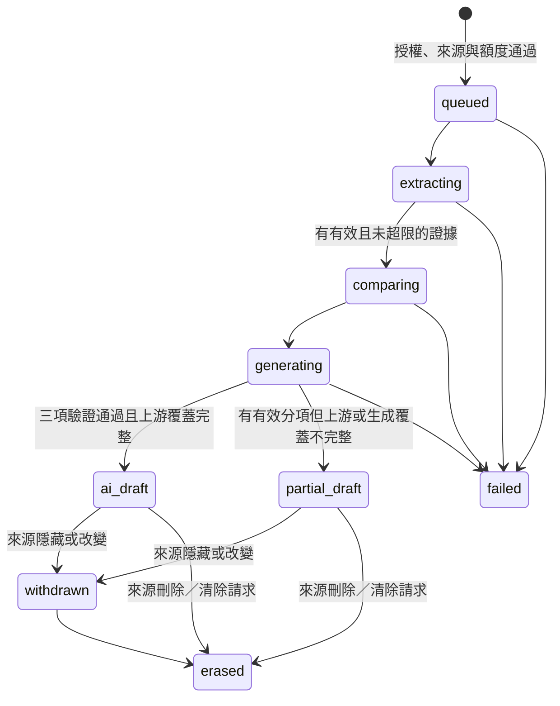

# Issue #183：證據抽取、跨素材判斷與結構化彙整實驗計畫

> **狀態：既有流程已由使用者回報產出 `ai_draft`，但人工檢閱發現共識混入歧見、爭點遺漏與立場逐條枚舉，語義品質尚未通過。下一輪改進 Clef 關係判斷，並將 Gemma 改為共識／爭點／立場地圖三次專項生成；本次只修訂計畫，這批改進尚未實作，本 draft 暫不合併。**
>
> 本文件依修改後的 [#183](https://github.com/g0v/civic-talk-hono/issues/183)、[工程師人工檢閱](./plan_review.md) 與後續使用者裁示修訂，取代原本的 #107 計畫。檢閱要求與後續裁示有差異時，以使用者裁示為準；本次新增決策詳見第 5.2、5.3、9、10 節。**使用者已明確要求將下一步實作規格改為 Clef 校準與三次專項生成；本次要求只授權修改計畫，不表示已實作或已完成新一輪付費驗收。** 既有實作與安全守門完成後的真實模型實測沿用原核准範圍；每次新付費工作仍須明確同意。過往 commit／push／更新 draft PR #191 的個別授權不視為本次自動授權，不授權合併、部署、遠端 migration 或遠端業務資料庫寫入。

## 1. 已確認的範圍與決策

|項目|本次確認|
|---|---|
|分支|從 main 新建 `feat/issue-183-evidence-pipeline`，不接續舊實驗分支|
|本輪交付|完整 API／curl 實驗：三模型流程、非同步任務、可追溯 AI 草稿、人改版本與差異、快取、配額及預算控制|
|不在本輪|一鍵操作 UI、正式站啟用、寫入既有 briefing、自動發布、替換原自帶 AI token 流程；素材投稿上限與移除再彙整 UI 只記入合併後待辦，不在本輪實作|
|使用者|任何未停權的登入者；不要求 admin 或帳號層級的 volunteer 角色|
|草稿權限|申請者與 admin／super-admin；不是公開草稿庫|
|真實資料|可唯讀讀取遠端業務 D1，以真實議題與素材實驗品質|
|寫入位置|輸入快照、AI 工件、工作狀態、配額、預算、人改版本皆只寫隔離本機業務庫|
|認證例外|DB_AUTH 允許既有 Better Auth 正常登入與 session 生命週期；不新增角色、人工停權／解停權操作或 auth schema|
|來源留存|保存完整私有輸入快照；來源隱藏時停用結果，刪除時清除相關原文／引文 payload，保留雜湊與處置紀錄|
|判斷類別|agree／disagree／unrelated／uncertain；先對照共同問題、條件與歸屬，校準被誤判為 unrelated 的支持或對立；一般支持／相容不等於共同命題，不以類別配額硬湊判斷|
|生成方式|Gemma 分別執行共識、爭點、立場地圖三個專項；共用同一份已驗證證據與必要關係資料，不串接前一段摘要代替證據|
|帳號日限額|每帳號每日 20 次新付費任務|
|議題冷卻|同議題新付費任務間隔 5 分鐘|
|比較規模|最多 64 段驗證後證據；不同素材的無向配對最多 2,016 組，排除同素材配對後通常較少；不是全站素材投稿上限|
|交換律|以無向配對去重與重用判斷；不因 A／B 順序相反建立第二份正式關係|
|遞移使用範圍|只產生待驗證候選群；A 同意 B、B 同意 C 不能直接成為 A 同意 C 的確認結果，不省略共識成立所需的直接配對驗證|
|全站額度|本實驗環境每日 US$5 的費用估算預留額度；超額停止新增付費工作，不視為 Cloudflare 帳單硬上限|
|快取|相同輸入與有效設定直接重用工件；命中或加入同一進行中工作不扣新任務配額|
|合併後待辦|實作交付時新增 `Issues.md`，列出素材投稿上限與再彙整 UI 移除／未來意見綜整；本次僅修訂計畫，不提前建立 GitHub issues|

舊 [PR #187](https://github.com/g0v/civic-talk-hono/pull/187)、[PR #188](https://github.com/g0v/civic-talk-hono/pull/188) 保留實驗紀錄；只選擇性重用逐份抽取與來源錨定概念，不整批 merge／cherry-pick，也不帶回 `scope: "issue"` 的 Clairic 全素材抽取模式。

## 2. main 現況與不得破壞的契約

- `src/api/routes.ts` 的 `requireUser()` 已處理未登入 401、停權 403；所有登入者可以使用志願者工具。`useViewerRole` 是介面偏好，不是認證角色。
- 既有 `POST /api/issues/:id/briefing` 透過 `createBriefing()` 建立版本並把正常議題推進 `published`。**新 AI 草稿不能借用此路徑儲存。** 管理端 PUT 會覆寫現有 briefing，也不能拿來充當不可變 AI 原稿。
- 現有素材沒有版本歷史；管理端刪除素材／議題會實體刪除。只存 ID、hash、offset 不足以在刪除後重建原文。
- `wrangler.jsonc` 現有 `DB`、`DB_AUTH` 與 `FACT_CHECK_CORE`，沒有 AI binding、持久任務或本功能的資料表。`vp run dev:remote` 目前會使用遠端綁定，**不能直接沿用其業務庫寫入設定做本實驗。**
- 現有 migration 最新為 `0016_issue_closure.sql`。所有新 SQL 業務表使用 `ct_` 前綴，只對本機 `DB` 套用 migration；不對 `DB_AUTH` 建表或套 migration。
- 本輪保留既有 API、`.html` 導向、SSR／hydration、投票、結案與自帶 token 的 prompt 流程。結案不是禁止本實驗的條件。合併後另案移除「再彙整」UI，但保留 `GET /api/issues/:id/prompt?type=synthesis` 的登入守門、語意與成功回應；不以 UI 移除為由刪除既有 API。
- 投稿安全審查的 OpenRouter fail-open 規則不變。**生成實驗失敗不能套用 fail-open 來偽造成功草稿。**

## 3. 實驗環境與遠端寫入隔離

### 3.1 專用實驗入口與配置

以下為本計畫提出的工程設計，隨本文件一併供人工核准：

- 增加專用實驗 Worker 入口及 Wrangler 配置，使用既有 Vite+／Wrangler，不增加套件管理器或另一套 Web 框架。
- 保留一般 `vp run dev`、`vp run dev:remote`、production build／deploy 的既有行為；一般模式與正式站的新實驗端點一律 404。
- 預定以 `CIVIC_AI_EXPERIMENT=1 vp run dev:remote` 明確選擇專用配置。該配置使用獨立的 `.wrangler/` persist 目錄；不能與一般本機庫混用。
- 實驗入口僅註冊本功能 API 與必要認證端點，重用原 Better Auth handler、角色與停權守門。不得順帶開放會修改遠端 auth 個人資料、處理停權或其他管理操作的業務端點。
- OAuth／session 的正常維護寫入是唯一認證例外；不轉存 cookie、secret、OAuth token 到工作流或 AI 紀錄。
- 需要抽出共用登入守門或縮窄 auth helper 的 binding 型別時，先查 LSP references，再遷移所有呼叫端；不建立平行的認證規則。

|Binding|連線與用途|允許操作|
|---|---|---|
|`DB`|隔離本機 D1；所有實驗狀態與 `ct_*` 新表|本機讀寫|
|`SOURCE_DB`|遠端 `vtaiwan-civic-talks`，僅來源 repository 使用|固定、參數化的 SELECT；不交給寫入 repository|
|`DB_AUTH`|既有遠端 `vtaiwan-auth`|既有 Better Auth 正常認證生命週期；必要授權 SELECT|
|`AI`|遠端 Workers AI|本計畫三模型推論|
|`EVIDENCE_WORKFLOW`|本機 Workflows 模擬與持久狀態|僅本機執行與保存工作進度|

`SOURCE_DB` 的 remote binding 本身不是資料庫授予的唯讀 credential，不能如此宣稱。隔離依靠專用入口、只提供讀取方法的來源 repository、固定 SELECT、不同的本機寫入 binding，以及行為測試；不得把遠端 binding 傳入通用寫入函式。若實作無法維持此邊界，須停下重新討論，不以「開發模式」當作安全保證。

### 3.2 持久任務與付費呼叫

使用本機 Cloudflare Workflows 承接非同步工作，不用 `waitUntil()`、單次長 HTTP 連線或模組記憶體假裝耐久佇列。官方文件支持本機 Workflows 存取遠端 bindings；**實際重啟恢復能力仍須先 smoke 驗證**。

- Workflow 參數只有工作 ID；step 回傳工件 ID／狀態，不包含全文、引文或原始模型輸出，避免 checkpoint 留下另一份無法清除的內容。
- 內容只放本機 D1；日誌、step 名稱及錯誤訊息不放原文、prompt、cookie、姓名／email 快照。
- 模型呼叫明確停用自動重試。每次呼叫先記錄付費嘗試與預留額度，再呼叫 provider，最後保存結果／用量。
- 若程序在 provider 可能已接受請求後中斷，記錄為結果／費用不確定，不在恢復時偷偷重打；保留保守預算扣帳與診斷。
- 不提供任意 force-refresh、任意模型 ID 或任意 prompt 來繞過去重。相同失敗工作也不因重按而自動新增付費嘗試；實驗調整輸入或受版本管理的設定後才產生新工作。
- 取消來源授權、素材撤下或帳號停權後，不繼續啟動新的付費步驟。已送出的推論不能宣稱可完整撤回。
- 依實際環境的 Workflow step／subrequest／CPU 限額預檢工作量，不把 64 段證據誤當成任何長度與批次都可完成的保證。超限須在下一個付費階段前明確停止；不為了湊完工作而自動增加帳戶額度、改部署或把多個模型呼叫塞成不可追蹤的一步。

## 4. 輸入、快照與來源生命週期

### 4.1 輸入白名單

預設使用指定議題的全部合格素材，亦允許請求明確指定 `material_ids` 子集合；不默默只取前幾份。

- 議題與素材必須符合實驗可讀條件，`abuse_flagged = 0`；待審、確認違規與 AI 隱藏內容不送模型。
- 只取議題 ID／標題／必要描述與素材 ID、標題、來源名稱、URL、content。**不取或傳送作者 ID、姓名、email、show_email、條款快照。** 素材內文本身仍可能含個資，不能宣稱已匿名化。
- 不爬取外部 URL、不讀取 URL 指向的網頁、不使用管理員作者投影；素材 URL 僅作來源資料。
- API 不接受呼叫者自行冒充來源的正文或 hash；快照與雜湊由伺服器從來源 repository 產生。
- content 保持原樣，不 trim、不正規化換行或 Unicode 後再計算 offset。雜湊明訂為原始字串 UTF-8 的 SHA-256；若提供模型的 state 含包裝，另存包裝與原文的映射。
- 素材排序採穩定 ID 順序；輸入 manifest 包含 source namespace、議題／素材 ID、內容與相關 metadata hash。模型、prompt、schema、抽句／比較演算法、語言與推論參數也納入快取鍵。

供本次計畫檢核的起始資源配置：最多 64 份素材、單份 content 48 KiB UTF-8、合計 content 512 KiB；超限在付費呼叫前明確拒絕並列出可縮小集合的資訊，不裁切正文。這些是應用保護界線，不冒充精確 tokenizer 計數；provider 若仍拒絕 context，保留失敗而不偷偷截斷。

此處的 64 份是「單次實驗輸入」上限，64 段是「抽取後證據」上限；兩者均不代表已實作「每議題最多投稿 64 則素材」。後者的第 33 則起警示與第 65 則禁止提交屬第 11.1 節的合併後待辦，本輪不得宣稱 UI／API 已有該投稿關卡。

### 4.2 隱藏、變更與刪除

- 每個付費階段前、草稿／證據／修訂交付前重新確認來源可讀性與 hash；遠端查核失敗時不返回先前快照內容。
- 隱藏或 hash 改變：停用關聯工件的一般調閱，標為 withdrawn／stale，不把新原文套到舊 offset，也不自動發布任何版本。
- 確認來源刪除或收到清除請求：使關聯工件失效，清除會保留原文／引文的快照、AI 原始 payload、生成結果、人改 payload 與 diff；保留 hash、時間及清除原因等不含正文的稽核 tombstone。
- **清除與在途推論的競態：** 清除須在同一本機交易中持久化來源 tombstone、遞增 generation fence，並刪除關聯 payload。每次模型呼叫捕獲所有依賴來源的 generation；回應落地、快取登記與人改版本保存時，必須以同一原子寫入條件確認來源未被清除且 generation 仍一致，不得用「先 SELECT、稍後無條件 INSERT」代替。寫入與清除無論先後，清除完成後都不能留下該次舊回應的正文。
- 延遲回應未通過 fence 時，丟棄正文／引文，只允許保存不含內容的狀態與費用結算；不得寫入錯誤日誌、Workflow checkpoint 或其他快取。重啟、重放及重新匯入來源不能重設舊 generation 或刪掉 tombstone，讓舊呼叫重新取得寫入資格。
- 清除是明列的留存例外，不是假裝原稿從未改過；原稿不可變不等於可以拒絕資料刪除。
- 啟動時先對帳現有快照，再開放內容調閱；另提供本機清除／對帳命令，處理權利請求與無人讀取的舊工作。
- **跨庫限制：** 遠端來源唯讀且沒有刪除通知，本輪不能保證刪除瞬間同步抹除關閉中的本機庫。清除發生在啟動／對帳或首次查核發現刪除時；記錄 `source_checked_at`，不宣稱跨庫原子性或零延遲。此限制需隨計畫人工檢核，若不可接受須改環境／通知架構，不能默認略過。

## 5. 三模型流程與證據規則

|模型|識別字|責任|
|---|---|---|
|Clairic|`@cf/cloudflare/clairic`|每份素材獨立抽取原文主張／條件，使用 text／list primitive，不要求 #181 巢狀結構|
|Clef|`@cf/cloudflare/clef`|跨素材證據關係的四選一判斷；不是生成最終摘要|
|Gemma 4|`@cf/google/gemma-4-26b-a4b-it`|三次專項生成：共同命題提煉、爭點／張力整理、立場分群綜整；依已驗證證據及關係資料輸出受約束文字與逐句引用|

### 5.1 Clairic：逐素材抽取與原文錨定

1. 每份素材一個 state、一次抽取；prompt 明確要求原文中的具體主張及其必要條件，不替作者發明立場、動機或數值。
2. 用 list 取得多段主張；沒有明示內容就是 null，不從 `p_null`、沉默或既有 `stance` 標籤推導新立場。
3. 取得 provider 回傳的 state text（若合約提供），驗證 span 的單位、起迄與切片。以繁中、日文、英文、emoji、CRLF 與重複片語實測；不直接假定 JS UTF-16 index 等於 provider offset。
4. 只有能唯一、正確定位到該份原文的片段才能進下一步；重複字串而無有效 span 時不能任選第一次出現。`value` 與 span 衝突亦拒收。
5. 由程式按有版本的中英日標點／段落規則擴展成完整句子，保留原始及擴展後 span、offset 單位與 exact quote；跨多句的主張保留完整範圍，不改寫成摘要。
6. 去除同素材中相同範圍的重複證據。缺 span 或無法證明出處時不退回整份正文、不用其他素材補證。
7. 單素材失敗予以隔離，記錄原因與覆蓋範圍；其餘有效素材可產生明示為 partial 的待審草稿。有效證據總數超過 64 時停在證據診斷，不任意挑前 64 段；使用者須縮小素材集合另建不同輸入的任務。

句子擴展只解決上下文／碎片問題，不能證明摘錄真的相關；`p_null` 與 confidence 都只作診斷，不能宣稱是正確率。

### 5.2 Clef（B 階段）：交換律、遞移候選與跨素材判斷

- **保留一般支持判斷，但補足可比較的語境。** agree 不要求完全同義，也不是等價關係；必須能指出在共同問題／判斷維度及各自明示條件下的支持、補充或有意義的相容。僅同屬一個議題、或兩句話可以同時成立，不足以證明共同主張。遞移仍僅用於候選，不補寫已確認的 agree 邊。
- 只比較不同素材的證據；同一來源不因重複段落變成多票，也不把素材數當作獨立公民人數。
- **交換律是應用端的關係契約。** 四分類問題採兩段主張的對稱關係，而不是「A 是否蘊含 B」等有方向的問題。以兩個證據識別的固定排序建立無向 pair key；同一輸入／設定下，A-B 與 B-A 共用一份正式判斷與快取，不重複扣題數或啟動模型呼叫。保留實際送入模型的順序、題目版本、選項機率與 provider 診斷；不宣稱模型對調輸入的機率天然相同。
- 每對仍只回答 agree／disagree／unrelated／uncertain，依第 5.2.1 節校準 instructions、四選項 criteria 與必要上下文；不新增前置模型呼叫來替 Clef 代答。正式關係保留該配對的直接模型判斷；候選推導必須另記來源路徑與待驗證狀態，不冒充另一筆模型輸出或使用其機率。
- provider 每次最多 64 題；依實際 state 大小再縮小批次，不把 64 題誤認為無限長 context 或原生 async Batch 能力。
- 使用固定排序與已記錄的批次策略。無法完整容納的 state 明確失敗，不接受服務端截斷後仍冒充完整比較。
- **遞移只用於找候選、安排驗證。** 已知 A-B、B-C 為 agree 時，可以提出 A-B-C 候選群並將 A-C 列為待直接比較；不能推定 A-C 為 agree。只要共識候選仍依賴 A-C 的關係，就不能為了節省費用省略這個必要配對。
- 程式以直接 agree 邊產生**待提煉共同命題的候選**：至少兩個不同素材，群內所需的跨素材配對均有直接 agree，且相關證據間沒有已接受的反例。候選不是已成立的共識；Gemma 仍須找到各參與來源真正支持的共同命題。若 A-C 為 disagree／unrelated／uncertain、漏比或失敗，三者不能因支持路徑相連就合併成共識；可保留較小候選群與未分類證據。
- 直接 disagree 提供明確對立候選；Gemma 可另從已驗證證據提出可並存的策略／價值張力，但必須與直接矛盾分開標記，不能改寫 Clef 原始關係。不能用遞移候選覆蓋反例；支持鏈與直接比較衝突時，診斷保留鏈、直接判斷與排除原因。
- 計算節省來自無向配對去重與既有有效工件快取；遞移候選可協助群組搜尋與比較排程，但不保證減少必要的模型題數。診斷分開列出符合資格的無向配對數、直接判斷數、快取命中數、僅推導的候選及未完成配對；後兩者不算已比較或已支持。
- 立場地圖整理素材明示的主張／關注點；證據清單與關係圖是分群輸入，不再把「一條證據一個候選，加上共識群」當成唯一合法分群。分群提案及證據歸屬須可追溯，不推定作者人格、隱藏動機或公眾支持比例。
- 中文人工標註樣本須抽查對調 A／B 的結果及非遞移支持鏈，揭露方向偏差與錯誤合併。反向抽查是品質診斷，不覆寫正式關係；其付費呼叫仍須記帳。若必須全面雙向判斷才能達到品質，先回來討論成本與計畫，不暗中把所有呼叫加倍。

#### 5.2.1 下一輪：降低不合理的 unrelated，而非追求特定比例

- **先辨識共同問題與條件，再判斷關係。** 題目保留兩段已驗證原文、來源歸屬及比較所需的原始上下文；不改寫成帶有預判的摘要，不把議題標題相同當成兩段一定相關。檢查題目、選項文字、證據句子擴展與批次 context，區分模型誤分類、上下文不足及真正無關。
- 四類判準須有對照例：agree 為同一可比較問題下的支持／補充／有意義的相容；disagree 為相同或可對照條件下，事實結論或明示立場／建議互相對立；unrelated 為沒有可合理對照的問題／維度，不是「不是嚴格同義，也不是直接否定」的兜底類；uncertain 為條件、歸屬或資訊不足以確定關係。
- **策略張力不硬塞成事實矛盾。** 「AI 可能取代部分工作」與「設計師應擁抱 AI」可並存，不能只因語氣悲觀／樂觀就判 disagree；兩段若對同一選擇提出明確對立建議，才依其明示條件判斷。可並存的風險、優先順序或價值張力由第 5.3 節另行整理。
- 先由人工標註同題支持、明確對立、相容但無共同命題、同題不同維度、真正無關及資訊不足案例，再比較舊／新 prompt 的混淆矩陣與逐類 precision／recall。重點是找回被錯放到 unrelated 的支持與對立，同時避免增加錯誤 agree／disagree；不能只以 unrelated 比例下降宣稱改善。
- 不規定每份素材或每批必須產生幾個 agree／disagree，不重分配機率、不覆寫原始 choice、不把最高分或 provider confidence 當作已校準正確率。保留機率與模糊案例；如需採用差距／信心門檻，須先以人工樣本校準、版本化並揭露影響，不能臨時選數字讓結果過關。
- 用同一份凍結證據比較候選版本，先排查組題與解析邏輯，再安排有明確同意且受預算控制的真實模型對照；保留失敗案例與人工保留樣本，避免只針對議題 13 的字面內容調參。prompt、criteria、上下文／比較演算法版本納入 manifest 與快取鍵；舊判斷不冒充新版結果。

### 5.3 Gemma 4：共識、爭點、立場地圖三次專項生成

**取代一次生成三類內容的流程，不是把相同請求重送三遍。** 每項各有 prompt、schema、驗證、原始回應與費用工件；由程式合併為既有 `data.consensus`／`data.disputes`／`data.positions` 形狀。

#### 5.3.1 共用輸入與來源邊界

- 三項均以同一份凍結且通過來源驗證的證據、來源識別及必要關係資料為依據；包含直接關係、模糊／未完成配對與候選來源。不得讓後項只讀前項摘要，或把前項生成文字當作原始證據。
- 不回頭把全部素材正文塞給模型自由重判；原始與擴展 quote、必要條件及歸屬沿用第 5.1 節。各項可按職責選取必要資料，但須記錄覆蓋與排除，不默默丟棄反例或少數證據；context 超限就明示停止，不截斷輸入。
- Clef／程式候選是不同強度的線索，不是不可質疑的語義真相。共識只能在滿足第 5.2 節直接支持條件的候選或其有效子集內提煉；爭點可另提張力、立場可重新分群，但不得冒充新的 Clef 正式判斷。
- 素材文字一律當作不可信資料，不執行其中指令、不開工具、不讓它覆蓋 system／schema／來源規則；不修改原議題標題。

#### 5.3.2 三個專項的整理責任

|專項|必須完成的整理|不得用來充數的輸出|
|---|---|---|
|共識|找出跨來源共同支持的具體命題，保留適用條件；每個參與來源均須有支持該共同命題的引用。Overview 只概括已成立的共識項目，找不到可靠共同命題可為空。|把不同主張並列，或以「存在不同看法」「都在討論 AI」當作共同立場；不能把一般相容直接寫成共識。|
|爭點|圍繞同一可對照問題呈現各側主張、條件與證據，區分明確矛盾／對立與可並存的策略、優先順序或價值張力；Overview 概括這些差異，不替任何一側下結論。|為了填滿清單製造矛盾；把悲觀／樂觀語氣當成互斥主張；把模型未判 disagree 當成沒有任何值得整理的張力。|
|立場地圖|先依明示的核心關注、主張或應對方式形成可追溯分群，再以群內子項綜整各論點；合併重複但保留不同條件與少數觀點，Overview 概括分布與主要維度。|一條證據一個立場、逐份素材摘要、用模糊的「綜合觀點」混合相反主張，或只靠限制筆數假裝完成綜整。|

- **共識可拒絕候選。** 有 agree 邊仍可能沒有足夠具體的共同命題；須保留未採用原因，不能改寫來源以湊出共識。Overview 與 description 都遵守相同語義，不把歧見移到 Overview 後假裝解決。
- **爭點不以非空 disagree 候選為啟動條件。** 此專項仍讀取同一證據與關係資料，檢查可追溯的張力提案。每項至少引用兩個不同素材，逐側記錄證據、比較條件、類型及來源是直接判斷還是 Gemma 提案；未獲 Clef 直接支持的矛盾提案保留為待審，不升格成已確認 disagree。若確無足夠證據，允許空結果。
- **立場重新分群，不強制一素材一立場。** 同一素材可出現在不同關注群，多素材也可支持同一群；不要求每群必須跨素材，不把素材數當支持人數。不得將相反主張壓成同一立場，亦不靠固定群數裁掉內容；無法合併的少數觀點可獨立保留，不推測作者動機。
- 立場專項須提交分群證據集合及群內子項引用，取代目前「每筆只能選一個既有單條候選」的限制。逐條證據記錄已納入的群組、重疊或未採用原因，讓遺漏與重複可檢查；Core_concern 僅在原文明示且足以支持時填寫，否則為 null。

#### 5.3.3 引用、組裝與跨項檢核

- 內部生成格式維持「句子文字＋evidence IDs」，另外保存共同命題／爭點各側／立場分群的證據歸屬與提案來源。由程式組成 #181 字串與逐句 citation map，不要求模型計算輸出 offset。
- 每個生成文字欄位的每句，包括 Title、Overview、立場名稱，都須有有效證據。程式核對 exact quote、來源歸屬、各項專用的分群與配對限制；共識不得引用未列入該命題的來源，立場不得以放寬分群為由接受未知證據。
- 各項分別嚴格驗證 JSON、schema、必需欄位、完成原因與 citation coverage；拒絕截斷、refusal、偽造 quote、跨素材錯配或缺引用。不從 Markdown／雜訊猜 JSON，不另呼叫模型修格式。
- 合併時核對三項的輸入／證據／比較版本一致、JSON Pointer 與 offset 正確，並保留共識與反例衝突、爭點兩側、立場覆蓋／重複診斷。結構上違反支持邊或引用限制者拒收；語義上是否真正共識、合理張力或有效綜整仍須人工檢核，不宣稱程式能證明引用蘊含生成文字。
- 不新增第四次 Gemma 總整或裁判呼叫。結果固定標為 `ai_unverified`，不自動寫入 briefing 或改變議題狀態。

#### 5.3.4 工作流、分項狀態與失敗

- 初版固定依共識、爭點、立場地圖順序執行三個獨立付費 step；順序只為控制資源，不構成摘要依賴，不以並行化為本輪必要範圍。每項有獨立且不含原文的 step／嘗試鍵、工件、驗證與結算，成功結果不被其他項失敗覆寫。
- `diagnostics.generation.sections` 分別記錄三項的狀態、原因與工件關聯：`completed` 為驗證通過且有內容；`no_findings` 為驗證通過但無足夠可整理內容；`failed` 為該項呼叫或驗證失敗；`not_started` 為未能啟動。進行中另呈現當前 step，不把未完成當作 no_findings。
- 單項 provider／schema／引用失敗，若授權、來源與剩餘預算仍有效，可繼續其他專項，但不得自動重打該項。至少一項驗證通過而其餘失敗／未啟動時，只能交付明示分項缺漏的 `partial_draft`；全部失敗／未啟動則為 `failed`。三項均 completed／no_findings 且來源與比較覆蓋完整，才可為 `ai_draft`；上游覆蓋不完整仍為 partial。
- 預算不足停止尚未啟動的付費步驟，記錄 not_started 與原因；來源失效、清除或授權失效則沿用全域守門，不藉 partial 返回已失去調閱資格的內容。每項回應保存及最後組裝均須通過來源 generation fence。
- 不新增付費重試入口、隱藏抽樣或 force-refresh；重啟／重放重用已保存的有效分項工件，未知費用仍保留預留，缺回應不自動再呼叫。

## 6. 結構化輸出與版本

沿用 [#181](https://github.com/g0v/civic-talk-hono/issues/181) 的輸出語意及現有實驗 API 的下列欄位／nullable 契約；三項生成只擴充診斷與 provenance，不改既有 briefing JSON，也不改名或刪除現有 data 欄位：

- `data.consensus`：`{ Overview, items: Opinion[] }`
- `data.disputes`：`{ Overview, items: Opinion[] }`
- `data.positions`：`{ Overview, items: Position[] }`
- `Opinion`：`{ Title: string, description: string }`
- `Position`：`{ name: string, Sources: Source[], Core_concern: string | null, opinions: Opinion[] }`
- `Source`：`{ Title: string, href: string, material_id: number }`；href 由程式用已驗證來源資料組成，不由模型隨意填網址。
- 證據不足且專項驗證通過時，Overview 可為 null、清單為 `[]`；Core_concern 不足以支持時為 null，不捏造核心價值。專項失敗／未啟動時不混入未驗證文字，data 對應段維持空形狀作相容占位，**其意義必須由 `diagnostics.generation.sections` 明確區分，不得把失敗宣稱成「沒有共識／爭點／立場」**。機器原因放在 diagnostics，不假裝成有引文支持的生成結論。
- `citation_map` 以 data 的 JSON Pointer、句子範圍與 evidence IDs 對應來源；範圍由程式組裝文字時計算。附帶 `evidence`、覆蓋範圍、排除理由及 provenance，供 curl 檢視。

provenance 保存：輸入 manifest／hash、原文與 state 映射、原始及擴展 span、比較 pair key／實際題序／直接判斷與候選推導路徑、三模型 selector、provider 實際回報的版本／request metadata、推論參數、完整 prompt 與 hash、prompt／schema／演算法版本、程式版本、原始回應、驗證結果、用量與時間。三個生成專項另存各自的輸入依賴、prompt／schema 版本、分群／爭點類型與提案來源、工件關聯及費用；新版 manifest／快取鍵必須區分舊的一次生成，不覆寫舊原稿，也不將舊工件冒充三項已完成。

模型 selector 不是不可變權重 SHA；provider 未提供的 revision 必須標 unknown／null，不補造。「可重現」指可取回同一份保存的工件及核對其來源，不保證未來再次推論逐字相同。

AI 原稿為不可覆寫工件。申請者可另存人改版本，保存 parent、editor ID、時間、內容 hash 與程式計算的欄位差異；管理員可稽核，不冒用申請者編輯。修改過的文字明確標為 `human_unverified`，不能沿用舊 citation 就假裝新句子已被 AI／程式語義驗證。並發編輯使用 parent/version 檢查，過時提交回 409。

## 7. API、狀態與資料表

### 7.1 新 API 提案

所有端點只在明確啟用的實驗入口存在；沿用 `/api/*` 全域 `apiCsrf`，不逐端點重造 Origin 檢查、不提供管理／寫入 CORS 放行。敏感回應為 private／no-store。

|方法／路徑|用途|
|---|---|
|`POST /api/issues/:id/evidence-jobs`|登入／停權守門；接受選填素材集合、生成語言與明確的處理告知同意，凍結來源、去重、預留並排入工作；新工作 202，命中完成工件 200|
|`GET /api/evidence-jobs/:jobId`|申請者／管理員取得進度、來源覆蓋、費用狀態、驗證後的草稿或失敗診斷；取得 payload 前重驗來源|
|`GET /api/evidence-jobs/:jobId/revisions`|取得該申請者工作下的 AI 基底與人改歷史／差異，不帶出其他申請者的私人修訂|
|`POST /api/evidence-jobs/:jobId/revisions`|申請者以 parent revision 另存人改版本；不能覆寫 AI 原稿或竄改 provenance|

未登入 401、停權 403；非申請者且非管理員以 404 避免枚舉。輸入錯誤 400，沒有可用來源／內容或證據規模不合限制 422，請求本身過大 413，版本衝突 409，帳號限額／議題冷卻 429，全站預算停止新工作 503，回應維持 `{ error: string }`，可擴充機器代碼與 reset／retry 時間。非同步階段失敗以工作狀態與原因呈現，不回假的完整草稿。

任何階段都可能因來源失效、帳號停權或預算不足終止；不能把失敗狀態強轉成完成。人改版本另存，不改動這條 AI 原稿狀態歷史。

### 7.2 本機資料設計

沿用已存在的 `migrations/0017_evidence_pipeline.sql` 與隔離本機庫。三項狀態與工件優先使用現有資料責任；只有實際 schema 需求才新增順序 migration，不為拆呼叫重建資料庫、清空帳本或重設來源 tombstone。migration 只套用專用本機 persist 目錄，不執行任何遠端 migration。

最小資料責任分離：

- `ct_ai_jobs`：申請者、輸入 key、執行工件、狀態、來源查核時間、處理告知版本／同意時間與錯誤碼。
- `ct_ai_sources`：不可變輸入快照與 manifest；遠端 ID 只是來源識別，不跨資料庫宣告外鍵，也不 FK 到本機示範議題。
- `ct_ai_artifacts`：抽取、判斷、生成各階段工件與驗證／用量；原稿、失敗及原始回應不得以成功輸出覆寫。
- `ct_ai_revisions`：申請者的人改版本、parent、diff 與編輯者。
- `ct_ai_usage`：付費嘗試、帳號日計數、環境日預算的預留／結算依據；使用整數微美元，不用浮點金額。
- `ct_ai_issue_cooldowns`：議題的新付費任務冷卻與原子 claim。

執行 cache key 用唯一約束控制同輸入的完成工件／進行中執行；每個申請者使用自己的工作關聯，不因快取命中洩露首位申請者、帳號額度或其人改版本。交易／原子條件寫入避免並發雙跑、雙扣額度與預算穿透。

## 8. 配額、計價與失敗政策

- 每日以 UTC 00:00 重設，回傳絕對 `reset_at`；這是本計畫的起始工程配置，可於人工檢核改為台北日界線。
- 次數計的是啟動新模型執行的任務，不是 GET 次數；付費嘗試已開始後的失敗仍算次數與已發生費用，避免惡意輸入一直免費耗模型。
- 先查授權與當下來源，再查完成／進行中快取；命中仍可在日限額或新工作預算耗盡時讀取有效結果。
- 冷卻以議題為單位，只擋新付費工作；使用帳號，不以同 IP 阻擋工作坊參與者。
- 用版本化價目及保守的輸入／最大輸出估計預留成本；已知實際工作量後如需增額，必須先原子取得額度，否則停止，不先呼叫再算超支。
- 生成階段估算須涵蓋三個專項各自的 prompt／證據輸入與最大輸出，不沿用單次生成額度，也不將總管線費用假稱必然乘三。每項呼叫前仍獨立原子預留／結算；不得先發出三次再補預算。帳號日次數仍按一個新工作計一次，不因三項生成變成三個新工作。
- provider 回報可靠用量時結算；逾時、連線中斷或缺用量不能當作零成本退款。保留估算／實際／未知的區別。
- 日預算按呼叫歸屬與已預留額度跨午夜結算，不能重設時計算遺漏未完成工作。新的一天也不自動重打失敗模型呼叫。
- US$5 只涵蓋本功能的模型費用估算控制，不涵蓋帳號其他 Worker、D1、認證與其他費用，也不是 provider 保證的硬支出上限。
- 不新增自動修 JSON、多次抽樣、改用其他模型或模型呼叫重試等隱藏成本。

## 9. 開工後順序與停止條件

1. **凍結基準與人工答案。** 沿用現有隔離環境及安全守門，保存本次三素材品質失敗案例的私有快照／hash 與基準工件；人工標註關係及預期整理重點，將提示校準樣本與保留驗收樣本分開。不以重新建立環境或再次成功 HTTP 回應取代語義檢查。
2. **校準 Clef。** 先核對組題、criteria、原文上下文、對稱關係與解析；依第 5.2.1 節以固定樣本比較新版，保留無向去重、非遞移支持與直接反例。真正付費對照仍須明確同意與既有預算記帳。
3. **修訂候選與引用契約。** 區分相容候選與共同命題、直接對立與可並存張力；立場允許可追溯的多證據重新分群，不再受單條候選枚舉限制。先完成行為回歸測試與每項 schema／引用驗證，不用關鍵字或輸出筆數冒充語義判斷。
4. **切換三項生成與工作流。** 實作三個專用 prompt／schema／付費 step、分項狀態、工件、預算與組裝；移除舊的一次生成執行路徑，不保留雙軌 fallback。證明快取、重啟、清除 fence 與部分失敗不會重複付費、不會復活正文或誤報完整結果，再進真實模型驗收。
5. **完整 smoke 與品質報告。** 跑既有完整檢查，使用固定真實來源檢視三項內容、逐句引用、快取、人改 diff、來源與費用邊界；依第 10.2、10.3 節比較品質與實際成本／時間，更新 README 及 Insight 紀錄。`Issues.md` 的兩項合併後待辦不擴充、不提前實作；本輪沒有自動合併、發布或部署步驟。

若真實 schema 合約、offset 定位、Workflows 本機恢復或費用隔離不成立，保留負面結果並先討論修訂計畫；不暗換模型、不改遠端工作流、不降級成無出處摘要，也不把未達品質的產出當作成功發布。

## 10. 自動測試、實測與品質驗收

### 10.1 永久回歸測試

依現有 `src/tests/`／`vite-plus/test` 慣例，針對行為而非程式碼文字或 wiring：

- 多語句界線、emoji／UTF-16 差異、CRLF、重複片語、錯素材引文、value／span 衝突、缺 span 與 null，不讓錯錨定進入下一階段。
- A-B／B-A 重用同一正式關係，不重複啟動付費呼叫；同素材不建立跨素材支持票。
- A-B／B-C 的 agree 可產生待驗證 A-C 候選，但不能補寫確認邊；A-C 為 disagree／uncertain／漏比／失敗時不得合併成三方共識，unrelated 亦不算支持。反例不被候選覆蓋，候選路徑與直接判斷可區分，partial 覆蓋不可冒充完整。
- JSON 結構、逐句 citation coverage、未知 evidence、跨組錯引、截斷／refusal；引用存在的檢查不假裝測得語義正確率。
- 三項生成的共同命題引用涵蓋每個參與來源；爭點各側與張力提案的類型／證據可追溯，空的直接對立候選不阻止張力整理；多條證據可合成一個立場而不是被單條候選限制。以可控結構案例驗證契約，不以 mocked 文字或字串關鍵字宣稱測得綜整品質。
- 分項完成、no_findings、失敗與未啟動可區分；一項失敗不丟棄其他有效工件，全失敗不交付草稿，覆蓋缺漏只交付 partial。三項同輸入版本、獨立預留／結算、重啟不重打、預算不足不啟動下一項，及來源清除後分項與合併均不得重新落下正文。
- 401／403、跨申請者 404、管理員稽核、CSRF、正式模式 404、來源作者快照不進模型／輸出。
- 並發相同輸入只啟動一個付費執行、快取不雙扣、20 次邊界、5 分鐘冷卻、UTC 日界線與在途預留、日預算並發、未知費用不退款。
- 人改不覆蓋 AI 原稿、過時 parent 409、變更文字不沿用「已驗證」標籤、其他申請者無法取得私人修訂。
- 來源隱藏／刪除／hash 改變、查核失敗不洩露快照、清除涵蓋原始模型 payload 與 diff、重啟不從 checkpoint 復活正文。
- 以可控制的延遲回應重現「模型已啟動 → 清除交易完成 → 模型回應返回」，確認原文／引文不會回到工件、快取、人改 payload、日誌或 checkpoint；另覆蓋回應先提交再清除、清除與人改／快取提交並發，以及清除後重啟／重放，驗證 fence 持續有效而非僅阻擋新呼叫。
- 用可觀察的資料庫行為證明工作只改本機狀態，來源庫資料不被工作流程修改；不以比對 SQL 字串代替此驗證。

### 10.2 必做實際執行

開工後依序跑 `vp check --no-fmt --no-lint`、`vp test`、`vp run build`，再啟動專用實驗模式，以真實模型及遠端唯讀來源做 smoke；單元測試與假的 provider 回應不能當成真實模型能力證明。

實測步驟、指令與人工判讀須按第 10.3 節寫入 README；開發者自己的成功回應或零散 curl 紀錄，不能代替另一位檢閱者可重做的驗收流程。

驗收檢核分三類，保留實際案例、輸入／工件 hash、用量與失敗原因：

1. **人工標註小樣本：** 四種關係各至少三個明確中文例子，另涵蓋相容但無共同命題、同題不同維度、策略／價值張力、少數反對、條件式支持、文內轉述他人、prompt injection 及中英日／emoji 定位。包含 A／B 對調與 A-B／B-C 支持但 A-C 衝突或不確定的支持鏈。對固定輸入比較舊／新 Clef 的混淆矩陣、逐類 precision／recall、模糊配對及人工保留樣本；先有人標準答案，不讓模型評自己，也不以關係分布符合期望取代正確性。
2. **真實議題與三項生成：** 優先使用議題 13、素材 25／26／27，先確認仍可讀且與基準 hash 一致；來源變更時記錄差異，不假稱同樣本對照。人工分別檢查共同命題及條件、明確對立／可並存張力與兩側證據、立場分群／群內綜整、少數觀點及遺漏。沿用本次已發現的三類品質失敗作回歸案例，不把它們變成強迫非空輸出的模板。
3. **成本與失敗對照：** 在相同證據與語言下記錄舊的一次生成與新版三項生成的各項 token、預留／實際／未知費用、時間及分項結果；Clairic／Clef 與 Gemma 費用分開。若同時修改 Clef 與生成，報告揭露兩項變因，不把全部改善歸因於拆呼叫。優先使用已保存的基準，不為補齊表格自動重跑付費模型。

機械門檻：偽造出處、跨素材錯錨與缺引用必須被拒絕；未直接驗證的遞移候選或 Gemma 張力提案不得計為 Clef 已確認關係。品質報告列出抽取／關係混淆、方向偏差、支持鏈反例、三項各自的缺漏與人工修正，不以 HTTP 200、schema 通過或高 confidence 宣稱品質過關。已知反例仍被寫成共識、明確對立被漏掉／混作共識、或立場仍只逐條枚舉而未綜整時，品質驗收不通過；不得以所有清單變非空或程式檢查全綠取代此門檻。

本輪不新增一鍵 UI；若為隱私告知而修改既有介面文字，仍須 zh-TW／en／ja 同步，並以真實瀏覽器檢查桌機／手機、淺色／深色與 hydration。未實測的登入、語言或正式站行為不得在報告勾成通過。

### 10.3 README 必交付：真實議題人工驗收手冊

README 必須有獨立的 #183 實驗驗收章節，讓未參與開發的檢閱者能依序操作；以下是實作交付時的文件要求，不表示這些實驗命令／端點目前已可使用。

1. **前置與隔離確認：** 列出工具／登入／Workers AI 付費權限與設定前提，先執行 `npx wrangler whoami` 核對帳號。提供實際專用配置、本機 persist 路徑、僅對隔離本機 `DB` 套 migration 的完整指令及唯讀來源檢查方式；明確禁止對 `SOURCE_DB` 或 `DB_AUTH` 套 migration，也不能直接用一般 `vp run dev:remote` 取代實驗模式。
2. **啟動與登入：** 寫出經實測的專用啟動命令 `CIVIC_AI_EXPERIMENT=1 vp run dev:remote`、實際 origin／port、停止與重啟方式。本機 `http://localhost:5173` 使用 Google 登入；依使用者確認，GitHub OAuth callback 僅開放 vtaiwan.tw 子域，不能將 GitHub 列為 localhost 可用 provider。示範使用權限受限且不進 git 的 cookie jar；不得將 cookie、OAuth token 或 secret 印入終端、報告或範例。
3. **參數與請求準備：** 先設定並驗證包含 scheme／host 的 `BASE_URL`，再設定議題 ID、選填素材 ID 與語言；不使用空 host、未替換 ID 或假的 cookie 假裝可直接執行。curl 範例明列 cookie jar、JSON Content-Type、同源 Origin 及處理告知同意的實際欄位；不得只寫「帶上登入資訊」。
4. **真實來源查核：** 優先以議題 13、素材 25／26／27 操作，但先驗證是否仍存在、可讀且符合輸入條件；不符合時記錄來源變更並明列替代樣本。展示本次素材集合、輸入 hash／快照與排除原因；只讀遠端，不為了測試而新增、隱藏、修改或刪除正式素材。
5. **新建與輪詢：** 給出完整 POST 與回應解析指令，取得實際 job ID 後輪詢 GET，區分 202 排隊、200 快取命中、進行中、AI 草稿、partial 與失敗。輪詢須有合理間隔與停止條件，不以無限快速重送 POST 等待結果；停止等待不代表已取消在途模型呼叫。
6. **目視 JSON 與出處：** 給出可直接執行的 `jq` 與安全存檔指令，分別查看三項 data、分項狀態、citation map、證據、分群／爭點提案、比較診斷與費用；結果過長時保存本機權限受限且不進 git 的 JSON，不貼上私人全文。逐句核對原文、條件、轉述歸屬與少數反例；區分 no_findings、失敗與未啟動，依第 10.2 節檢核共同命題、爭點兩側及立場綜整，不能只檢查 JSON 可 parse。
7. **快取與人改：** 原樣再送一次，核對重用工件且沒有新增付費嘗試／配額扣帳；另示範修改文字後以正確 parent 保存修訂、查歷史與 diff，確認 AI 原稿不變、新文字為 `human_unverified`，且既有 briefing／議題狀態不變。提供過時 parent 回 409 的重做步驟。
8. **失敗、留存與恢復：** 列出無登入、權限不足、來源不合格、輸入／證據超限、額度不足的預期狀態及診斷查法。提供本機對帳／清除與 Workflow 重啟恢復的實際命令和觀察點。需要來源撤下／變更／刪除或競態才能驗證的案例，若無安全可控的來源，就明列自動化隔離測試證據與未完成的人工實測，不用遠端寫入製造案例；不為了演示配額耗盡而刻意燒滿付費額度。
9. **驗收紀錄：** 附一份已實填的去識別紀錄，包含實測時間、程式／模型／prompt／schema／演算法版本、來源與工件 hash、job ID、抽取／比較／引用品質、排除及人工修正、用量／預留與結算、結果與未驗證項目。私有原文、引文 payload、cookie jar 及人改內容只留本機；README／PR 不貼真實個資或憑證。

交付門檻：另一位人工檢閱者能依手冊重做「真實議題 → 三模型 → JSON 與引文核對 → 快取 → 人改 diff」；重做會產生新的費用時須明示，仍受配額、預算與實測授權限制。此流程未走完，不勾選「真實議題人工驗收完成」，也不把尚未開發的命令寫成已實測成功。

## 11. 預計影響檔案與文件

既有入口、隔離配置、`src/ai/`、migration 與驗收文件已在本分支。下一輪沿用現有責任分工，以下為實作目標，不表示本次已修改這些檔案：

- 重點修改 `src/ai/models.ts`、`comparison.ts`、`generation.ts`、`runner.ts` 及必要的 `store.ts`／`routes.ts`／`pricing.ts`，完成 Clef 題目校準、可追溯分群、三項生成與分項診斷；沿用既有來源／生命週期邊界，不引入通用 AI agent 框架。
- 沿用 `migrations/0017_evidence_pipeline.sql`；僅在實際 schema 需要時新增後續本機 migration，SQL 留在 DB／repository 層，不散落在 handler。補充相應行為測試，不用測試檔案文字或 mocked 摘要替代語義驗收。
- 不因拆分生成而修改一般模式的 Vite／Wrangler／認證設定；若實作確有必要，須維持既有隔離與型別生成機制，不能接上遠端業務寫入、新 auth schema 或一般伺服器任意生成。
- 更新 `README.md`：實驗啟用、來源只讀、認證寫入例外、本機留存與刪除限制、平台付費與限額，以及第 10.3 節完整人工驗收手冊、實際指令／預期結果／品質紀錄及 BYO 流程保留。
- 保留現有 `Issues.md`：依第 11.1 節保存兩項合併後待辦，不擴充其範圍，不把清單當作已建立 GitHub issue 或已完成開發。
- 更新 `AGENTS.md` 的 #183 專屬授權／狀態敘述，不把舊 admin-only 抽取實驗當作新版規格，不放寬成一般伺服器任意生成。
- 更新既有隱私／條款必要敘述與三語 key：素材會由平台送交 Cloudflare Workers AI，可能含個資；說明私有快照、清除時機與原稿／人改區別。若法律條款實質改版，同步 `TERMS_VERSION`，但不順手改寫所有舊投稿 API 的同意契約。
- `.dev.vars.example` 只在確有新設定時加入假值；cookie jar、快照與本機結果留在忽略的實驗目錄，不提交真實個資或憑證。保留現有授權／notices／自動來源版本機制。

### 11.1 `Issues.md`：本 PR 合併後待開議題

既有 `Issues.md` 保留下列兩項後續工作及驗收條件；本輪不提前實作、開 GitHub issue 或把其完成狀態混入 #183 的模型實驗。實際建立 GitHub issues 仍須另取得使用者授權。

#### 待辦一：素材投稿警示與每議題 64 則上限

- 目的：使用者在到達上限前就收到提示；不能只有 AI 實驗拒收時才發現超限。
- UI／API 兩層設關卡。議題超過 32 則、即第 33 則起，使用者皆能看到接近上限的警語；達 64 則後不得提交第 65 則，不能只靠前端禁用按鈕。
- API 的限額判斷與新增須能承受並發，不得讓兩筆同時投稿繞過 64 則上限；既有已超限資料不能因此被自動裁切或刪除。
- 該議題實作前須明訂素材計數口徑（包含隱藏、刪除如何計算）及相容的錯誤回應；驗收覆蓋 32／33／64／65 邊界、直接呼叫 API 與並發提交。
- 警語／拒收文字同步 zh-TW／en／ja，驗收桌機／手機、淺色／深色；與第 4.1、5.1 節實驗輸入／證據上限分開說明。

#### 待辦二：移除再彙整 UI，公民意見另走未來意見綜整

- 依使用者裁示，只移除志願者工具中的「再彙整」操作、僅供該介面使用的狀態／處理函式與相關導覽、三語說明；不移除素材彙整、說明頁或其他 BYO 流程，也不修改既有 briefing 資料。
- **既有 API 保留：** `GET /api/issues/:id/prompt?type=synthesis` 的登入／停權守門、prompt 語意與成功回應不變；後續清理不能誤刪此分支或改成 404，不將「UI 下架」說成「API 淘汰」。
- 公民意見綜整留給待研發的「意見綜整」程序，以類似 polis.tw 的視覺化呈現為方向；具體分群／共識算法、資料契約與操作設計另案確認，不混入本輪素材證據彙整。
- 此方向不等於恢復舊版 polis.tw 外部 embed，也不代表授權接入新服務；本站現有投票與 `comments.csv` 保留。
- 驗收確認再彙整 UI 不再出現、保留的 prompt API 與其餘志願者流程仍可用，相關說明不再引導使用已移除的操作；UI 變更仍須三語、桌機／手機及淺色／深色檢查。

## 12. 交付與人工關卡

既有實作、README 人工驗收手冊、`Issues.md` 與 `Insight.md` 已有各自紀錄，使用者已回報真實流程產出 `ai_draft`，但指出共識、爭點與立場綜整品質問題。本次交付僅為計畫修訂；Clef 校準、三項生成及其新一輪 smoke／人工品質驗收尚未完成，不把舊版成功或既有檢查算成新版通過。完整 OAuth 驗收仍按已記錄範圍逐項確認，不以取得草稿概括全部登入案例；本次不 commit、push、部署或寫入遠端業務 D1。

- [x] 閱讀修改後 #183、#181 與舊實驗紀錄，核對 main。
- [x] 建立乾淨新分支。
- [x] 確認本輪 API 範圍、資料與認證例外、草稿權限、留存、四分類及工作坊限額。
- [x] 建立計畫並依人工檢閱修訂，確認一般支持判斷只做候選遞移，以及再彙整僅移除 UI、保留 API；使用者已明確核准實作。
- [x] 使用者已檢核並明確核准修訂版計畫，包含實驗入口／本機 Workflow、額外輸入資源界線、nullable 輸出、UTC 日界線及跨庫刪除時機。
- [x] 原實作曾獲核准；真實模型呼叫須先具備費用與授權守門，後續由使用者回報產出 AI 草稿。
- [x] 已交付 README 人工驗收手冊、`Issues.md` 與 `Insight.md`；本次使用者人工檢閱已指出語義品質失敗，未提前實作合併後功能。
- [x] 依使用者要求修訂下一步計畫：Clef 判斷校準及 Gemma 共識／爭點／立場地圖三項生成，不以類別比例或非空清單當品質目標。
- [ ] 完成第 5.2.1 節 Clef 校準與人工保留樣本檢核。
- [ ] 完成第 5.3 節三項生成、引用／分群契約、分項狀態、預算與去重／清除邊界。
- [ ] 完成新版完整檢查、真實 smoke 與人工語義品質驗收，再另行取得 commit／push／更新 PR 的授權；保留舊版與負面實驗紀錄。
- [ ] 正式站啟用、部署或任何遠端業務 D1 寫入：另案明確授權，本計畫不包含。

## 參考

- [新版 #183](https://github.com/g0v/civic-talk-hono/issues/183)、[#181 輸出語意](https://github.com/g0v/civic-talk-hono/issues/181)、[#185 Gemma 實驗需求](https://github.com/g0v/civic-talk-hono/issues/185)
- [工程師人工檢閱與決策](./plan_review.md)；交換律／遞移範圍及再彙整 API 的取捨，以本文件第 1、5.2、11.1 節記錄的本次使用者裁示為準。
- [PR #187](https://github.com/g0v/civic-talk-hono/pull/187)、[PR #188](https://github.com/g0v/civic-talk-hono/pull/188)
- [Jigsaw #124：span 抽取](https://github.com/Jigsaw-Code/sensemaking-tools/pull/124)、[#125：摘錄與判斷的品質限制](https://github.com/Jigsaw-Code/sensemaking-tools/pull/125)
- [Clairic](https://developers.cloudflare.com/workers-ai/models/clairic/)、[Clef](https://developers.cloudflare.com/workers-ai/models/clef/)、[Gemma 4](https://developers.cloudflare.com/workers-ai/models/gemma-4-26b-a4b-it/)、[JSON Mode 限制](https://developers.cloudflare.com/workers-ai/features/json-mode/)
- [本機／遠端 binding 支援表](https://developers.cloudflare.com/workers/local-development/bindings-per-env/)、[本機 Workflows 存取遠端資源](https://developers.cloudflare.com/workers/local-development/#using-remote-resources-with-durable-objects-and-workflows)、[Workflows 冪等與持久化規則](https://developers.cloudflare.com/workflows/build/rules-of-workflows/)
- [Workflows step、subrequest 與 checkpoint 限額](https://developers.cloudflare.com/workflows/reference/limits/)
