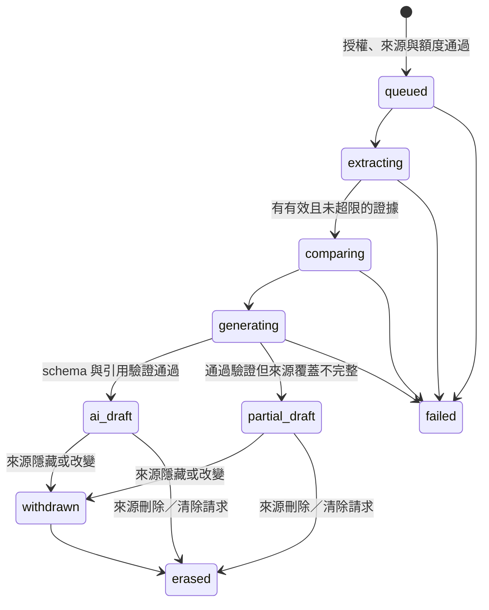

# Issue #183：證據抽取、跨素材判斷與結構化彙整實驗計畫

> **狀態：決策討論完成，計畫待人工檢核。尚未開始程式開發。**
>
> 本文件依修改後的 [#183](https://github.com/g0v/civic-talk-hono/issues/183) 與本次問答建立，取代原本的 #107 計畫。**只有使用者明確核准本計畫後，才能開始以下實作與付費模型實測。** 計畫核准不等於 commit、push、建立 PR、部署或遠端業務資料庫寫入授權。

## 1. 已確認的範圍與決策

|項目|本次確認|
|---|---|
|分支|從 main 新建 `feat/issue-183-evidence-pipeline`，不接續舊實驗分支|
|本輪交付|完整 API／curl 實驗：三模型流程、非同步任務、可追溯 AI 草稿、人改版本與差異、快取、配額及預算控制|
|不在本輪|一鍵操作 UI、正式站啟用、寫入既有 briefing、自動發布、替換原自帶 AI token 流程|
|使用者|任何未停權的登入者；不要求 admin 或帳號層級的 volunteer 角色|
|草稿權限|申請者與 admin／super-admin；不是公開草稿庫|
|真實資料|可唯讀讀取遠端業務 D1，以真實議題與素材實驗品質|
|寫入位置|輸入快照、AI 工件、工作狀態、配額、預算、人改版本皆只寫隔離本機業務庫|
|認證例外|DB_AUTH 允許既有 Better Auth 正常登入與 session 生命週期；不新增角色、人工停權／解停權操作或 auth schema|
|來源留存|保存完整私有輸入快照；來源隱藏時停用結果，刪除時清除相關原文／引文 payload，保留雜湊與處置紀錄|
|判斷類別|同意、不同意、無關、證據不足／不確定|
|帳號日限額|每帳號每日 20 次新付費任務|
|議題冷卻|同議題新付費任務間隔 5 分鐘|
|比較規模|最多 64 段驗證後證據；無向配對最多 2,016 組，排除同素材配對後通常較少|
|全站額度|本實驗環境每日 US$5 的費用估算預留額度；超額停止新增付費工作，不視為 Cloudflare 帳單硬上限|
|快取|相同輸入與有效設定直接重用工件；命中或加入同一進行中工作不扣新任務配額|

舊 [PR #187](https://github.com/g0v/civic-talk-hono/pull/187)、[PR #188](https://github.com/g0v/civic-talk-hono/pull/188) 保留實驗紀錄；只選擇性重用逐份抽取與來源錨定概念，不整批 merge／cherry-pick，也不帶回 `scope: "issue"` 的 Clairic 全素材抽取模式。

## 2. main 現況與不得破壞的契約

- `src/api/routes.ts` 的 `requireUser()` 已處理未登入 401、停權 403；所有登入者可以使用志願者工具。`useViewerRole` 是介面偏好，不是認證角色。
- 既有 `POST /api/issues/:id/briefing` 透過 `createBriefing()` 建立版本並把正常議題推進 `published`。**新 AI 草稿不能借用此路徑儲存。** 管理端 PUT 會覆寫現有 briefing，也不能拿來充當不可變 AI 原稿。
- 現有素材沒有版本歷史；管理端刪除素材／議題會實體刪除。只存 ID、hash、offset 不足以在刪除後重建原文。
- `wrangler.jsonc` 現有 `DB`、`DB_AUTH` 與 `FACT_CHECK_CORE`，沒有 AI binding、持久任務或本功能的資料表。`vp run dev:remote` 目前會使用遠端綁定，**不能直接沿用其業務庫寫入設定做本實驗。**
- 現有 migration 最新為 `0016_issue_closure.sql`。所有新 SQL 業務表使用 `ct_` 前綴，只對本機 `DB` 套用 migration；不對 `DB_AUTH` 建表或套 migration。
- 保留既有 API、`.html` 導向、SSR／hydration、投票、結案與自帶 token 的 prompt 流程。結案不是禁止本實驗的條件。
- 投稿安全審查的 OpenRouter fail-open 規則不變。**生成實驗失敗不能套用 fail-open 來偽造成功草稿。**

## 3. 實驗環境與遠端寫入隔離

### 3.1 專用實驗入口與配置

以下為本計畫提出的工程設計，隨本文件一併供人工核准：

- 增加專用實驗 Worker 入口及 Wrangler 配置，使用既有 Vite+／Wrangler，不增加套件管理器或另一套 Web 框架。
- 保留一般 `vp run dev`、`vp run dev:remote`、production build／deploy 的既有行為；一般模式與正式站的新實驗端點一律 404。
- 預定以 `CIVIC_AI_EXPERIMENT=1 vp run dev:remote` 明確選擇專用配置。該配置使用獨立的 `.wrangler/` persist 目錄；不能與一般本機庫混用。
- 實驗入口僅註冊本功能 API 與必要認證端點，重用原 Better Auth handler、角色與停權守門。不得順帶開放會修改遠端 auth 個人資料、處理停權或其他管理操作的業務端點。
- OAuth／session 的正常維護寫入是唯一認證例外；不轉存 cookie、secret、OAuth token 到工作流或 AI 紀錄。
- 需要抽出共用登入守門或縮窄 auth helper 的 binding 型別時，先查 LSP references，再遷移所有呼叫端；不建立平行的認證規則。

|Binding|連線與用途|允許操作|
|---|---|---|
|`DB`|隔離本機 D1；所有實驗狀態與 `ct_*` 新表|本機讀寫|
|`SOURCE_DB`|遠端 `vtaiwan-civic-talks`，僅來源 repository 使用|固定、參數化的 SELECT；不交給寫入 repository|
|`DB_AUTH`|既有遠端 `vtaiwan-auth`|既有 Better Auth 正常認證生命週期；必要授權 SELECT|
|`AI`|遠端 Workers AI|本計畫三模型推論|
|`EVIDENCE_WORKFLOW`|本機 Workflows 模擬與持久狀態|僅本機執行與保存工作進度|

`SOURCE_DB` 的 remote binding 本身不是資料庫授予的唯讀 credential，不能如此宣稱。隔離依靠專用入口、只提供讀取方法的來源 repository、固定 SELECT、不同的本機寫入 binding，以及行為測試；不得把遠端 binding 傳入通用寫入函式。若實作無法維持此邊界，須停下重新討論，不以「開發模式」當作安全保證。

### 3.2 持久任務與付費呼叫

使用本機 Cloudflare Workflows 承接非同步工作，不用 `waitUntil()`、單次長 HTTP 連線或模組記憶體假裝耐久佇列。官方文件支持本機 Workflows 存取遠端 bindings；**實際重啟恢復能力仍須先 smoke 驗證**。

- Workflow 參數只有工作 ID；step 回傳工件 ID／狀態，不包含全文、引文或原始模型輸出，避免 checkpoint 留下另一份無法清除的內容。
- 內容只放本機 D1；日誌、step 名稱及錯誤訊息不放原文、prompt、cookie、姓名／email 快照。
- 模型呼叫明確停用自動重試。每次呼叫先記錄付費嘗試與預留額度，再呼叫 provider，最後保存結果／用量。
- 若程序在 provider 可能已接受請求後中斷，記錄為結果／費用不確定，不在恢復時偷偷重打；保留保守預算扣帳與診斷。
- 不提供任意 force-refresh、任意模型 ID 或任意 prompt 來繞過去重。相同失敗工作也不因重按而自動新增付費嘗試；實驗調整輸入或受版本管理的設定後才產生新工作。
- 取消來源授權、素材撤下或帳號停權後，不繼續啟動新的付費步驟。已送出的推論不能宣稱可完整撤回。
- 依實際環境的 Workflow step／subrequest／CPU 限額預檢工作量，不把 64 段證據誤當成任何長度與批次都可完成的保證。超限須在下一個付費階段前明確停止；不為了湊完工作而自動增加帳戶額度、改部署或把多個模型呼叫塞成不可追蹤的一步。

## 4. 輸入、快照與來源生命週期

### 4.1 輸入白名單

預設使用指定議題的全部合格素材，亦允許請求明確指定 `material_ids` 子集合；不默默只取前幾份。

- 議題與素材必須符合實驗可讀條件，`abuse_flagged = 0`；待審、確認違規與 AI 隱藏內容不送模型。
- 只取議題 ID／標題／必要描述與素材 ID、標題、來源名稱、URL、content。**不取或傳送作者 ID、姓名、email、show_email、條款快照。** 素材內文本身仍可能含個資，不能宣稱已匿名化。
- 不爬取外部 URL、不讀取 URL 指向的網頁、不使用管理員作者投影；素材 URL 僅作來源資料。
- API 不接受呼叫者自行冒充來源的正文或 hash；快照與雜湊由伺服器從來源 repository 產生。
- content 保持原樣，不 trim、不正規化換行或 Unicode 後再計算 offset。雜湊明訂為原始字串 UTF-8 的 SHA-256；若提供模型的 state 含包裝，另存包裝與原文的映射。
- 素材排序採穩定 ID 順序；輸入 manifest 包含 source namespace、議題／素材 ID、內容與相關 metadata hash。模型、prompt、schema、抽句／比較演算法、語言與推論參數也納入快取鍵。

供本次計畫檢核的起始資源配置：最多 64 份素材、單份 content 48 KiB UTF-8、合計 content 512 KiB；超限在付費呼叫前明確拒絕並列出可縮小集合的資訊，不裁切正文。這些是應用保護界線，不冒充精確 tokenizer 計數；provider 若仍拒絕 context，保留失敗而不偷偷截斷。

### 4.2 隱藏、變更與刪除

- 每個付費階段前、草稿／證據／修訂交付前重新確認來源可讀性與 hash；遠端查核失敗時不返回先前快照內容。
- 隱藏或 hash 改變：停用關聯工件的一般調閱，標為 withdrawn／stale，不把新原文套到舊 offset，也不自動發布任何版本。
- 確認來源刪除或收到清除請求：使關聯工件失效，清除會保留原文／引文的快照、AI 原始 payload、生成結果、人改 payload 與 diff；保留 hash、時間及清除原因等不含正文的稽核 tombstone。
- **清除與在途推論的競態：** 清除須在同一本機交易中持久化來源 tombstone、遞增 generation fence，並刪除關聯 payload。每次模型呼叫捕獲所有依賴來源的 generation；回應落地、快取登記與人改版本保存時，必須以同一原子寫入條件確認來源未被清除且 generation 仍一致，不得用「先 SELECT、稍後無條件 INSERT」代替。寫入與清除無論先後，清除完成後都不能留下該次舊回應的正文。
- 延遲回應未通過 fence 時，丟棄正文／引文，只允許保存不含內容的狀態與費用結算；不得寫入錯誤日誌、Workflow checkpoint 或其他快取。重啟、重放及重新匯入來源不能重設舊 generation 或刪掉 tombstone，讓舊呼叫重新取得寫入資格。
- 清除是明列的留存例外，不是假裝原稿從未改過；原稿不可變不等於可以拒絕資料刪除。
- 啟動時先對帳現有快照，再開放內容調閱；另提供本機清除／對帳命令，處理權利請求與無人讀取的舊工作。
- **跨庫限制：** 遠端來源唯讀且沒有刪除通知，本輪不能保證刪除瞬間同步抹除關閉中的本機庫。清除發生在啟動／對帳或首次查核發現刪除時；記錄 `source_checked_at`，不宣稱跨庫原子性或零延遲。此限制需隨計畫人工檢核，若不可接受須改環境／通知架構，不能默認略過。

## 5. 三模型流程與證據規則

|模型|識別字|責任|
|---|---|---|
|Clairic|`@cf/cloudflare/clairic`|每份素材獨立抽取原文主張／條件，使用 text／list primitive，不要求 #181 巢狀結構|
|Clef|`@cf/cloudflare/clef`|跨素材證據關係的四選一判斷；不是生成最終摘要|
|Gemma 4|`@cf/google/gemma-4-26b-a4b-it`|根據已驗證證據與程式產生的候選群組，產生符合 schema 的敘述與逐句證據對應|

### 5.1 Clairic：逐素材抽取與原文錨定

1. 每份素材一個 state、一次抽取；prompt 明確要求原文中的具體主張及其必要條件，不替作者發明立場、動機或數值。
2. 用 list 取得多段主張；沒有明示內容就是 null，不從 `p_null`、沉默或既有 `stance` 標籤推導新立場。
3. 取得 provider 回傳的 state text（若合約提供），驗證 span 的單位、起迄與切片。以繁中、日文、英文、emoji、CRLF 與重複片語實測；不直接假定 JS UTF-16 index 等於 provider offset。
4. 只有能唯一、正確定位到該份原文的片段才能進下一步；重複字串而無有效 span 時不能任選第一次出現。`value` 與 span 衝突亦拒收。
5. 由程式按有版本的中英日標點／段落規則擴展成完整句子，保留原始及擴展後 span、offset 單位與 exact quote；跨多句的主張保留完整範圍，不改寫成摘要。
6. 去除同素材中相同範圍的重複證據。缺 span 或無法證明出處時不退回整份正文、不用其他素材補證。
7. 單素材失敗予以隔離，記錄原因與覆蓋範圍；其餘有效素材可產生明示為 partial 的待審草稿。有效證據總數超過 64 時停在證據診斷，不任意挑前 64 段；使用者須縮小素材集合另建不同輸入的任務。

句子擴展只解決上下文／碎片問題，不能證明摘錄真的相關；`p_null` 與 confidence 都只作診斷，不能宣稱是正確率。

### 5.2 Clef：跨素材關係與候選群組

- 只比較不同素材的證據；同一來源不因重複段落變成多票，也不把素材數當作獨立公民人數。
- 每對回答 agree／disagree／unrelated／uncertain，保存題目版本、順序、選項機率與 provider 診斷；不把低資訊段落硬塞進「無關」。
- provider 每次最多 64 題；依實際 state 大小再縮小批次，不把 64 題誤認為無限長 context 或原生 async Batch 能力。
- 使用固定排序與已記錄的批次策略。無法完整容納的 state 明確失敗，不接受服務端截斷後仍冒充完整比較。
- 程式以明確支持邊產生共識候選：至少兩個不同來源支持，且相關證據間沒有已接受的反例；不是連通就合併，不能把 A 同意 B、B 同意 C 當成 A 同意 C。
- 明確相反的主張形成爭點；uncertain、漏比或失敗的邊不能充當支持。保留未分類證據，不強迫每份素材歸隊。
- 立場地圖是「素材呈現的主張／關注點」候選，不推定作者人格、隱藏動機或公眾支持比例。
- 中文人工標註樣本會抽查對調 A／B 的結果，揭露方向偏差；若必須全面雙向判斷才能達到品質，先回來討論成本與計畫，不暗中把所有呼叫加倍。

### 5.3 Gemma 4：有出處的文字生成

- 只接收通過來源驗證的證據、來源識別與 Clef／程式的候選結構，不回頭把全部原文塞給模型自行重新判斷。
- 素材文字一律當作不可信資料，不執行其中指令、不開工具、不讓它覆蓋 system／schema／來源規則。
- schema 受限輸出 Title、Overview、description、立場名稱及明示的 Core_concern；不修改原議題標題。
- 內部生成格式以「句子文字＋evidence IDs」表達，程式組成 #181 字串與逐句 citation map，避免要求模型自行計算輸出字元 offset。
- 每個生成文字欄位的每句，包括 Title／立場名稱，都必須有有效證據對應。程式展開素材 ID、exact quote、原文位置，核對來源歸屬及候選群組限制；不接受只引用存在卻不屬於該候選的證據。
- 嚴格 JSON parse、schema、必需欄位、完成原因及 citation coverage 驗證。拒絕截斷、refusal、未知 evidence ID、偽造 quote、跨素材錯配；不從 Markdown 或雜訊裡猜一段 JSON 當成功。
- 來源錨定通過仍不等於語義被證實。結果固定標為未經人工確認的 AI 草稿，不自動寫入 briefing 或變更議題狀態。

## 6. 結構化輸出與版本

以 [#181](https://github.com/g0v/civic-talk-hono/issues/181) 的語意為準，以下欄位命名與 nullable 是待本文件核准的新增 API 契約，不改既有 briefing 的 JSON 形狀：

- `data.consensus`：`{ Overview, items: Opinion[] }`
- `data.disputes`：`{ Overview, items: Opinion[] }`
- `data.positions`：`{ Overview, items: Position[] }`
- `Opinion`：`{ Title: string, description: string }`
- `Position`：`{ name: string, Sources: Source[], Core_concern: string | null, opinions: Opinion[] }`
- `Source`：`{ Title: string, href: string, material_id: number }`；href 由程式用已驗證來源資料組成，不由模型隨意填網址。
- 缺證據的 Overview 為 null、清單為 `[]`；Core_concern 不足以支持時為 null，不捏造核心價值。機器狀態的「證據不足」放在 diagnostics，不假裝成有引文支持的生成結論。
- `citation_map` 以 data 的 JSON Pointer、句子範圍與 evidence IDs 對應來源；範圍由程式組裝文字時計算。附帶 `evidence`、覆蓋範圍、排除理由及 provenance，供 curl 檢視。

provenance 保存：輸入 manifest／hash、原文與 state 映射、原始及擴展 span、三模型 selector、provider 實際回報的版本／request metadata、推論參數、完整 prompt 與 hash、prompt／schema／演算法版本、程式版本、原始回應、驗證結果、用量與時間。

模型 selector 不是不可變權重 SHA；provider 未提供的 revision 必須標 unknown／null，不補造。「可重現」指可取回同一份保存的工件及核對其來源，不保證未來再次推論逐字相同。

AI 原稿為不可覆寫工件。申請者可另存人改版本，保存 parent、editor ID、時間、內容 hash 與程式計算的欄位差異；管理員可稽核，不冒用申請者編輯。修改過的文字明確標為 `human_unverified`，不能沿用舊 citation 就假裝新句子已被 AI／程式語義驗證。並發編輯使用 parent/version 檢查，過時提交回 409。

## 7. API、狀態與資料表

### 7.1 新 API 提案

所有端點只在明確啟用的實驗入口存在；沿用 `/api/*` 全域 `apiCsrf`，不逐端點重造 Origin 檢查、不提供管理／寫入 CORS 放行。敏感回應為 private／no-store。

|方法／路徑|用途|
|---|---|
|`POST /api/issues/:id/evidence-jobs`|登入／停權守門；接受選填素材集合、生成語言與明確的處理告知同意，凍結來源、去重、預留並排入工作；新工作 202，命中完成工件 200|
|`GET /api/evidence-jobs/:jobId`|申請者／管理員取得進度、來源覆蓋、費用狀態、驗證後的草稿或失敗診斷；取得 payload 前重驗來源|
|`GET /api/evidence-jobs/:jobId/revisions`|取得該申請者工作下的 AI 基底與人改歷史／差異，不帶出其他申請者的私人修訂|
|`POST /api/evidence-jobs/:jobId/revisions`|申請者以 parent revision 另存人改版本；不能覆寫 AI 原稿或竄改 provenance|

未登入 401、停權 403；非申請者且非管理員以 404 避免枚舉。輸入錯誤 400，沒有可用來源／內容或證據規模不合限制 422，請求本身過大 413，版本衝突 409，帳號限額／議題冷卻 429，全站預算停止新工作 503，回應維持 `{ error: string }`，可擴充機器代碼與 reset／retry 時間。非同步階段失敗以工作狀態與原因呈現，不回假的完整草稿。

任何階段都可能因來源失效、帳號停權或預算不足終止；不能把失敗狀態強轉成完成。人改版本另存，不改動這條 AI 原稿狀態歷史。

### 7.2 本機資料設計

在目前 migration 序列後新增 `0017_evidence_pipeline.sql`，若開工時 main 已增加 migration，按實際序列調整。只套用專用本機 persist 目錄，不執行任何遠端 migration。

最小資料責任分離：

- `ct_ai_jobs`：申請者、輸入 key、執行工件、狀態、來源查核時間、處理告知版本／同意時間與錯誤碼。
- `ct_ai_sources`：不可變輸入快照與 manifest；遠端 ID 只是來源識別，不跨資料庫宣告外鍵，也不 FK 到本機示範議題。
- `ct_ai_artifacts`：抽取、判斷、生成各階段工件與驗證／用量；原稿、失敗及原始回應不得以成功輸出覆寫。
- `ct_ai_revisions`：申請者的人改版本、parent、diff 與編輯者。
- `ct_ai_usage`：付費嘗試、帳號日計數、環境日預算的預留／結算依據；使用整數微美元，不用浮點金額。
- `ct_ai_issue_cooldowns`：議題的新付費任務冷卻與原子 claim。

執行 cache key 用唯一約束控制同輸入的完成工件／進行中執行；每個申請者使用自己的工作關聯，不因快取命中洩露首位申請者、帳號額度或其人改版本。交易／原子條件寫入避免並發雙跑、雙扣額度與預算穿透。

## 8. 配額、計價與失敗政策

- 每日以 UTC 00:00 重設，回傳絕對 `reset_at`；這是本計畫的起始工程配置，可於人工檢核改為台北日界線。
- 次數計的是啟動新模型執行的任務，不是 GET 次數；付費嘗試已開始後的失敗仍算次數與已發生費用，避免惡意輸入一直免費耗模型。
- 先查授權與當下來源，再查完成／進行中快取；命中仍可在日限額或新工作預算耗盡時讀取有效結果。
- 冷卻以議題為單位，只擋新付費工作；使用帳號，不以同 IP 阻擋工作坊參與者。
- 用版本化價目及保守的輸入／最大輸出估計預留成本；已知實際工作量後如需增額，必須先原子取得額度，否則停止，不先呼叫再算超支。
- provider 回報可靠用量時結算；逾時、連線中斷或缺用量不能當作零成本退款。保留估算／實際／未知的區別。
- 日預算按呼叫歸屬與已預留額度跨午夜結算，不能重設時計算遺漏未完成工作。新的一天也不自動重打失敗模型呼叫。
- US$5 只涵蓋本功能的模型費用估算控制，不涵蓋帳號其他 Worker、D1、認證與其他費用，也不是 provider 保證的硬支出上限。
- 不新增自動修 JSON、多次抽樣、改用其他模型或模型呼叫重試等隱藏成本。

## 9. 開工後順序與停止條件

1. **先證明隔離與真實合約。** 建好專用本機環境，套用本機 migration，查 `sqlite_master` 確認新增業務表皆為 `ct_*`。執行遠端資源指令前用 `wrangler whoami` 確認帳號；只用允許的 SELECT 讀來源。小樣本實測本機 Workflow 重啟、Clairic Unicode／span、Clef 四分類與批次、Gemma 4 schema／完成原因／引用。所有付費 smoke 走同一套本機預算記帳。
2. **逐份證據與來源生命週期。** 完成快照、span 錨定、句子擴展、覆蓋診斷、撤下／清除與對帳；先有可核對的證據，再做彙整。
3. **比較與受約束生成。** 完成跨素材關係、非傳遞式候選群組、#181 資料結構、逐句 citation map 與拒絕條件。
4. **API／版本與完整濫用邊界。** 完成各端點、申請者隔離、人改 diff／並發、整個任務去重、帳號配額、冷卻、預算與中斷狀態；實際模型呼叫不得先於額度保護上線。
5. **完整 smoke 與品質報告。** 走真實議題的新建、輪詢、快取、人改、拒絕／撤下與本機清除流程；更新必要文件並移除臨時腳本。沒有自動升級為正式站功能的步驟。

若真實 schema 合約、offset 定位、Workflows 本機恢復或費用隔離不成立，保留負面結果並先討論修訂計畫；不暗換模型、不改遠端工作流、不降級成無出處摘要，也不把未達品質的產出當作成功發布。

## 10. 自動測試、實測與品質驗收

### 10.1 永久回歸測試

依現有 `src/tests/`／`vite-plus/test` 慣例，針對行為而非程式碼文字或 wiring：

- 多語句界線、emoji／UTF-16 差異、CRLF、重複片語、錯素材引文、value／span 衝突、缺 span 與 null，不讓錯錨定進入下一階段。
- disagree 不變共識、uncertain 不變支持、A-B／B-C 不導出 A-C、同素材不算多來源；partial 覆蓋不可冒充完整。
- JSON 結構、逐句 citation coverage、未知 evidence、跨組錯引、截斷／refusal；引用存在的檢查不假裝測得語義正確率。
- 401／403、跨申請者 404、管理員稽核、CSRF、正式模式 404、來源作者快照不進模型／輸出。
- 並發相同輸入只啟動一個付費執行、快取不雙扣、20 次邊界、5 分鐘冷卻、UTC 日界線與在途預留、日預算並發、未知費用不退款。
- 人改不覆蓋 AI 原稿、過時 parent 409、變更文字不沿用「已驗證」標籤、其他申請者無法取得私人修訂。
- 來源隱藏／刪除／hash 改變、查核失敗不洩露快照、清除涵蓋原始模型 payload 與 diff、重啟不從 checkpoint 復活正文。
- 以可控制的延遲回應重現「模型已啟動 → 清除交易完成 → 模型回應返回」，確認原文／引文不會回到工件、快取、人改 payload、日誌或 checkpoint；另覆蓋回應先提交再清除、清除與人改／快取提交並發，以及清除後重啟／重放，驗證 fence 持續有效而非僅阻擋新呼叫。
- 用可觀察的資料庫行為證明工作只改本機狀態，來源庫資料不被工作流程修改；不以比對 SQL 字串代替此驗證。

### 10.2 必做實際執行

開工後依序跑 `vp check --no-fmt --no-lint`、`vp test`、`vp run build`，再啟動專用實驗模式，以真實模型及遠端唯讀來源做 smoke；單元測試與假的 provider 回應不能當成真實模型能力證明。

README 的 curl 範例須可直接操作：先設定並檢查有 host 的 `BASE_URL`，使用私有 cookie jar、JSON Content-Type、必要 Origin、明確處理同意；新建後輪詢工作、用 `jq` 看 data／引用／診斷、重按命中快取、另存人改版本與檢視 diff。不輸出 cookie 或憑證，不重現舊的空 host curl 問題。

人工品質檢核分兩類，保留實際案例、輸入／工件 hash、用量與失敗原因：

1. **人工標註小樣本：** 四種關係各至少三個明確中文例子，另有不確定、少數反對、條件式支持、文內轉述他人、prompt injection 與中英日／emoji 定位案例。先有人標準答案，再看模型，不讓模型評自己的答案。
2. **真實議題：** 優先使用舊實驗的議題 13，確認素材 25／26 若仍可讀；若資料已變更，記錄差異而不假稱使用原樣本。逐句核對出處、語義與遺漏，觀察是否把反方錯寫為共識、擅自補價值／條件或把轉述當作者認可。

機械門檻：偽造出處、跨素材錯錨與缺引用必須被拒絕；品質報告列出抽取／關係混淆與人工修正，不以 HTTP 200、schema 通過或高 confidence 宣稱品質過關。已知明確反例若仍被列為共識，品質驗收不通過，即使程式檢查全綠。

本輪不新增一鍵 UI；若為隱私告知而修改既有介面文字，仍須 zh-TW／en／ja 同步，並以真實瀏覽器檢查桌機／手機、淺色／深色與 hydration。未實測的登入、語言或正式站行為不得在報告勾成通過。

## 11. 預計影響檔案與文件

以下是待新增／修改的目標，不表示目前已存在實作：

- 新增專用實驗入口／配置與 `src/ai/` 內的來源 repository、模型合約、證據、比較、生成、工作流、schema／prompt 版本及本機紀錄查詢；依責任分檔，不引入通用 AI agent 框架。
- 新增 `0017_evidence_pipeline.sql` 與相應行為測試；SQL 集中於 DB／repository 層，不散落在 handler。
- 必要時修改 `vite.config.mts`、`package.json`、共用 auth 型別／守門，以選擇隔離模式；一般模式不得因此接上遠端業務寫入或新 AI 端點。綁定型別由實際配置重新產生，不手改生成物。
- 更新 `README.md`：實驗啟用、來源只讀、認證寫入例外、本機留存與刪除限制、平台付費、限額、完整 curl／品質檢核方式及 BYO 流程保留。
- 更新 `AGENTS.md` 的 #183 專屬授權／狀態敘述，不把舊 admin-only 抽取實驗當作新版規格，不放寬成一般伺服器任意生成。
- 更新既有隱私／條款必要敘述與三語 key：素材會由平台送交 Cloudflare Workers AI，可能含個資；說明私有快照、清除時機與原稿／人改區別。若法律條款實質改版，同步 `TERMS_VERSION`，但不順手改寫所有舊投稿 API 的同意契約。
- `.dev.vars.example` 只在確有新設定時加入假值；cookie jar、快照與本機結果留在忽略的實驗目錄，不提交真實個資或憑證。保留現有授權／notices／自動來源版本機制。

## 12. 交付與人工關卡

本次交付到本文件為止；後續程式開發仍受人工關卡控制。

- [x] 閱讀修改後 #183、#181 與舊實驗紀錄，核對 main。
- [x] 建立乾淨新分支。
- [x] 確認本輪 API 範圍、資料與認證例外、草稿權限、留存、四分類及工作坊限額。
- [x] 建立本計畫，**不表示下列工作已獲准。**
- [ ] 使用者檢核並討論本計畫，特別是實驗入口／本機 Workflow、額外輸入資源界線、nullable 輸出、UTC 日界線及跨庫刪除時機。
- [ ] 使用者明確核准後，才開發及執行真實模型能力驗證。
- [ ] 完成全部行為、檢查、真實 smoke 與人工品質檢核後，再討論 commit／push／新 PR；舊實驗仍保留。
- [ ] 正式站啟用、部署或任何遠端業務 D1 寫入：另案明確授權，本計畫不包含。

## 參考

- [新版 #183](https://github.com/g0v/civic-talk-hono/issues/183)、[#181 輸出語意](https://github.com/g0v/civic-talk-hono/issues/181)、[#185 Gemma 實驗需求](https://github.com/g0v/civic-talk-hono/issues/185)
- [PR #187](https://github.com/g0v/civic-talk-hono/pull/187)、[PR #188](https://github.com/g0v/civic-talk-hono/pull/188)
- [Jigsaw #124：span 抽取](https://github.com/Jigsaw-Code/sensemaking-tools/pull/124)、[#125：摘錄與判斷的品質限制](https://github.com/Jigsaw-Code/sensemaking-tools/pull/125)
- [Clairic](https://developers.cloudflare.com/workers-ai/models/clairic/)、[Clef](https://developers.cloudflare.com/workers-ai/models/clef/)、[Gemma 4](https://developers.cloudflare.com/workers-ai/models/gemma-4-26b-a4b-it/)、[JSON Mode 限制](https://developers.cloudflare.com/workers-ai/features/json-mode/)
- [本機／遠端 binding 支援表](https://developers.cloudflare.com/workers/local-development/bindings-per-env/)、[本機 Workflows 存取遠端資源](https://developers.cloudflare.com/workers/local-development/#using-remote-resources-with-durable-objects-and-workflows)、[Workflows 冪等與持久化規則](https://developers.cloudflare.com/workflows/build/rules-of-workflows/)
- [Workflows step、subrequest 與 checkpoint 限額](https://developers.cloudflare.com/workflows/reference/limits/)
